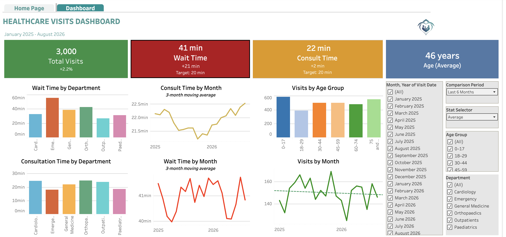

# Healthcare Visits Analytics

[← Back to portfolio](../README.md)

[](https://public.tableau.com/views/HealthcareVisitsDashboard/HealthcareVisitsDashboard)

*The Healthcare Visits Dashboard on Tableau Public. Select the image to open the live version.*

## Table of Contents
1. [Overview](#1-overview)
   - [Repository Structure](#repository-structure)
   - [Data](#data)
2. [Executive Summary](#2-executive-summary)
   - [Purpose](#purpose)
   - [How to Read the Figures](#how-to-read-the-figures)
   - [Key Findings](#key-findings)
   - [Key Performance Indicators (KPIs)](#key-performance-indicators-kpis)
   - [Average Wait and Consultation Time by Department](#average-wait-and-consultation-time-by-department)
3. [Business Problem](#3-business-problem)
4. [Methodology](#4-methodology)
5. [How to Reproduce](#5-how-to-reproduce)
   - [Excel Workbook](#excel-workbook)
   - [SQL Queries](#sql-queries)
6. [Exploratory Data Analysis](#6-exploratory-data-analysis)
7. [Business Questions](#7-business-questions)
8. [Key Insights](#8-key-insights)
9. [Dashboard](#9-dashboard)
10. [Deductions](#10-deductions)
11. [Recommendations](#11-recommendations)

## 1. Overview

An end-to-end analysis of 3,000 hospital visits (Jan 2025 – Aug 2026) using **Excel** for a formula-based workbook that reproduces the key figures, **PostgreSQL** for analysis and **Tableau** for the dashboard, with findings and recommendations for hospital managers.

| | |
|---|---|
| **Tools** | Excel, PostgreSQL, Tableau |
| **Excel workbook** | [Download the workbook](https://github.com/anita-owiredu/data-analytics-portfolio-projects/raw/main/healthcare-visits-analytics/excel/healthcare_visits_analysis.xlsx) |
| **Live dashboard** | [View on Tableau Public](https://public.tableau.com/views/HealthcareVisitsDashboard/HealthcareVisitsDashboard) |
| **Skills** | • Excel analysis (formulas, percentiles, moving averages, conditional formatting, charts)<br>• PostgreSQL (CTEs, window functions, percentiles)<br>• Data cleaning<br>• Exploratory data analysis<br>• KPI and target analysis<br>• Dashboard design in Tableau (parameters and calculated fields)<br>• Data storytelling and recommendations |
| **Data** | 3,000 patient visits, 6 departments, 20 months |
| **Database** | `health_analdb` → table `patient_visits` |

### Repository Structure

```
healthcare-visits-analytics/
├── README.md
├── data/
│   └── patient_visits.csv        # the data: a copy of the table (3,000 rows)
├── excel/
│   └── healthcare_visits_analysis.xlsx  # first pass: the analysis built with Excel formulas
├── sql/
│   ├── 00_schema_and_load.sql
│   ├── 01_exploratory_data_analysis.sql
│   ├── 02_data_cleaning.sql
│   └── 03_business_questions.sql # Q1-Q6: one query per dashboard element
├── dashboard/
│   └── Healthcare Visit Workbook and Dashboard.twbx
└── images/
    └── dashboard.png             # screenshot of the published dashboard
```

| File | Contents |
|---|---|
| [`healthcare_visits_analysis.xlsx`](excel/healthcare_visits_analysis.xlsx) | The first pass at the analysis, built in Excel with formulas: overall wait and consultation times, department results against target, the monthly trend and wait by age group. The SQL queries below give the same results. See [Excel Workbook](#excel-workbook) |
| [`00_schema_and_load.sql`](sql/00_schema_and_load.sql) | The definition of the `patient_visits` table and the command that loads the CSV data file of 3,000 visits into it |
| [`01_exploratory_data_analysis.sql`](sql/01_exploratory_data_analysis.sql) | Queries to run checks on the loaded data: the number of visits, the date range, missing values, duplicate IDs, age groups that do not match the patient's age, and Paediatrics visits for patients older than 17 |
| [`02_data_cleaning.sql`](sql/02_data_cleaning.sql) | The queries(in steps) used to correct Paediatrics visits recorded for patients older than 17: a backup of the table, a count of the affected visits, their reassignment to other departments, and checks of the result |
| [`03_business_questions.sql`](sql/03_business_questions.sql) | The queries behind business questions Q1 to Q6, one for each tile or chart on the dashboard |

### Data

This project uses a dataset of **3,000 hospital visits** from 1 January 2025 to 31 August 2026. Each visit is one row, showing the department, the patient's age, the date of visit, wait time and onsultation time. No values are missing. 

**Note:The data is synthetic: it was created for this portfolio project and describes no real patient or hospital.**

#### Schema Description

| Field | Type | Constraint | Description |
|---|---|---|---|
| `patient_id` | VARCHAR(20) | Primary key (every value is different) | A unique reference number for the visit (`P00001` to `P03000`) |
| `department` | VARCHAR(100) | Not null (always filled in) | Where the patient went: Cardiology, Emergency, General Medicine, Orthopaedics, Outpatients or Paediatrics |
| `age` | INTEGER | Not null (always filled in) | The patient's age in years (1–90) |
| `visit_date` | DATE | Not null (always filled in) | The day of the visit (1 Jan 2025 to 31 Aug 2026) |
| `wait_time_minutes` | INTEGER | Not null (always filled in) | Minutes from arriving to being seen (5–111) |
| `consultation_time_minutes` | INTEGER | Not null (always filled in) | Minutes spent with a clinician, such as a doctor or nurse (5–58) |
| `age_group` | VARCHAR(20) | Can be empty (none are empty in the data) | The age band: 0–17, 18–29, 30–44, 45–59, 60–74 or 75 and above |

## 2. Executive Summary

### Purpose

This analysis measures waiting and consultation times across 3,000 patient visits in six hospital departments between January 2025 and August 2026. Every figure in this report can be checked in two ways: in the Excel workbook, where each number is a formula ([section 5](#excel-workbook)), and in the SQL queries behind each business question ([section 7](#7-business-questions)).

<a id="how-to-read-the-figures"></a>

<details>
<summary><a href="#how-to-read-the-figures-definitions">How to Read the Figures</a></summary>

<a id="how-to-read-the-figures-definitions"></a>

1. [Q2. How long are waits and consultations, and how old are patients?](#q2-how-long-are-waits-and-consultations-and-how-old-are-patients)
   - **Wait time:** the minutes from arriving at the hospital to being seen
   - **Consultation time:** the minutes spent with a doctor or other clinician
   - **Average:** the total divided by the number of visits
   - **Median:** the middle value, where half of the patients wait less than this and half wait more
   - **90th percentile (P90):** 9 in 10 patients are at or below this value. A P90 wait of 64 minutes means 9 in 10 patients wait 64 minutes or less, and 1 in 10 waits longer
   - **95th percentile (P95):** the same idea for 19 in 20 patients. It shows how long the longest-waiting patients wait
2. [Q3. Which departments miss the wait-time target?](#q3-which-departments-miss-the-wait-time-target)
   - **Wait time target:** 20 minutes. A department whose average wait is longer than this is flagged "Over target". It can be changed on the dashboard (Target Wait Time)
3. [Q4. Which departments' consultations run over target?](#q4-which-departments-consultations-run-over-target)
   - **Consultation time target:** 20 minutes. A department whose average consultation is longer than this is flagged "Over target". It can be changed on the dashboard (Target Consult Time), separately from the wait time target
4. [Q5. How are the key indicators performing?](#q5-how-are-the-key-indicators-performing)
   - **3-month moving average:** for each month, the average of that month and the two months before it. It evens out one-off highs and lows, so the overall direction is easier to see
5. [9. Dashboard](#9-dashboard)
   - **Stat Selector:** a drop-down on the dashboard that switches the Wait Time, Consult Time and Age tiles between average, median, P90 and P95

</details>

### Key Findings

- **Data:** The dataset holds 3,000 visits in six departments, with seven fields per visit. It has no missing values and no duplicate visit IDs. The latest visit date is 31 August 2026. Paediatrics visits for patients older than 17 were reassigned to other departments before the analysis.
- **Overall wait time:** The average wait time is 41 minutes and the median is 40 minutes. Nine in 10 patients (P90) wait 64 minutes or less, and 19 in 20 (P95) wait 70 minutes or less. Individual wait times range from 5 to 111 minutes.
- **Overall consultation time:** The average consultation time is 22 minutes and the median is 22 minutes. Nine in 10 consultations (P90) last 32 minutes or less, and 19 in 20 (P95) last 35 minutes or less. Individual consultation times range from 5 to 58 minutes.
- **Wait target:** All six departments have an average wait above the 20-minute wait target. The overall wait is above the wait target by 21 minutes on the average, 20 minutes on the median, 44 minutes at P90 and 50 minutes at P95.
- **Consultation target:** Four of the six departments have an average consultation above the 20-minute consultation target: Orthopaedics, Cardiology, Outpatients and General Medicine. Paediatrics and Emergency are below it.
- **Wait time over time:** It is steady. Single months swing from 38.6 to 43 minutes, but the 3-month moving average stays between 40 and 41.7 minutes and ends within 0.7 minutes of where it started. The last 6 months averaged 40.4 minutes, 0.8 minutes below the 6 months before.
- **Consultation time over time:** It is getting longer. The 3-month moving average fell from 22.3 minutes (March 2025) to 21.2 minutes (October 2025), then rose to 22.5 minutes in August 2026, its highest point. The last 6 months averaged 22.4 minutes, 0.9 minutes (4%) above the 6 months before.
- **Visits:** Monthly visits ranged from 125 (February 2026) to 169 (November 2025). Visits totalled 902 in the last six months against 883 in the six months before, an increase of 2.2%.
- **Patients:** Ages range from 1 to 90 (average 46, median 45). Visits by age group were 587 aged 0–17, 386 aged 18–29, 498 aged 30–44, 499 aged 45–59, 481 aged 60–74 and 549 aged 75 and above.

**Recommendations:** See [section 11](#11-recommendations).

### Key Performance Indicators (KPIs)

| KPI | Value |
|---|---:|
| Total visits | 3,000 (Jan 2025 – Aug 2026) |
| Wait time: average / median / P90 / P95 | 41 / 40 / 64 / 70 min |
| Consultation time: average / median / P90 / P95 | 22 / 22 / 32 / 35 min |
| Departments on the 20-minute wait time target | 0 of 6 |
| Longest average wait time | Emergency, 55 min |
| Shortest average wait time | Outpatients, 27 min |
| Departments over the 20-minute consultation time target | 4 of 6 |
| Visits, last 6 months vs prior 6 months | 902 vs 883 (+2.2%) |

### Average Wait and Consultation Time by Department

| Department | Average wait time (min) | Above the 20-min wait target by (min) | Average consultation time (min) |
|---|---:|---:|---:|
| Emergency | 55.4 | 35.4 | 18.1 |
| Orthopaedics | 42.8 | 22.8 | 24.8 |
| General Medicine | 38.8 | 18.8 | 22 |
| Cardiology | 32.6 | 12.6 | 24.5 |
| Paediatrics | 31.1 | 11.1 | 18.5 |
| Outpatients | 27 | 7 | 23.9 |

## 3. Business Problem

**How can the hospital reduce long patient waits, and where should managers act first?**

Hospital managers have limited staff and budget, so they need to know **where patients get held up**. The dashboard is built to answer six questions:

**Q1** Is demand growing or shrinking?

**Q2** How long are waits and consultations, and how old are patients?

**Q3** Which departments miss the wait-time target?

**Q4** Which departments' consultations run over target?

**Q5** How are the key indicators (visits, wait time and consultation time) performing?

**Q6** Which age groups use the service most?

The answers point to where management should act first.

## 4. Methodology

The project followed seven steps, from raw data to recommendations.

1. **Analyse in Excel:** Work out the main figures with formulas on the data file: overall wait and consultation times, department results against target, the monthly trend and wait by age group. Anyone can click a cell to see how a number is worked out (section 5).
2. **Load:** Load the data file into PostgreSQL (`health_analdb`, table `patient_visits`).
3. **Explore:** Check the row count, date coverage, missing values, duplicate IDs and consistency of `age_group` with `age` (section 6).
4. **Clean:** Fix the conflict between the Paediatrics department and patient age, with a backup, a check, a fix and a verification (section 6).
5. **Analyse in SQL:** Write one SQL query per dashboard element, so every tile and chart can be reproduced and the Excel figures confirmed (section 7).
6. **Visualise:** Build the Tableau dashboard with adjustable targets, statistic and comparison period (section 9).
7. **Interpret:** Turn the figures into insights, deductions and recommendations (sections 8, 10 and 11).

## 5. How to Reproduce

The project can be reproduced in two parts, in this order: the Excel workbook (no setup), then the SQL queries (PostgreSQL).

### Excel Workbook

[`excel/healthcare_visits_analysis.xlsx`](excel/healthcare_visits_analysis.xlsx) is the first pass at the analysis and needs no database, only Excel. Nothing in it is typed in as a result: every figure is a formula that reads the 3,000 visits on the `Data` sheet, so changing a target or a visit updates everything.

GitHub cannot preview Excel files, so open the file from the `excel/` folder and select the download button (or **Download raw file**), then open it in Microsoft Excel on your computer.

**[Download the workbook](https://github.com/anita-owiredu/data-analytics-portfolio-projects/raw/main/healthcare-visits-analytics/excel/healthcare_visits_analysis.xlsx)**

| Sheet | What it shows |
|---|---|
| `Guide` | What each sheet does, plain-language definitions of the terms used, and the colour code |
| `Data` | The 3,000 visits from `data/patient_visits.csv` (the cleaned data file), plus a helper column giving the month of each visit |
| `Overall` | Average, median, 90th and 95th percentile for wait time, consultation time and age, and how far each is above target. Also a scorecard of visits, average wait and average consultation time for the latest 6 months against the 6 months before. Answers Q1, Q2 and the scorecard in Q5 |
| `Targets` | The wait time and consultation time targets (20 minutes each) and the comparison period (6 months). These are the only cells to change: yellow with blue text |
| `Departments` | Visits, average and median wait, 90th percentile wait and average consultation time for each department, flagged "Over target" or "On target", with two bar charts. Answers Q3 and Q4 |
| `Monthly` | Visits, average wait and average consultation time for each month, with a 3-month moving average (each month averaged with the two months before it) and two charts. Answers the month-by-month part of Q5 |
| `Wait by Age` | Average wait for each department and age group, shaded from green (shorter) to red (longer), and the number of visits in each group. Answers Q6 |

The SQL queries in the next part give the same results as the workbook. For example, the average wait is 41 minutes (median 40, 90th percentile 64), and visits in the last 6 months are 902 against 883 in the 6 months before (+2.2%). Each department total and the monthly total also include a check that the visits add up to the 3,000 rows on `Data`.

The file keeps the calculated results next to each formula, so numbers show in a file preview as well as in Excel. Excel recalculates everything when the file is opened, so editing a target or a visit updates every sheet.

### SQL Queries

Requires PostgreSQL 13+ and `psql`.

```bash
git clone https://github.com/anita-owiredu/data-analytics-portfolio-projects.git
cd data-analytics-portfolio-projects/healthcare-visits-analytics

createdb health_analdb
psql health_analdb -f sql/00_schema_and_load.sql             # create table, load data/patient_visits.csv
psql health_analdb -f sql/01_exploratory_data_analysis.sql   # row count, date range, missing-value and duplicate checks
psql health_analdb -f sql/02_data_cleaning.sql              # the data file is already cleaned, so this changes nothing
psql health_analdb -f sql/03_business_questions.sql          # reproduces the dashboard numbers
```

Run the `psql` commands from this project folder (`healthcare-visits-analytics/`) so the relative path to the CSV resolves.

## 6. Exploratory Data Analysis

Before any analysis, the data was checked with [`sql/01_exploratory_data_analysis.sql`](sql/01_exploratory_data_analysis.sql) to confirm it was complete and consistent.

| Check | Result |
|---|---|
| Number of visits | 3,000 |
| Date range | 2025-01-01 to 2026-08-31 |
| Missing values (NULLs) in any column | None |
| Duplicate `patient_id` values | None |
| `age_group` that does not match `age` | None |
| Paediatrics visits for patients older than 17 | None (after the cleaning described below) |

### Data cleaning

**The problem:** The department and the age did not agree. Paediatrics is children's care, and age limits for it vary between hospitals (often 16 or 17). This dataset's youngest age band is `0–17`, so this project defines Paediatrics as ages **0–17**. Some visits recorded in Paediatrics were for patients older than that range, which made the department and the age group conflict.

**The process:** The fix was made in the database in four steps. The statements are in [`sql/02_data_cleaning.sql`](sql/02_data_cleaning.sql), in the order they were run.

| Step | What was done | Reason |
|---|---|---|
| 1. Back up | Copied the table to `patient_visits_backup` before changing anything | Keeps the pre-fix data for comparison |
| 2. Check | Counted the Paediatrics visits for patients older than 17 | Measures the size of the problem |
| 3. Fix | Reassigned those visits to the other five departments, at random in proportion to each department's number of visits | Keeps every visit and keeps the department mix roughly unchanged |
| 4. Verify | Re-counted: no Paediatrics visit above 17, Paediatrics ages 1 to 17, and the total still 3,000 | Confirms the fix and that no rows were lost |

The fix uses `random()`, so re-running it on the original data would send the affected visits to different departments. The data file in the repository holds the result of the original run. On that file, step 2 finds 0 rows and step 3 changes nothing, so the script is safe to run.

| After cleaning | Result |
|---|---|
| Paediatrics visits for patients older than 17 | 0 |
| Age range of Paediatrics visits | 1 to 17 |
| `age_group` of Paediatrics visits | All `0–17` |

**Age band label:** The oldest age band was labelled `75+`, while the other bands are written as ranges. It was relabelled `75 and above` with a single `UPDATE`, which is correction 2 in the same script. The six age bands and their visit counts did not change.

The CSV data file and the Tableau workbook contain the cleaned data, so every figure in this report reflects it.

**Conclusion:** The data is complete and consistent, so every figure in this report is based on all 3,000 visits.

## 7. Business Questions

Each part below is a business question, the query that answers it, and the result. The insights drawn from them are collected in section 8. Each question is answered by one query in [`03_business_questions.sql`](sql/03_business_questions.sql), and each query returns the same figures as a tile or chart on the Tableau dashboard. The dashboard's wait time and consultation time targets (each set to **20 minutes** in the saved workbook), its **Stat Selector** (a drop-down with Average, Median, P90 and P95) and its comparison period (last month, quarter or 6 months) are adjustable, so the queries return every option.

The same questions are also answered in the [Excel workbook](#excel-workbook), with matching figures:

| Question | Excel sheet | SQL query |
|---|---|---|
| Q1 Is demand growing or shrinking? | `Overall` | Q1 in `03_business_questions.sql` |
| Q2 How long are waits and consultations, and how old are patients? | `Overall` | Q2 |
| Q3 Which departments miss the wait-time target? | `Departments` | Q3 |
| Q4 Which departments' consultations run over target? | `Departments` | Q4 |
| Q5 How are the key indicators performing? | `Overall` (scorecard) and `Monthly` (month by month) | Q5 |
| Q6 Which age groups use the service most? | `Wait by Age` (visits by age group) | Q6 |

### Q1. Is demand growing or shrinking?

<details>
<summary>View the SQL query</summary>

```sql
-- period_months: 1 = Last Month, 3 = Last Quarter, 6 = Last 6 Months
WITH params AS (
    SELECT 6 AS period_months, MAX(visit_date) AS max_date FROM patient_visits
),
periods AS (
    SELECT SUM(CASE WHEN v.visit_date >  p.max_date - make_interval(months => p.period_months)
                    THEN 1 ELSE 0 END) AS current_period_visits,
           SUM(CASE WHEN v.visit_date <= p.max_date - make_interval(months => p.period_months)
                     AND v.visit_date >  p.max_date - make_interval(months => 2 * p.period_months)
                    THEN 1 ELSE 0 END) AS prior_period_visits
    FROM patient_visits v CROSS JOIN params p
)
SELECT current_period_visits, prior_period_visits,
       ROUND(100.0 * (current_period_visits - prior_period_visits) / prior_period_visits, 1) AS visits_pct_change,
       CASE WHEN current_period_visits >= prior_period_visits THEN 'Growth' ELSE 'Decline' END AS visits_trend
FROM periods;
```

</details>

| Last 6 months | Prior 6 months | Change | Trend |
|---:|---:|---:|---|
| 902 | 883 | **+2.2%** | Growth |

**Dashboard element:** Total Visits tile.

### Q2. How long are waits and consultations, and how old are patients?

<details>
<summary>View the SQL query</summary>

```sql
SELECT 'Wait time (min)' AS measure,
       ROUND(AVG(wait_time_minutes), 0)                                AS "Average",
       PERCENTILE_CONT(0.50) WITHIN GROUP (ORDER BY wait_time_minutes) AS "Median",
       PERCENTILE_CONT(0.90) WITHIN GROUP (ORDER BY wait_time_minutes) AS "P90",
       PERCENTILE_CONT(0.95) WITHIN GROUP (ORDER BY wait_time_minutes) AS "P95"
FROM patient_visits
UNION ALL
SELECT 'Consult time (min)', ROUND(AVG(consultation_time_minutes), 0),
       PERCENTILE_CONT(0.50) WITHIN GROUP (ORDER BY consultation_time_minutes),
       PERCENTILE_CONT(0.90) WITHIN GROUP (ORDER BY consultation_time_minutes),
       PERCENTILE_CONT(0.95) WITHIN GROUP (ORDER BY consultation_time_minutes)
FROM patient_visits
UNION ALL
SELECT 'Age (years)', ROUND(AVG(age), 0),
       PERCENTILE_CONT(0.50) WITHIN GROUP (ORDER BY age),
       PERCENTILE_CONT(0.90) WITHIN GROUP (ORDER BY age),
       PERCENTILE_CONT(0.95) WITHIN GROUP (ORDER BY age)
FROM patient_visits;
```

</details>

| Measure | Average | Median | P90 | P95 |
|---|---:|---:|---:|---:|
| Wait time (min) | 41 | 40 | 64 | 70 |
| Consultation time (min) | 22 | 22 | 32 | 35 |
| Age (years) | 46 | 45 | 82 | 86 |

Median, P90 and P95 are explained in [How to Read the Figures](#how-to-read-the-figures).

**Dashboard element:** Wait Time, Consult Time and Age tiles, switched by the Stat Selector.

### Q3. Which departments miss the wait-time target?

<details>
<summary>View the SQL query</summary>

```sql
SELECT department,
       ROUND(AVG(wait_time_minutes), 1) AS avg_wait_min,
       CASE WHEN AVG(wait_time_minutes) > 20 THEN 'Over target' ELSE 'On target' END AS status_vs_20_min
FROM patient_visits
GROUP BY department
ORDER BY avg_wait_min DESC;
```

</details>

| Department | Avg wait time (min) | vs 20-min wait target |
|---|---:|---|
| Emergency | 55.4 | Over |
| Orthopaedics | 42.8 | Over |
| General Medicine | 38.8 | Over |
| Cardiology | 32.6 | Over |
| Paediatrics | 31.1 | Over |
| Outpatients | 27 | Over |

**Dashboard element:** Wait Time by Department chart.

**How far is the overall wait from the wait target?** The Wait Time tile shows this gap, and it depends on the selected statistic:

<details>
<summary>View the SQL query: gap to target by statistic</summary>

```sql
WITH kpi AS (
    SELECT AVG(wait_time_minutes) AS avg_wait,
           PERCENTILE_CONT(0.50) WITHIN GROUP (ORDER BY wait_time_minutes) AS median_wait,
           PERCENTILE_CONT(0.90) WITHIN GROUP (ORDER BY wait_time_minutes) AS p90_wait,
           PERCENTILE_CONT(0.95) WITHIN GROUP (ORDER BY wait_time_minutes) AS p95_wait,
           20.0 AS target_min
    FROM patient_visits
)
SELECT target_min,
       CASE WHEN avg_wait > target_min THEN 'Over target' ELSE 'On target' END AS wait_time_status,
       ROUND((avg_wait    - target_min)::numeric, 0) AS delta_if_average,
       ROUND((median_wait - target_min)::numeric, 0) AS delta_if_median,
       ROUND((p90_wait    - target_min)::numeric, 0) AS delta_if_p90,
       ROUND((p95_wait    - target_min)::numeric, 0) AS delta_if_p95
FROM kpi;
```

</details>

| Status | If Average | If Median | If P90 | If P95 |
|---|---:|---:|---:|---:|
| Over target | +21 | +20 | +44 | +50 |

### Q4. Which departments' consultations run over target?

<details>
<summary>View the SQL query</summary>

```sql
SELECT department,
       ROUND(AVG(consultation_time_minutes), 1) AS avg_consult_min,
       CASE WHEN AVG(consultation_time_minutes) > 20 THEN 'Over target' ELSE 'On target' END AS status_vs_20_min
FROM patient_visits
GROUP BY department
ORDER BY avg_consult_min DESC;
```

</details>

| Department | Avg consultation time (min) | vs 20-min consultation target |
|---|---:|---|
| Orthopaedics | 24.8 | Over |
| Cardiology | 24.5 | Over |
| Outpatients | 23.9 | Over |
| General Medicine | 22 | Over |
| Paediatrics | 18.5 | On target |
| Emergency | 18.1 | On target |

**Dashboard element:** Consultation Time by Department chart.

### Q5. How are the key indicators performing?

The key indicators are **visits**, **wait time** and **consultation time**. They are looked at in two ways: against the 6 months before (the scorecard), and month by month (the charts on the dashboard).

**Scorecard: the last 6 months against the 6 months before**

The last 6 months are March to August 2026. The 6 months before are September 2025 to February 2026. Visits are the total for each period. Wait time and consultation time are the average minutes per visit.

<details>
<summary>View the SQL query</summary>

```sql
WITH params AS (
    SELECT MAX(visit_date) AS max_date FROM patient_visits
),
periods AS (
    SELECT CASE WHEN v.visit_date > p.max_date - INTERVAL '6 months'  THEN 'last_6'
                WHEN v.visit_date > p.max_date - INTERVAL '12 months' THEN 'prior_6' END AS period,
           v.wait_time_minutes,
           v.consultation_time_minutes
    FROM patient_visits v CROSS JOIN params p
),
summary AS (
    SELECT COUNT(*) FILTER (WHERE period = 'prior_6')                       AS prior_visits,
           COUNT(*) FILTER (WHERE period = 'last_6')                        AS last_visits,
           AVG(wait_time_minutes) FILTER (WHERE period = 'prior_6')         AS prior_wait,
           AVG(wait_time_minutes) FILTER (WHERE period = 'last_6')          AS last_wait,
           AVG(consultation_time_minutes) FILTER (WHERE period = 'prior_6') AS prior_consult,
           AVG(consultation_time_minutes) FILTER (WHERE period = 'last_6')  AS last_consult
    FROM periods
)
SELECT 'Visits'                                           AS indicator,
       TO_CHAR(prior_visits, 'FM999,990')                 AS prior_6_months,
       TO_CHAR(last_visits, 'FM999,990')                  AS last_6_months,
       TO_CHAR(last_visits - prior_visits, 'FMS999,990')  AS change,
       TO_CHAR(100.0 * (last_visits - prior_visits) / prior_visits, 'FMS990.0') AS change_pct
FROM summary
UNION ALL
SELECT 'Average wait time (min)',
       TO_CHAR(prior_wait, 'FM990.0'),
       TO_CHAR(last_wait, 'FM990.0'),
       TO_CHAR(last_wait - prior_wait, 'FMS990.0'),
       TO_CHAR(100 * (last_wait - prior_wait) / prior_wait, 'FMS990.0')
FROM summary
UNION ALL
SELECT 'Average consultation time (min)',
       TO_CHAR(prior_consult, 'FM990.0'),
       TO_CHAR(last_consult, 'FM990.0'),
       TO_CHAR(last_consult - prior_consult, 'FMS990.0'),
       TO_CHAR(100 * (last_consult - prior_consult) / prior_consult, 'FMS990.0')
FROM summary;
```

</details>

| Indicator | 6 months before | Last 6 months | Change |
|---|---:|---:|---:|
| Visits | 883 | 902 | +19 (+2.2%) |
| Average wait time (min) | 41.2 | 40.4 | -0.8 (-1.9%) |
| Average consultation time (min) | 21.6 | 22.4 | +0.9 (+4%) |

Changes are calculated before the figures are rounded, so a change can differ by 0.1 from the difference of the two rounded figures (consultation time: 21.6 to 22.4 is shown as +0.9).

**Month by month**

Single months jump around, so the Wait Time by Month and Consult Time by Month charts show a **3-month moving average**: each month is averaged with the two months before it. This evens out one-off highs and lows, so the overall direction is easier to see.

<details>
<summary>View the SQL query</summary>

```sql
SELECT DATE_TRUNC('month', visit_date)::date                AS month,
       COUNT(*)                                             AS visits,
       ROUND(AVG(wait_time_minutes), 1)                     AS avg_wait_min,
       ROUND(AVG(AVG(wait_time_minutes)) OVER w, 1)         AS wait_3m_avg_min,
       ROUND(AVG(consultation_time_minutes), 1)             AS avg_consult_min,
       ROUND(AVG(AVG(consultation_time_minutes)) OVER w, 1) AS consult_3m_avg_min
FROM patient_visits
GROUP BY DATE_TRUNC('month', visit_date)
WINDOW w AS (ORDER BY DATE_TRUNC('month', visit_date) ROWS BETWEEN 2 PRECEDING AND CURRENT ROW)
ORDER BY month;
```

</details>

| Month | Visits | Wait time (min) | Wait time, 3-month average (min) | Consultation time (min) | Consultation time, 3-month average (min) |
|---|---:|---:|---:|---:|---:|
| 2025-01 | 143 | 41.5 | 41.5 | 22.1 | 22.1 |
| 2025-02 | 132 | 40.3 | 40.9 | 22.1 | 22.1 |
| 2025-03 | 154 | 38.8 | 40.2 | 22.7 | 22.3 |
| 2025-04 | 159 | 40.8 | 40 | 21.8 | 22.2 |
| 2025-05 | 166 | 41.5 | 40.4 | 20.9 | 21.8 |
| 2025-06 | 154 | 41.7 | 41.3 | 21.9 | 21.5 |
| 2025-07 | 163 | 40.3 | 41.2 | 21.9 | 21.6 |
| 2025-08 | 144 | 43 | 41.7 | 21.1 | 21.6 |
| 2025-09 | 152 | 38.8 | 40.7 | 21.9 | 21.6 |
| 2025-10 | 147 | 42.3 | 41.4 | 20.7 | 21.2 |
| 2025-11 | 169 | 41.7 | 41 | 21.6 | 21.4 |
| 2025-12 | 147 | 41 | 41.7 | 21.7 | 21.4 |
| 2026-01 | 143 | 41.6 | 41.4 | 21.8 | 21.7 |
| 2026-02 | 125 | 42.2 | 41.6 | 21.7 | 21.8 |
| 2026-03 | 152 | 39.6 | 41.1 | 22.4 | 22 |
| 2026-04 | 156 | 38.6 | 40.1 | 22 | 22.1 |
| 2026-05 | 155 | 42.1 | 40.1 | 22.5 | 22.3 |
| 2026-06 | 135 | 41.3 | 40.7 | 21.7 | 22.1 |
| 2026-07 | 158 | 41.8 | 41.7 | 22.9 | 22.4 |
| 2026-08 | 146 | 39.4 | 40.8 | 23 | 22.5 |

**How each indicator is performing**

- **Visits are steady:** Demand holds at about 150 visits a month (125 at the lowest, 169 at the highest). The last 6 months had 2.2% more visits than the 6 months before, a small change.
- **Wait time is steady, and too long:** The moving average stays between 40 and 41.7 minutes for all 20 months, and ends at 40.8 minutes in August 2026, close to where it started (41.5 minutes in January 2025). The last 6 months are 0.8 minutes shorter than the 6 months before, a small change. Waits have stayed at about twice the 20-minute wait target throughout.
- **Consultation time is getting longer:** The moving average fell from 22.3 minutes (March 2025) to 21.2 minutes (October 2025), then rose to 22.5 minutes in August 2026, its highest point. The last 6 months are 0.9 minutes (4%) longer than the 6 months before, the largest change of the three indicators. It rests on 10 months of rise, so it is worth watching rather than a settled trend.

**Dashboard element:** Visits by Month, Wait Time by Month (3-month moving average) and Consult Time by Month (3-month moving average) charts.

### Q6. Which age groups use the service most?

<details>
<summary>View the SQL query</summary>

```sql
SELECT age_group,
       COUNT(*) AS visits
FROM patient_visits
GROUP BY age_group
ORDER BY MIN(age);
```

</details>

| Age group | Visits |
|---|---:|
| 0–17 | 587 |
| 18–29 | 386 |
| 30–44 | 498 |
| 45–59 | 499 |
| 60–74 | 481 |
| 75 and above | 549 |

**Dashboard element:** Visits by Age Group chart.

## 8. Key Insights

The main findings from the business questions in section 7, each traced to the question it comes from.

|  | Insight | Evidence | Source |
|---|---|---|---|
| 1 | Demand is stable, so it does not explain the long wait times | Visits are up 2.2% over the last 6 months (902 vs 883 in the prior 6) and stay at about 150 a month | Q1, Q5 |
| 2 | The longest-waiting patients wait far longer than the average suggests | The median wait is 40 min, but 1 in 10 patients waits more than 64 min (P90) and 1 in 20 more than 70 min (P95). From median to P95 wait times rise by 30 minutes, while consultation times rise by 13 (22 to 35) | Q2 |
| 3 | Every department misses the 20-minute wait time target | Average wait times run from 27 min (Outpatients) to 55.4 min (Emergency). The overall wait time is 21 min over target on the average and 50 min over at P95 | Q3 |
| 4 | Emergency has by far the longest wait time | 55.4 min on average, twice Outpatients (27 min) | Q3 |
| 5 | Only Emergency and Paediatrics are on target for consultation time | 18.1 and 18.5 min, against 22 to 24.8 min in the other four departments | Q4 |
| 6 | A short consultation time is not a sign of a well-run department | Emergency has the shortest consultation time (18.1 min) and the longest wait time (55.4 min) | Q3, Q4 |
| 7 | Wait time is steady, not improving or worsening | The 3-month moving average stays between 40 and 41.7 min and ends within 0.7 min of where it started. The last 6 months (40.4 min) are 0.8 min shorter than the 6 months before. A single unusually high or low month tells little on its own: the highest month (43 min, Aug 2025) is 41.7 on the moving average and the lowest (38.6 min, Apr 2026) is 40.1 | Q5 |
| 8 | The long waits are persistent, not the result of a few bad months | The wait time moving average is at its lowest in Apr 2025 at 40 min, twice the 20-minute wait target, and stays within a 1.8-minute band for 20 months | Q3, Q5 |
| 9 | Consultation time is the one indicator that is changing: it is getting longer | The 3-month moving average fell from 22.3 min (Mar 2025) to 21.2 min (Oct 2025), then rose to 22.5 min (Aug 2026), its highest point. The last 6 months (22.4 min) are 0.9 min (4%) longer than the 6 months before. It rests on 10 months of rise | Q5 |
| 10 | Children and patients aged 75 and above account for the most visits, so any review of services, and any action taken, should look closely at their needs | 587 visits aged 0–17 and 549 aged 75 and above, together 1,136 of the 3,000 visits (38%). Ages 18–29 have the fewest, at 386 | Q6 |

## 9. Dashboard

The dashboard is published on Tableau Public: **[open the live dashboard](https://public.tableau.com/views/HealthcareVisitsDashboard/HealthcareVisitsDashboard)**. The workbook is also in the repository as [`dashboard/`](dashboard/Healthcare%20Visit%20Workbook%20and%20Dashboard.twbx) for download. It reads a saved copy of the `patient_visits` data (a Tableau extract), so it opens without a database connection. It includes:

- Home page with total visits, department count and last-updated date
- Total Visits tile with growth/decline against the previous period (last month, quarter or 6 months)
- Wait time and consultation time by department and by month (the monthly charts show a 3-month moving average), with **adjustable wait time and consultation time targets** that flag departments as "Over target" or "On target"
- Visits by month (with a dashed line showing the overall direction) and by age group
- A Stat Selector drop-down that switches wait time, consultation time and age between average, median, P90 and P95


## 10. Deductions

The insights in section 8 are what the dashboard shows. The deductions below are what follows from them.

| What the evidence shows | What can be deduced | Question |
|---|---|---|
| Visits are up 2.2% over the last 6 months, and the wait time moving average stays between 40 and 41.7 minutes with no direction | Demand is stable and is not what causes the long wait times, which will not ease on their own | Q1, Q5 |
| The lowest point of the wait time moving average (40 min) is twice the 20-minute wait target, and the average has stayed within a 1.8-minute band for 20 months | The long waits are a standing feature of how the hospital runs, not an episode, so quick fixes aimed at a bad month will not help | Q3, Q5 |
| The consultation time moving average has risen from 21.2 to 22.5 minutes since October 2025, while the wait time moving average has stayed flat | Longer consultations have not yet lengthened the waits. If the rise continues at steady demand, it will use more clinician time and put pressure on waits, so it is a risk to watch rather than a current cause | Q5 |
| Emergency has the shortest consultation time (18.1 min) but the longest wait time (55.4 min) | Consultation length does not explain Emergency's wait time. The delay points to how patients move through the department, not to how long clinicians spend with them | Q3, Q4 |
| The average wait time is 41 minutes, but 1 in 10 patients waits more than 64 minutes (P90) and 1 in 20 more than 70 minutes (P95) | The average understates what the longest-waiting patients experience, so averages alone are not enough to monitor wait times | Q2 |
| Every department is over the 20-minute wait target, and the best, Outpatients, averages 27 minutes | The 20-minute wait target is out of reach today, but Outpatients shows that a shorter wait time is possible in this hospital | Q3 |
| Emergency averages 55.4 minutes, twice Outpatients (27) | Emergency has the largest gap to close, so it is where to act first | Q3 |


## 11. Recommendations

|  | Recommendation | Evidence (from the dashboard) | Expected impact |
|---|---|---|---|
| 1 | **Prioritise how patients move through Emergency:** Review triage (how patients are sorted by urgency), a fast lane for patients with less urgent needs, and staffing at the points where waiting builds up. | Longest average wait time (55.4 min), twice Outpatients; wait time is about 3× the consultation time | Largest reduction in waiting for the least effort |
| 2 | **Set staged, department-specific targets:** The 20-minute wait target is out of reach today, so start above each department's current average and tighten over time. | All 6 departments over the 20-min wait target; best is 27 min | Gives managers a measurable, achievable goal |
| 3 | **Learn from Outpatients:** Document what keeps its average wait time at 27 minutes (scheduling, staffing mix, room use) and test it in Orthopaedics and General Medicine. | Outpatients wait times are half of Emergency's | Low-cost process transfer |
| 4 | **Review Emergency consultation length with clinical staff:** Emergency has the shortest consultation time (18.1 min) and the longest wait time (55.4 min). Check whether this reflects appropriate sorting of patients by urgency (triage) or pressure. | Q3 and Q4 | Protects quality of care while reducing waits |
| 5 | **Report the longest waits, not just the average:** Track P90 and P95 alongside the average using the dashboard's Stat Selector. | Average 41 min vs P95 70 min (Q2) | Shows how the longest-waiting patients are served |
| 6 | **Monitor monthly, on the 3-month moving average:** It evens out one-off highs and lows in single months. Wait time has stayed within 40 to 41.7 minutes for 20 months, so it needs a deliberate intervention rather than waiting for it to move. Consultation time is rising (21.2 to 22.5 minutes since October 2025), so watch whether the rise continues. | Q5 | Early warning if wait times worsen or consultation times keep rising |

*These figures come from synthetic data created for this portfolio project, so the recommendations show how the analysis would be used, not advice for a real hospital.*

---

Author: Anita Owiredu · [LinkedIn](https://www.linkedin.com/in/anitaowiredu-data)
