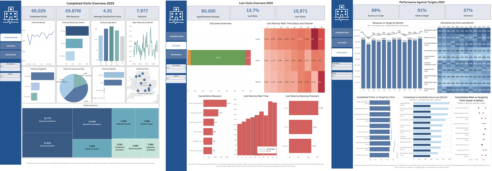
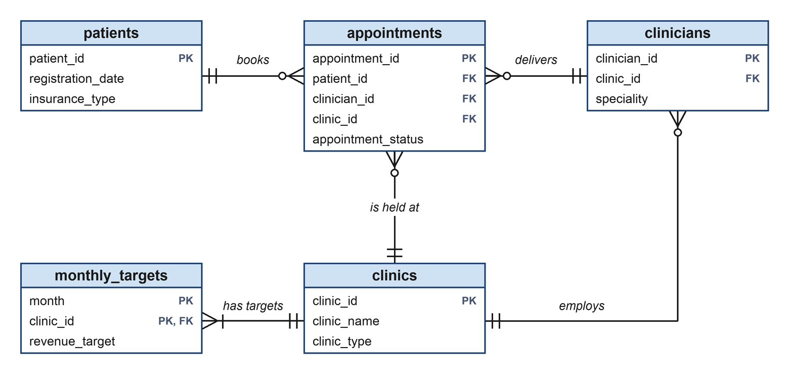

# Hospital Operations Analytics

[← Back to portfolio](../README.md)

[](https://public.tableau.com/views/HospitalOperations2025Project/CompletedVisitsOverview2025)

*The three pages of the Tableau dashboard, Hospital Operations 2025. Select the image to open the live version.*

**Open the live dashboard:** [Completed Visits](https://public.tableau.com/views/HospitalOperations2025Project/CompletedVisitsOverview2025) · [Lost Visits](https://public.tableau.com/views/HospitalOperations2025Project/LostVisitsOverview2025) · [Performance Against Targets](https://public.tableau.com/views/HospitalOperations2025Project/PerformanceAgainstTargets2025)

## Table of Contents
1. [Overview](#1-overview)
   - [Repository Structure](#repository-structure)
   - [Data](#data)
2. [Executive Summary](#2-executive-summary)
   - [Key Findings](#key-findings)
   - [Key Performance Indicators (KPIs)](#key-performance-indicators-kpis)
3. [Business Problem](#3-business-problem)
4. [Methodology](#4-methodology)
5. [How to Reproduce](#5-how-to-reproduce)
6. [Exploratory Data Analysis](#6-exploratory-data-analysis)
7. [Business Questions](#7-business-questions)
8. [Key Insights](#8-key-insights)
9. [Dashboard](#9-dashboard)
10. [Deductions](#10-deductions)
11. [Recommendations](#11-recommendations)

## 1. Overview

An end-to-end analysis of a year of activity (1 January – 31 December 2025) at a group of 10 hospital clinics, using **Excel** for a formula-based targets analysis, **PostgreSQL** for analysis and **Tableau** for the dashboard.

| | |
|---|---|
| **Tools** | Excel, PostgreSQL, Tableau |
| **Live dashboard** | [Completed Visits](https://public.tableau.com/views/HospitalOperations2025Project/CompletedVisitsOverview2025) · [Lost Visits](https://public.tableau.com/views/HospitalOperations2025Project/LostVisitsOverview2025) · [Performance Against Targets](https://public.tableau.com/views/HospitalOperations2025Project/PerformanceAgainstTargets2025) |
| **Excel workbook** | [Download the workbook](https://github.com/anita-owiredu/data-analytics-portfolio-projects/raw/main/hospital-operations-project/excel/hospital_operations_analysis.xlsx) |
| **Skills** | • Excel analysis: formulas, summaries and what-if scenarios<br>• PostgreSQL: views (saved queries), grouped summaries and conditional counts<br>• PostgreSQL joins across related tables<br>• Checking and exploring data<br>• Tracking business measures against monthly targets<br>• Dashboard design in Tableau<br>• Data storytelling and recommendations |
| **Data** | 80,000 appointments, 8,000 patients, 50 clinicians, 10 clinics and 120 monthly targets, January to December 2025 |
| **Database** | `hospital_opsdb`, with the tables in a group called `hospital_ops` |

### Repository Structure

<details>
<summary>View the repository structure</summary>

```text
hospital-operations-project/
├── README.md                                    this report
├── dashboard/
│   └── Hospital Operations 2025 Project.twbx    Tableau workbook (opens without a database)
├── data/
│   └── appointments.csv, patients.csv,          the five data files
│       clinicians.csv, clinics.csv,
│       monthly_targets.csv
├── excel/
│   └── hospital_operations_analysis.xlsx        targets analysis and what-if, built with formulas
├── images/
│   ├── dashboard.png                            the three dashboard pages
│   └── erd.png                                  how the tables link
└── sql/
    ├── 00_schema_and_load.sql                   creates the database and the five tables, and loads the data
    ├── 01_exploratory_data_analysis.sql         the data checks (C1-C9)
    ├── 02_data_cleaning.sql                     confirms nothing needs cleaning (D1-D2)
    └── 03_business_questions.sql                the nine business questions (Q1-Q9)
```

</details>

### Data

Each booked appointment is one row, whether the patient attended, cancelled or did not turn up. All amounts are in £. **The data is synthetic: it was created for this portfolio project and describes no real patient, clinician or hospital.**

| Table | Rows | One row is | Links to |
|---|---:|---|---|
| `clinics` | 10 | A clinic: city, region, type (Main, Specialist or Express), opening date and daily capacity | |
| `clinicians` | 50 | A doctor or other clinician: speciality, employment type, hourly cost and hours available each month | `clinic_id` → `clinics` |
| `patients` | 8,000 | A registered patient: date of birth, gender, postcode area, registration date, insurance type and segment | |
| `monthly_targets` | 120 | The targets for one clinic in one month: revenue, appointments, utilisation, cancellation rate and satisfaction | `clinic_id` → `clinics` |
| `appointments` | 80,000 | A booked appointment: dates, wait, service, status, money, booking channel, cancellation reason and satisfaction score | `patient_id`, `clinician_id`, `clinic_id` |



<details>
<summary>View every column</summary>

| Table | Column | Type | Description |
|---|---|---|---|
| `clinics`<br>10 rows | `clinic_id` | text | Unique ID for each clinic |
|  | `clinic_name` | text | Clinic name |
|  | `city` | text | City the clinic is in (10 cities) |
|  | `region` | text | Region of the UK the city is in (8 regions) |
|  | `clinic_type` | text | Main, Specialist or Express |
|  | `opening_date` | date | Date the clinic opened |
|  | `capacity_daily` | whole number | Daily capacity of the clinic (55 to 95) |
| `clinicians`<br>50 rows | `clinician_id` | text | Unique ID for each doctor or other clinician |
|  | `clinician_name` | text | Clinician's name |
|  | `speciality` | text | Speciality, such as Cardiology or Physiotherapy (10 specialities) |
|  | `clinic_id` | text | Clinic the clinician works at (links to `clinics`) |
|  | `employment_type` | text | Full-time, Part-time or Contractor |
|  | `hourly_cost` | money (£) | Cost of one hour of the clinician's time (£38 to £158) |
|  | `available_hours_monthly` | whole number | Hours the clinician has available each month (38 to 150) |
| `patients`<br>8,000 rows | `patient_id` | text | Unique ID for each registered patient |
|  | `date_of_birth` | date | Patient's date of birth |
|  | `gender` | text | Female, Male, Non-binary or Prefer not to say |
|  | `postcode_region` | text | Postcode area the patient lives in (17 areas, such as L or CB) |
|  | `registration_date` | date | Date the patient registered (January 2022 to September 2025) |
|  | `insurance_type` | text | How the patient pays: Private, Self-pay or Corporate |
|  | `patient_segment` | text | Standard, Premium or Corporate |
| `monthly_targets`<br>120 rows | `month` | date | First day of the month the targets are for |
|  | `clinic_id` | text | Clinic the targets are for (links to `clinics`) |
|  | `revenue_target` | money (£) | Net revenue the clinic should reach in the month |
|  | `appointment_target` | whole number | Completed appointments the clinic should reach in the month |
|  | `utilisation_target` | rate | Share of available clinician hours that should be used (76% to 88%) |
|  | `cancellation_target` | rate | Cancellation rate the clinic should stay at or below (6% to 10%) |
|  | `patient_satisfaction_target` | number | Average satisfaction score the clinic should reach, out of 5 (4.2 to 4.6) |
| `appointments`<br>80,000 rows | `appointment_id` | text | Unique ID for each booked appointment |
|  | `patient_id` | text | Patient who booked (links to `patients`) |
|  | `clinician_id` | text | Clinician for the appointment (links to `clinicians`) |
|  | `clinic_id` | text | Clinic where the appointment was booked (links to `clinics`) |
|  | `appointment_date` | date | Day of the appointment |
|  | `booking_date` | date | Day the appointment was booked |
|  | `appointment_type` | text | Consultation, Follow-up or Procedure |
|  | `service` | text | The specific service within each type (9 in all), such as General consultation or Minor procedure |
|  | `appointment_status` | text | Completed, Cancelled or No-show (the patient did not attend and gave no notice) |
|  | `appointment_duration_mins` | whole number | Planned length of the appointment, in minutes (15 to 90) |
|  | `wait_days` | whole number | Days between booking and the appointment (0 to 60) |
|  | `revenue` | money (£) | Amount billed. Cancelled appointments and no-shows bill nothing |
|  | `amount_collected` | money (£) | Amount received so far |
|  | `refund_amount` | money (£) | Amount refunded |
|  | `payment_status` | text | Paid, Pending, Refunded, or Not applicable (for cancelled appointments and no-shows) |
|  | `booking_channel` | text | Online, Phone or Referral |
|  | `cancellation_reason` | text | Why the appointment was cancelled (6 reasons). Empty unless the appointment was cancelled |
|  | `patient_satisfaction_score` | whole number | Score from 1 to 5. Empty unless the appointment was completed |

</details>

## 2. Executive Summary

This project examines how 10 hospital clinics performed in 2025 against their monthly targets: how many appointments were completed, how many were lost, and how much clinician time was used. It answers nine business questions across the three pages of the dashboard and ends with practical steps to improve, starting with closing the gap to target.

<a id="how-to-read-the-figures"></a>

<details>
<summary><b>How to Read the Figures</b></summary>

- **Booked appointment:** an appointment put in the diary (80,000 in 2025). A **completed visit** is one that went ahead. Revenue, satisfaction and the visit targets are measured on completed visits.
- **Lost visit:** a booked appointment that was cancelled or missed (a **no-show**: the patient did not attend and gave no notice). The **lost rate** is lost visits as a share of all bookings.
- **Cancellation rate:** cancelled appointments as a share of all bookings. A **lower** rate is better.
- **Net revenue:** the money billed for completed visits, minus refunds.
- **Target attainment** (for example "88.9% of target"): the actual figure divided by the target. 100% means the target was met.
- **Utilisation:** hours of completed appointments divided by the hours clinicians have available.
- **Clinic-month:** one clinic in one month (120 in the year).

</details>

### Key Findings

- **Completed Visits:** 69,029 of the 80,000 booked appointments (86.3%) were completed, bringing in **£9.87M** of net revenue. Visits are spread evenly across the 10 clinics, and online is the largest booking channel (47%).
- **Lost Visits:** **13.7% of bookings (10,971) were lost**: 8.1% cancelled and 5.6% no-shows. Online bookings (15.5%) and long waits (12.3% under 5 days, 17.2% at 25 to 29 days) lose the most.
- **Performance Against Targets:** Net revenue was **88.9% of target** (a £1.24M gap) and visits 91.3%, with every month and every clinic below its revenue target. Only 56.6% of clinician hours were used, against a target of about 82%.
- **Money still to collect:** £885,302 of billed revenue is marked Pending.

### Key Performance Indicators (KPIs)

The tiles on the dashboard, with the values it shows.

| Dashboard page | KPI | Value |
|---|---|---:|
| **Completed Visits** | Completed Visits | 69,029 |
| | Net Revenue | £9.87M (£9,866,837) |
| | Average Satisfaction Score | 4.31 (target 4.39) |
| | Patients | 7,977 |
| **Lost Visits** | Appointments Booked | 80,000 |
| | Lost Rate | 13.7% |
| | Lost Visits | 10,971 |
| **Performance Against Targets** | Revenue vs Target | 89% (£9.87M of £11.10M) |
| | Visits vs Target | 91% (69,029 of 75,601) |
| | Utilisation | 57% (target 82%) |

## 3. Business Problem

**How well are the hospital group's clinics meeting their 2025 targets, and where are the biggest opportunities to do better?**

In 2025 the 10 clinics brought in £9.87M of net revenue against a target of £11.10M: 88.9% of target, a gap of £1.24M. With the clinics, clinicians and budgets as they are, the opportunities come down to three things managers can influence: how many booked appointments are lost, how much clinician time is left unused, and whether the targets are realistic.

The nine questions follow the three pages of the dashboard. The first group shows who the clinics serve, the second where appointments are lost, and the third how each month and clinic performs against target. A **clinic-month** is one clinic in one month, so the year has 120.

**Completed Visits**
- **Q1** Who is using the clinics?
- **Q2** Which services, clinics and booking channels bring in the most visits?
- **Q3** How do visits and new patients change through the year?

**Lost Visits**
- **Q4** How many appointments are lost, and why?
- **Q5** Do the booking channel and the wait affect how many visits are lost?

**Performance Against Targets**
- **Q6** Is each month on target?
- **Q7** Which clinics miss their targets?
- **Q8** In which clinic-months were the targets met?
- **Q9** How much revenue could be won back from fewer cancellations and no-shows?

## 4. Methodology

1. Build a formula-based workbook in Excel that sets every clinic and month against its targets, with a what-if estimate.
2. Load the five data files (CSVs) into a PostgreSQL database.
3. Check the data, and clean what needs it. Nothing needed correcting, so it is used as supplied.
4. Answer nine business questions with SQL (the language used to query a database), matching the Excel workbook figure for figure.
5. Match each result to the dashboard tile or chart it explains in Tableau.
6. Draw insights, deductions and recommendations from the results.

## 5. How to Reproduce

**Excel (no setup):** Open [`excel/hospital_operations_analysis.xlsx`](excel/hospital_operations_analysis.xlsx) in Excel (GitHub cannot preview it, so download it first). Every figure is a formula on the data sheets, and the only inputs are the three yellow what-if cells on `Assumptions`.

**[Download the workbook](https://github.com/anita-owiredu/data-analytics-portfolio-projects/raw/main/hospital-operations-project/excel/hospital_operations_analysis.xlsx)**

<details>
<summary>View the sheets in the workbook</summary>

| Sheet | What it shows |
|---|---|
| `Guide` | What each sheet does, definitions of the terms used, and the colour code |
| `Clinic Month Data`, `Booking Data` | The numbers behind everything else, added up from the 80,000 appointments |
| `Clinic Summary`, `Monthly Summary` | The year for each clinic and for each month against target, with a chart |
| `Targets Scorecard` | All 120 clinic-months against their five targets, red where missed and green where met |
| `Channel and Wait` | Cancellation and no-show rates by booking channel and by wait |
| `Assumptions`, `What-If` | Three what-if settings, and the revenue that could be won back at those settings |

</details>

**SQL (PostgreSQL 13+ and `psql`):**

```bash
git clone https://github.com/anita-owiredu/data-analytics-portfolio-projects.git
cd data-analytics-portfolio-projects/hospital-operations-project/sql

psql -U postgres -f 00_schema_and_load.sql                          # creates hospital_opsdb and the 5 tables, loads the data, prints row counts
psql -U postgres -d hospital_opsdb -f 01_exploratory_data_analysis.sql   # the data checks
psql -U postgres -d hospital_opsdb -f 02_data_cleaning.sql               # confirms nothing needs cleaning
psql -U postgres -d hospital_opsdb -f 03_business_questions.sql          # the business questions
```

Run them from the `sql/` folder so the paths to `data/` resolve. The first script can be run again safely: it rebuilds the `hospital_ops` schema (refer to its tables as `hospital_ops.clinics` and so on). That also removes the `clinic_month` view that the last script creates, so run the last script again after every reload.

**Tableau:** Open [`dashboard/Hospital Operations 2025 Project.twbx`](dashboard/Hospital%20Operations%202025%20Project.twbx) in Tableau Desktop or Tableau Public. It includes a saved copy of the data, so it needs no database.

## 6. Exploratory Data Analysis

The data loads cleanly and holds together. The checks found nothing that needed correcting, so the data was used as supplied. They did turn up a few things worth knowing about.

### Results of Exploration

| Finding | Action Taken |
|---|---|
| 6,875 completed appointments are marked Pending: £1,013,537 was billed and £128,235 collected, leaving **£885,302 outstanding** | **Kept**<br>Revenue in this report is what was billed, not what was received. Collecting the balance is recommendation 6 |
| Two columns are empty by design: the satisfaction score (10,971 cancelled and no-show appointments) and the cancellation reason (73,538 appointments that were not cancelled) | **Kept**<br>Both are empty exactly when they should be |
| 449 appointments were booked before the patient's registration date (by up to 56 days), and 2,143 were booked in late 2024 for early-2025 appointments | **Kept**<br>Plausible pre-booking. No appointment takes place before the patient registered |
| For nine clinicians, the hours available in some months are lower than the hours of their completed appointments (65 of 600 clinician-months), which would give a utilisation above 100% | **Kept**<br>Utilisation is reported for clinics and months, not individual clinicians |
| Registrations end on 30 September 2025, and December's visit target (5,655) is the lowest of the year | **Kept and analysed**<br>The New Patients chart ends in September; December is analysed in Q6 |

<details>
<summary>View the nine data checks (C1 to C9) and their results</summary>

**The checks** (C1 to C9, in [`01_exploratory_data_analysis.sql`](sql/01_exploratory_data_analysis.sql)). Each query lists what it found next to what a clean data set should return:

| Check | Result | Query |
|---|---|---|
| Row counts | 10 clinics, 50 clinicians, 8,000 patients, 120 monthly targets, 80,000 appointments | C1 |
| Duplicate IDs | None | C2 |
| Missing values | None, apart from the two columns empty by design | C3 |
| Links between tables | No appointment points to a missing patient, clinician or clinic, and every clinician works at the clinic on their appointments | C4 |
| Dates | 1 January 2025 to 31 December 2025. None booked after the appointment, before the patient registered or before the clinic opened | C5 |
| Wait days | Always equal to the gap between booking and appointment dates (0 to 60 days) | C6 |
| Revenue and payments | All billing rules hold. Gross revenue £10,186,968, refunds £320,131, net revenue £9,866,837 | C7 |
| Categories | No spelling, spacing or capital-letter variants | C8 |
| Utilisation per clinician | 65 of 600 clinician-months above 100%, across 9 clinicians | C9 |

<details>
<summary>View the SQL query: The data checks (C1 to C9)</summary>

```sql
SELECT 'clinics' AS table_name, COUNT(*) AS found, 10 AS expected FROM clinics
UNION ALL SELECT 'clinicians',      COUNT(*), 50    FROM clinicians
UNION ALL SELECT 'patients',        COUNT(*), 8000  FROM patients
UNION ALL SELECT 'monthly_targets', COUNT(*), 120   FROM monthly_targets
UNION ALL SELECT 'appointments',    COUNT(*), 80000 FROM appointments;

SELECT 'appointments: duplicate appointment_id' AS check_name, COUNT(*) - COUNT(DISTINCT appointment_id) AS found, 0 AS expected FROM appointments
UNION ALL SELECT 'patients: duplicate patient_id',     COUNT(*) - COUNT(DISTINCT patient_id),   0 FROM patients
UNION ALL SELECT 'clinicians: duplicate clinician_id', COUNT(*) - COUNT(DISTINCT clinician_id), 0 FROM clinicians
UNION ALL SELECT 'clinics: duplicate clinic_id',       COUNT(*) - COUNT(DISTINCT clinic_id),    0 FROM clinics
UNION ALL SELECT 'monthly_targets: duplicate clinic and month',
       COUNT(*) - (SELECT COUNT(*) FROM (SELECT DISTINCT month, clinic_id FROM monthly_targets) d), 0
FROM monthly_targets;

-- Rows with a missing value in any other column (expected 0 in every table)
SELECT 'clinics' AS table_name,
       COUNT(*) FILTER (WHERE clinic_id IS NULL OR clinic_name IS NULL OR city IS NULL OR region IS NULL
                           OR clinic_type IS NULL OR opening_date IS NULL OR capacity_daily IS NULL) AS rows_with_missing_value
FROM clinics
UNION ALL
SELECT 'clinicians',
       COUNT(*) FILTER (WHERE clinician_id IS NULL OR clinician_name IS NULL OR speciality IS NULL OR clinic_id IS NULL
                           OR employment_type IS NULL OR hourly_cost IS NULL OR available_hours_monthly IS NULL)
FROM clinicians
UNION ALL
SELECT 'patients',
       COUNT(*) FILTER (WHERE patient_id IS NULL OR date_of_birth IS NULL OR gender IS NULL OR postcode_region IS NULL
                           OR registration_date IS NULL OR insurance_type IS NULL OR patient_segment IS NULL)
FROM patients
UNION ALL
SELECT 'monthly_targets',
       COUNT(*) FILTER (WHERE month IS NULL OR clinic_id IS NULL OR revenue_target IS NULL OR appointment_target IS NULL
                           OR utilisation_target IS NULL OR cancellation_target IS NULL OR patient_satisfaction_target IS NULL)
FROM monthly_targets
UNION ALL
SELECT 'appointments (all columns except the two that are empty by design)',
       COUNT(*) FILTER (WHERE appointment_id IS NULL OR patient_id IS NULL OR clinician_id IS NULL OR clinic_id IS NULL
                           OR appointment_date IS NULL OR booking_date IS NULL OR appointment_type IS NULL OR service IS NULL
                           OR appointment_status IS NULL OR appointment_duration_mins IS NULL OR wait_days IS NULL
                           OR revenue IS NULL OR amount_collected IS NULL OR refund_amount IS NULL OR payment_status IS NULL
                           OR booking_channel IS NULL)
FROM appointments;

-- The two columns that are empty by design: empty exactly when they should be
SELECT appointment_status,
       COUNT(*)                                                    AS appointments,
       COUNT(*) FILTER (WHERE patient_satisfaction_score IS NULL)  AS satisfaction_score_empty,
       COUNT(*) FILTER (WHERE cancellation_reason IS NULL)         AS cancellation_reason_empty
FROM appointments
GROUP BY appointment_status
ORDER BY appointments DESC;

SELECT 'appointments with no matching patient' AS check_name, COUNT(*) AS found, 0 AS expected
FROM appointments a LEFT JOIN patients p ON p.patient_id = a.patient_id WHERE p.patient_id IS NULL
UNION ALL
SELECT 'appointments with no matching clinician', COUNT(*), 0
FROM appointments a LEFT JOIN clinicians c ON c.clinician_id = a.clinician_id WHERE c.clinician_id IS NULL
UNION ALL
SELECT 'appointments with no matching clinic', COUNT(*), 0
FROM appointments a LEFT JOIN clinics c ON c.clinic_id = a.clinic_id WHERE c.clinic_id IS NULL
UNION ALL
SELECT 'clinicians with no matching clinic', COUNT(*), 0
FROM clinicians k LEFT JOIN clinics c ON c.clinic_id = k.clinic_id WHERE c.clinic_id IS NULL
UNION ALL
SELECT 'monthly targets with no matching clinic', COUNT(*), 0
FROM monthly_targets t LEFT JOIN clinics c ON c.clinic_id = t.clinic_id WHERE c.clinic_id IS NULL
UNION ALL
SELECT 'appointments at a different clinic from the clinician''s own clinic', COUNT(*), 0
FROM appointments a JOIN clinicians k ON k.clinician_id = a.clinician_id WHERE a.clinic_id <> k.clinic_id;

-- Date range of the appointments (expected: 1 January to 31 December 2025)
SELECT MIN(appointment_date) AS first_appointment, MAX(appointment_date) AS last_appointment
FROM appointments;

-- Impossible dates (expected 0 in each)
SELECT 'booked after the appointment date' AS check_name, COUNT(*) AS found, 0 AS expected
FROM appointments WHERE booking_date > appointment_date
UNION ALL
SELECT 'appointment before the patient registered', COUNT(*), 0
FROM appointments a JOIN patients p ON p.patient_id = a.patient_id WHERE a.appointment_date < p.registration_date
UNION ALL
SELECT 'appointment before the clinic opened', COUNT(*), 0
FROM appointments a JOIN clinics c ON c.clinic_id = a.clinic_id WHERE a.appointment_date < c.opening_date;

-- Things to know about the dates (these are not errors)
-- Bookings made before the patient's registration date, and how far ahead of it
SELECT COUNT(*)                                          AS booked_before_registration,
       MAX(p.registration_date - a.booking_date)         AS most_days_before_registration
FROM appointments a
JOIN patients p ON p.patient_id = a.patient_id
WHERE a.booking_date < p.registration_date;

-- Bookings made in 2024 for appointments in early 2025
SELECT MIN(booking_date) AS earliest_booking, COUNT(*) AS booked_in_2024
FROM appointments
WHERE booking_date < DATE '2025-01-01';

-- The last patient registration date (the new-patients chart ends here)
SELECT MAX(registration_date) AS last_registration FROM patients;

SELECT COUNT(*) FILTER (WHERE wait_days <> appointment_date - booking_date) AS wait_days_not_matching_dates,
       MIN(wait_days)                                                       AS shortest_wait_days,
       MAX(wait_days)                                                       AS longest_wait_days
FROM appointments;

-- Rules that should hold for every appointment (expected 0 in each)
SELECT 'completed appointment with no revenue' AS check_name, COUNT(*) AS found, 0 AS expected
FROM appointments WHERE appointment_status = 'Completed' AND revenue <= 0
UNION ALL
SELECT 'cancelled or no-show appointment with revenue', COUNT(*), 0
FROM appointments WHERE appointment_status <> 'Completed' AND revenue <> 0
UNION ALL
SELECT 'Paid appointment where the amount collected differs from the revenue', COUNT(*), 0
FROM appointments WHERE payment_status = 'Paid' AND amount_collected <> revenue
UNION ALL
SELECT 'Refunded appointment where the refund differs from the revenue', COUNT(*), 0
FROM appointments WHERE payment_status = 'Refunded' AND refund_amount <> revenue
UNION ALL
SELECT 'refund on an appointment that is not Refunded', COUNT(*), 0
FROM appointments WHERE payment_status <> 'Refunded' AND refund_amount <> 0
UNION ALL
SELECT 'payment status other than Not applicable on a cancelled or no-show appointment', COUNT(*), 0
FROM appointments WHERE appointment_status <> 'Completed' AND payment_status <> 'Not applicable';

-- Money in the data: gross revenue, refunds and net revenue (completed appointments)
SELECT SUM(revenue)                       AS gross_revenue_gbp,
       SUM(refund_amount)                 AS refunds_gbp,
       SUM(revenue - refund_amount)       AS net_revenue_gbp
FROM appointments
WHERE appointment_status = 'Completed';

-- Payments still to collect: completed appointments marked Pending
SELECT COUNT(*)                                  AS pending_appointments,
       SUM(revenue)                              AS revenue_billed_gbp,
       SUM(amount_collected)                     AS collected_so_far_gbp,
       SUM(revenue - amount_collected)           AS outstanding_gbp
FROM appointments
WHERE appointment_status = 'Completed' AND payment_status = 'Pending';

SELECT field,
       COUNT(DISTINCT value)                          AS distinct_values,
       COUNT(DISTINCT LOWER(TRIM(value)))             AS distinct_after_tidying
FROM (
    SELECT 'appointment_status' AS field, appointment_status AS value FROM appointments
    UNION ALL SELECT 'payment_status',    payment_status    FROM appointments
    UNION ALL SELECT 'booking_channel',   booking_channel   FROM appointments
    UNION ALL SELECT 'appointment_type',  appointment_type  FROM appointments
    UNION ALL SELECT 'service',           service           FROM appointments
    UNION ALL SELECT 'gender',            gender            FROM patients
    UNION ALL SELECT 'insurance_type',    insurance_type    FROM patients
    UNION ALL SELECT 'patient_segment',   patient_segment   FROM patients
    UNION ALL SELECT 'employment_type',   employment_type   FROM clinicians
) v
GROUP BY field
ORDER BY field;

WITH clinician_month AS (
    SELECT a.clinician_id,
           DATE_TRUNC('month', a.appointment_date)::date AS month,
           SUM(a.appointment_duration_mins) / 60.0       AS completed_hours
    FROM appointments a
    WHERE a.appointment_status = 'Completed'
    GROUP BY a.clinician_id, DATE_TRUNC('month', a.appointment_date)::date
)
SELECT COUNT(*)                                                         AS clinician_months,
       COUNT(*) FILTER (WHERE m.completed_hours > k.available_hours_monthly) AS above_100_pct_utilisation,
       COUNT(DISTINCT m.clinician_id) FILTER (WHERE m.completed_hours > k.available_hours_monthly) AS clinicians_affected
FROM clinician_month m
JOIN clinicians k ON k.clinician_id = m.clinician_id;
```

</details>

</details>

### Data Cleaning

The checks found nothing that needed correcting, so no data was changed and the tables are used as supplied. [`02_data_cleaning.sql`](sql/02_data_cleaning.sql) records that decision and proves it with two queries: D1 looks for rows that would need cleaning (stray spaces, impossible values, amounts that do not add up), and D2 compares the row counts and money totals that every later figure rests on with their expected values.

<details>
<summary>View the SQL query: Rows that would need cleaning (D1) and control totals (D2)</summary>

```sql
SELECT 'text values with a leading or trailing space' AS check_name, COUNT(*) AS found, 0 AS expected
FROM appointments
WHERE appointment_status <> TRIM(appointment_status) OR payment_status <> TRIM(payment_status)
   OR booking_channel <> TRIM(booking_channel) OR service <> TRIM(service)
   OR appointment_type <> TRIM(appointment_type) OR cancellation_reason <> TRIM(cancellation_reason)
UNION ALL
SELECT 'patient text values with a leading or trailing space', COUNT(*), 0
FROM patients
WHERE gender <> TRIM(gender) OR insurance_type <> TRIM(insurance_type) OR patient_segment <> TRIM(patient_segment)
UNION ALL
SELECT 'satisfaction score outside 1 to 5', COUNT(*), 0
FROM appointments WHERE patient_satisfaction_score NOT BETWEEN 1 AND 5
UNION ALL
SELECT 'appointment length of 0 minutes or less', COUNT(*), 0
FROM appointments WHERE appointment_duration_mins <= 0
UNION ALL
SELECT 'negative wait', COUNT(*), 0
FROM appointments WHERE wait_days < 0
UNION ALL
SELECT 'negative revenue, amount collected or refund', COUNT(*), 0
FROM appointments WHERE revenue < 0 OR amount_collected < 0 OR refund_amount < 0
UNION ALL
SELECT 'amount collected or refund above the revenue billed', COUNT(*), 0
FROM appointments WHERE amount_collected > revenue OR refund_amount > revenue
UNION ALL
SELECT 'patient born after registering', COUNT(*), 0
FROM patients WHERE date_of_birth > registration_date
UNION ALL
SELECT 'clinician with a cost or available hours of 0 or less', COUNT(*), 0
FROM clinicians WHERE hourly_cost <= 0 OR available_hours_monthly <= 0
UNION ALL
SELECT 'revenue or appointment target of 0 or less', COUNT(*), 0
FROM monthly_targets WHERE revenue_target <= 0 OR appointment_target <= 0
UNION ALL
SELECT 'rate target outside 0 to 1, or satisfaction target outside 1 to 5', COUNT(*), 0
FROM monthly_targets
WHERE utilisation_target NOT BETWEEN 0 AND 1 OR cancellation_target NOT BETWEEN 0 AND 1
   OR patient_satisfaction_target NOT BETWEEN 1 AND 5;

SELECT 'booked appointments' AS measure, COUNT(*)::numeric AS found, 80000 AS expected
FROM appointments
UNION ALL
SELECT 'completed appointments', COUNT(*) FILTER (WHERE appointment_status = 'Completed'), 69029
FROM appointments
UNION ALL
SELECT 'cancelled appointments', COUNT(*) FILTER (WHERE appointment_status = 'Cancelled'), 6462
FROM appointments
UNION ALL
SELECT 'no-shows', COUNT(*) FILTER (WHERE appointment_status = 'No-show'), 4509
FROM appointments
UNION ALL
SELECT 'patients with a completed visit', COUNT(DISTINCT patient_id) FILTER (WHERE appointment_status = 'Completed'), 7977
FROM appointments
UNION ALL
SELECT 'gross revenue (£)', SUM(revenue), 10186967.92
FROM appointments
UNION ALL
SELECT 'refunds (£)', SUM(refund_amount), 320130.95
FROM appointments
UNION ALL
SELECT 'net revenue (£)', SUM(revenue - refund_amount), 9866836.97
FROM appointments;
```

</details>

**Result:** D1 finds 0 rows in all 11 checks. D2 matches all 8 control totals: 80,000 booked appointments (69,029 completed, 6,462 cancelled and 4,509 no-shows), 7,977 patients with a completed visit, gross revenue £10,186,968, refunds £320,131 and net revenue £9,866,837.

## 7. Business Questions

Each question is answered in [`03_business_questions.sql`](sql/03_business_questions.sql), and each returns the same figures as the Excel workbook and as a tile or chart on the dashboard, so any number can be checked three ways. Every figure on the workbook's `Monthly Summary`, `Clinic Summary`, `Targets Scorecard`, `Channel and Wait` and `What-If` sheets was checked against the SQL results and matches.

The workbook builds every sheet from one table with a row per clinic per month (`Clinic Month Data`). The SQL does the same with a **view** (a saved query that works like a table) called `clinic_month`, which Q6 to Q9 use. Rates for a year or a group are worked out from the totals, not by averaging monthly rates.

<details>
<summary>View the SQL query: The clinic_month view (the SQL version of the Excel sheet Clinic Month Data)</summary>

```sql
CREATE OR REPLACE VIEW clinic_month AS
WITH actual AS (
    SELECT clinic_id,
           DATE_TRUNC('month', appointment_date)::date                                   AS month,
           COUNT(*)                                                                      AS booked,
           COUNT(*) FILTER (WHERE appointment_status = 'Completed')                      AS completed,
           COUNT(*) FILTER (WHERE appointment_status = 'Cancelled')                      AS cancelled,
           COUNT(*) FILTER (WHERE appointment_status = 'No-show')                        AS no_shows,
           COALESCE(SUM(revenue)       FILTER (WHERE appointment_status = 'Completed'), 0) AS gross_revenue,
           COALESCE(SUM(refund_amount) FILTER (WHERE appointment_status = 'Completed'), 0) AS refunds,
           COALESCE(SUM(patient_satisfaction_score), 0)                                  AS satisfaction_total,
           COUNT(patient_satisfaction_score)                                             AS rated,
           COALESCE(SUM(appointment_duration_mins) FILTER (WHERE appointment_status = 'Completed'), 0) / 60.0
                                                                                         AS completed_hours
    FROM appointments
    GROUP BY clinic_id, DATE_TRUNC('month', appointment_date)::date
),
available AS (
    SELECT clinic_id, SUM(available_hours_monthly) AS available_hours
    FROM clinicians
    GROUP BY clinic_id
)
SELECT t.month,
       c.clinic_id,
       c.clinic_name,
       c.region,
       c.clinic_type,
       a.booked,
       a.completed,
       a.cancelled,
       a.no_shows,
       a.gross_revenue,
       a.refunds,
       a.gross_revenue - a.refunds   AS net_revenue,
       a.satisfaction_total,
       a.rated,
       a.completed_hours,
       v.available_hours,
       t.revenue_target,
       t.appointment_target,
       t.utilisation_target,
       t.cancellation_target,
       t.patient_satisfaction_target AS satisfaction_target
FROM monthly_targets t
JOIN clinics   c ON c.clinic_id = t.clinic_id
JOIN actual    a ON a.clinic_id = t.clinic_id AND a.month = t.month
JOIN available v ON v.clinic_id = t.clinic_id;

-- Check: the view should have 120 rows (10 clinics x 12 months) and cover all 80,000 bookings
SELECT COUNT(*) AS clinic_months, SUM(booked) AS booked_appointments
FROM clinic_month;
```

</details>

### Completed Visits

#### Q1. Who is using the clinics?

**Answer:** 69,029 completed visits brought in £9,866,837 of net revenue from 7,977 patients, who averaged 8.65 completed visits each, with a satisfaction score of 4.31 out of 5. The 45–59 age band is the largest (23.4%), women make 51.7% of visits, and 80% are paid by private insurance (42.3%) or self-pay (37.9%).

**Dashboard elements:** the four headline tiles, and the Visits by Age Band, Gender, Segment and Insurance Type charts.

<details>
<summary>View the detailed results</summary>

**Results:** 69,029 completed visits, £9,866,837 net revenue, an average satisfaction score of 4.31 out of 5, and 7,977 patients with at least one completed visit, who averaged 8.65 completed visits each.

| Share of completed visits by | Result |
|---|---|
| Age band | 18-29 17.3% · 30-44 21.9% · 45-59 23.4% · 60-74 20.7% · 75+ 16.7% |
| Gender | Female 51.7% · Male 46.2% · Non-binary 1.2% · Prefer not to say 0.9% |
| Segment | Standard 61.1% · Premium 22.6% · Corporate 16.3% |
| Insurance type | Private 42.3% · Self-pay 37.9% · Corporate 19.8% |

Age is the age the patient reaches in 2025 (2025 minus the year of birth), as on the dashboard.

</details>

<details>
<summary>View the SQL query</summary>

<details>
<summary>View the SQL query: Headline tiles, and visits by age band, gender, segment and insurance type</summary>

```sql
-- Headline tiles: completed visits, net revenue, average satisfaction and patients,
-- and the average number of completed visits for each patient who had one
SELECT COUNT(*)                                       AS completed_visits,
       SUM(revenue - refund_amount)                   AS net_revenue_gbp,
       ROUND(AVG(patient_satisfaction_score), 2)      AS avg_satisfaction_score,
       COUNT(DISTINCT patient_id)                     AS patients,
       ROUND(1.0 * COUNT(*) / COUNT(DISTINCT patient_id), 2) AS completed_visits_per_patient
FROM appointments
WHERE appointment_status = 'Completed';

-- Visits by age band, gender, segment and insurance type
-- Age is the age the patient reaches in 2025 (2025 minus the year of birth), as on the dashboard.
WITH completed AS (
    SELECT p.gender,
           p.patient_segment,
           p.insurance_type,
           CASE WHEN 2025 - EXTRACT(YEAR FROM p.date_of_birth) < 30 THEN '18-29'
                WHEN 2025 - EXTRACT(YEAR FROM p.date_of_birth) < 45 THEN '30-44'
                WHEN 2025 - EXTRACT(YEAR FROM p.date_of_birth) < 60 THEN '45-59'
                WHEN 2025 - EXTRACT(YEAR FROM p.date_of_birth) < 75 THEN '60-74'
                ELSE '75+' END AS age_band
    FROM appointments a
    JOIN patients p ON p.patient_id = a.patient_id
    WHERE a.appointment_status = 'Completed'
),
grouped AS (
    SELECT 1 AS ord, 'Age band' AS breakdown, age_band       AS grp, COUNT(*) AS visits FROM completed GROUP BY age_band
    UNION ALL
    SELECT 2, 'Gender',         gender,          COUNT(*) FROM completed GROUP BY gender
    UNION ALL
    SELECT 3, 'Segment',        patient_segment, COUNT(*) FROM completed GROUP BY patient_segment
    UNION ALL
    SELECT 4, 'Insurance type', insurance_type,  COUNT(*) FROM completed GROUP BY insurance_type
)
SELECT breakdown,
       grp AS category,
       visits,
       ROUND(100.0 * visits / SUM(visits) OVER (PARTITION BY breakdown), 1) AS share_pct
FROM grouped
ORDER BY ord, CASE WHEN breakdown = 'Age band' THEN 0 ELSE -visits END, grp;
```

</details>

</details>

#### Q2. Which services, clinics and booking channels bring in the most visits?

**Answer:** Three services (general consultation, initial assessment and specialist consultation) make 55% of visits. Online is the largest booking channel (47%), and each clinic completed 6,683 to 7,082 visits. Per clinician hour, procedures earn £339, consultations £286 and follow-up reviews £241.

**Dashboard elements:** Visits by Service, Visits by Clinic and Visits by Booking Channel.

<details>
<summary>View the detailed results</summary>

**Results:**

| Service | Completed visits | Share of visits | Net revenue per visit |
|---|---:|---:|---:|
| General consultation | 12,770 | 18.5% | £140 |
| Initial assessment | 12,635 | 18.3% | £140 |
| Specialist consultation | 12,568 | 18.2% | £141 |
| Follow-up review | 7,365 | 10.7% | £82 |
| Treatment review | 7,329 | 10.6% | £82 |
| Results review | 7,305 | 10.6% | £83 |
| Therapeutic procedure | 3,091 | 4.5% | £301 |
| Minor procedure | 2,984 | 4.3% | £300 |
| Diagnostic procedure | 2,982 | 4.3% | £301 |

By type of appointment, with what each earns for each hour of clinician time:

| Type | Share of visits | Share of net revenue | Average minutes | Net revenue per clinician hour |
|---|---:|---:|---:|---:|
| Procedure | 13.1% | 27.6% | 53 | £339 |
| Consultation | 55% | 54% | 29 | £286 |
| Follow-up | 31.9% | 18.4% | 21 | £241 |

By booking channel: online 47% (32,470), phone 34.5% (23,843), referral 18.4% (12,716). Each clinic completed 6,683 to 7,082 visits (9.7% to 10.3% of the total). Net revenue per visit is after refunds; before refunds a consultation brings in about £145, a review £85 and a procedure £310.

</details>

<details>
<summary>View the SQL query</summary>

<details>
<summary>View the SQL query: Visits by service, clinic and booking channel, and what each type of appointment earns per clinician hour</summary>

```sql
WITH completed AS (
    SELECT a.service, a.booking_channel, c.clinic_name,
           a.revenue - a.refund_amount AS net_revenue
    FROM appointments a
    JOIN clinics c ON c.clinic_id = a.clinic_id
    WHERE a.appointment_status = 'Completed'
),
grouped AS (
    SELECT 1 AS ord, 'Service' AS breakdown, service         AS grp, COUNT(*) AS visits, SUM(net_revenue) AS net_revenue FROM completed GROUP BY service
    UNION ALL
    SELECT 2, 'Clinic',          clinic_name,     COUNT(*), SUM(net_revenue) FROM completed GROUP BY clinic_name
    UNION ALL
    SELECT 3, 'Booking channel', booking_channel, COUNT(*), SUM(net_revenue) FROM completed GROUP BY booking_channel
)
SELECT breakdown,
       grp AS category,
       visits,
       ROUND(100.0 * visits / SUM(visits) OVER (PARTITION BY breakdown), 1) AS share_pct,
       ROUND(net_revenue / visits, 0)                                        AS net_revenue_per_visit_gbp
FROM grouped
ORDER BY ord, visits DESC;

-- Share of visits and of net revenue by type of appointment, and what each type earns for each
-- hour of clinician time (net revenue / hours of completed appointments)
SELECT appointment_type,
       COUNT(*)                                                                            AS completed_visits,
       ROUND(100.0 * COUNT(*) / SUM(COUNT(*)) OVER (), 1)                                  AS share_of_visits_pct,
       ROUND(100.0 * SUM(revenue - refund_amount) / SUM(SUM(revenue - refund_amount)) OVER (), 1) AS share_of_net_revenue_pct,
       ROUND(AVG(appointment_duration_mins), 0)                                            AS avg_minutes,
       ROUND(SUM(revenue - refund_amount) / (SUM(appointment_duration_mins) / 60.0), 0)    AS net_revenue_per_clinician_hour_gbp
FROM appointments
WHERE appointment_status = 'Completed'
GROUP BY appointment_type
ORDER BY net_revenue_per_clinician_hour_gbp DESC;
```

</details>

</details>

#### Q3. How do visits and new patients change through the year?

**Answer:** Completed visits stay between 5,312 and 5,955 a month. New registrations run at about 175 to 183 a month and stop after September 2025, the last registration date in the data.

**Dashboard elements:** Visits by Month and New Patients by Month charts.

<details>
<summary>View the detailed results</summary>

**Results:**

| Month | Completed visits | New patients registered |
|---|---:|---:|
| January | 5,821 | 174 |
| February | 5,312 | 174 |
| March | 5,804 | 171 |
| April | 5,700 | 155 |
| May | 5,791 | 185 |
| June | 5,688 | 169 |
| July | 5,885 | 189 |
| August | 5,862 | 192 |
| September | 5,595 | 169 |
| October | 5,825 | – |
| November | 5,791 | – |
| December | 5,955 | – |

New registrations per month averaged 178 in 2022, 175 in 2023, 183 in 2024, 175 in 2025, so they are flat. New patients cover all 8,000 registered patients, not only those with a completed visit. Registrations stop after September 2025, the last registration date in the data. The visits are the "Completed appointments" column on the Excel sheet `Monthly Summary`.

</details>

<details>
<summary>View the SQL query</summary>

<details>
<summary>View the SQL query: Completed visits by month, and new patients by year and month</summary>

```sql
-- Completed visits by month of appointment
SELECT DATE_TRUNC('month', appointment_date)::date AS month,
       COUNT(*)                                    AS completed_visits
FROM appointments
WHERE appointment_status = 'Completed'
GROUP BY 1
ORDER BY 1;

-- New patients by registration year. The chart covers all 8,000 registered patients, not only
-- those with a completed visit, and registrations stop in September 2025.
SELECT EXTRACT(YEAR FROM registration_date)::int AS registration_year,
       COUNT(*)                                  AS new_patients,
       COUNT(DISTINCT DATE_TRUNC('month', registration_date)) AS months_with_registrations,
       ROUND(1.0 * COUNT(*) / COUNT(DISTINCT DATE_TRUNC('month', registration_date)), 0) AS new_patients_per_month
FROM patients
GROUP BY 1
ORDER BY 1;

-- New patients by registration month in 2025 (the right-hand end of the chart)
SELECT DATE_TRUNC('month', registration_date)::date AS month,
       COUNT(*)                                     AS new_patients
FROM patients
WHERE registration_date >= DATE '2025-01-01'
GROUP BY 1
ORDER BY 1;
```

</details>

</details>

### Lost Visits

#### Q4. How many appointments are lost, and why?

**Answer:** 13.7% of bookings (10,971) were lost: 8.1% cancelled and 5.6% no-shows. Patient unavailability (30.6%) and scheduling conflicts (19.7%) account for half of all cancellations.

**Dashboard elements:** the three headline tiles on the Lost Visits page, Outcomes Overview and Cancellation Reasons.

<details>
<summary>View the detailed results</summary>

**Results:** 80,000 appointments were booked and 10,971 were lost, a lost rate of 13.7%: 69,029 completed (86.3%), 6,462 cancelled (8.1%) and 4,509 no-shows (5.6%).

| Cancellation reason | Cancelled appointments | Share of cancellations |
|---|---:|---:|
| Patient unavailability | 1,977 | 30.6% |
| Scheduling conflict | 1,271 | 19.7% |
| Symptoms improved | 911 | 14.1% |
| Cost concerns | 808 | 12.5% |
| Transport issue | 763 | 11.8% |
| Clinician unavailable | 732 | 11.3% |

The totals are the "All appointments" row on the Excel sheet `Channel and Wait`.

</details>

<details>
<summary>View the SQL query</summary>

<details>
<summary>View the SQL query: Lost rate, outcomes and cancellation reasons</summary>

```sql
-- Headline tiles: booked appointments, lost visits and lost rate
SELECT COUNT(*)                                                        AS booked_appointments,
       COUNT(*) FILTER (WHERE appointment_status <> 'Completed')       AS lost_visits,
       ROUND(100.0 * COUNT(*) FILTER (WHERE appointment_status <> 'Completed') / COUNT(*), 1) AS lost_rate_pct
FROM appointments;

-- Outcomes overview: completed, cancelled and no-show
SELECT appointment_status,
       COUNT(*)                                          AS appointments,
       ROUND(100.0 * COUNT(*) / SUM(COUNT(*)) OVER (), 1) AS share_pct
FROM appointments
GROUP BY appointment_status
ORDER BY appointments DESC;

-- Cancellation reasons (only cancelled appointments have a reason)
SELECT cancellation_reason,
       COUNT(*)                                          AS cancellations,
       ROUND(100.0 * COUNT(*) / SUM(COUNT(*)) OVER (), 1) AS share_of_cancellations_pct
FROM appointments
WHERE appointment_status = 'Cancelled'
GROUP BY cancellation_reason
ORDER BY cancellations DESC;
```

</details>

</details>

#### Q5. Do the booking channel and the wait affect how many visits are lost?

**Answer:** Online bookings are lost most often (15.5%, against 12.2% by phone and 11.8% by referral), and the lost rate rises from 12.3% for waits under 5 days to 17.2% for waits of 25 to 29 days.

**Dashboard elements:** Lost Rate by Booking Channels, Lost Rate by Wait Time, and the Lost Rate by Wait Time and Channel heat map. **Excel sheet:** `Channel and Wait`.

<details>
<summary>View the detailed results</summary>

**Results:** By booking channel, the lost rate is 15.5% online, 12.2% by phone and 11.8% by referral. In the Excel wait groups it rises from 12.6% (0 to 7 days) to 14.2%, 15.5% and 18.1% (31 days or more). The dashboard uses bands of 5 days:

| Wait band starts at (days) | All bookings | Online | Phone | Referral |
|---|---:|---:|---:|---:|
| 0 | 12.3% | 14.1% | 10.8% | 10.5% |
| 5 | 13.2% | 15.1% | 11.7% | 11.1% |
| 10 | 14.4% | 16.3% | 12.8% | 12.5% |
| 15 | 14.9% | 16.5% | 13.6% | 13.3% |
| 20 | 15.7% | 17% | 15.4% | 13% |
| 25 | 17.2% | 17.9% | 16.6% | 16.6% |
| 30 | 15.7% | 17.3% | 12.5% | 17.4% |
| 35 | 21.2% | 27% | 17.3% | 11.4% |
| 40 | 20.7% | 21.3% | 17% | 25% |

A band of 0 means 0 to 4 days, 5 means 5 to 9 days, and so on. Waits of 45 days or more are left out, as on the dashboard, because very few appointments fall in that range, and single cells rest on fewer appointments, so they jump around more than the totals.

</details>

<details>
<summary>View the SQL query</summary>

<details>
<summary>View the SQL query: Lost rate by booking channel, by wait, and by wait and channel</summary>

```sql
-- Cancellations, no-shows and lost rate by booking channel (as on the Excel sheet)
SELECT COALESCE(booking_channel, 'All appointments')                                  AS booking_channel,
       COUNT(*)                                                                       AS booked_appointments,
       COUNT(*) FILTER (WHERE appointment_status = 'Cancelled')                       AS cancelled,
       COUNT(*) FILTER (WHERE appointment_status = 'No-show')                         AS no_shows,
       ROUND(100.0 * COUNT(*) FILTER (WHERE appointment_status = 'Cancelled') / COUNT(*), 1) AS cancellation_rate_pct,
       ROUND(100.0 * COUNT(*) FILTER (WHERE appointment_status = 'No-show')   / COUNT(*), 1) AS no_show_rate_pct,
       ROUND(100.0 * COUNT(*) FILTER (WHERE appointment_status <> 'Completed') / COUNT(*), 1) AS lost_rate_pct
FROM appointments
GROUP BY ROLLUP (booking_channel)
ORDER BY booking_channel IS NULL, lost_rate_pct DESC;

-- The same by wait band: 0-7, 8-14, 15-30 and 31+ days (as on the Excel sheet)
WITH banded AS (
    SELECT appointment_status,
           CASE WHEN wait_days <= 7  THEN '0-7 days'
                WHEN wait_days <= 14 THEN '8-14 days'
                WHEN wait_days <= 30 THEN '15-30 days'
                ELSE '31+ days' END AS wait_band
    FROM appointments
)
SELECT COALESCE(wait_band, 'All appointments')                                        AS wait_before_appointment,
       COUNT(*)                                                                       AS booked_appointments,
       COUNT(*) FILTER (WHERE appointment_status = 'Cancelled')                       AS cancelled,
       COUNT(*) FILTER (WHERE appointment_status = 'No-show')                         AS no_shows,
       ROUND(100.0 * COUNT(*) FILTER (WHERE appointment_status = 'Cancelled') / COUNT(*), 1) AS cancellation_rate_pct,
       ROUND(100.0 * COUNT(*) FILTER (WHERE appointment_status = 'No-show')   / COUNT(*), 1) AS no_show_rate_pct,
       ROUND(100.0 * COUNT(*) FILTER (WHERE appointment_status <> 'Completed') / COUNT(*), 1) AS lost_rate_pct
FROM banded
GROUP BY ROLLUP (wait_band)
ORDER BY wait_band IS NULL, MIN(CASE wait_band WHEN '0-7 days' THEN 1 WHEN '8-14 days' THEN 2
                                               WHEN '15-30 days' THEN 3 ELSE 4 END);

-- The dashboard groups the wait more finely, in bands of 5 days (0 = 0 to 4 days, 5 = 5 to 9 days,
-- and so on). Waits of 45 days or more are left out of the two wait-time charts, as on the
-- dashboard, because very few appointments fall in that range.

-- Lost rate by 5-day wait band (Lost Rate by Wait Time chart)
SELECT (FLOOR(wait_days / 5.0) * 5)::int                              AS wait_band_start_days,
       COUNT(*)                                                       AS booked_appointments,
       COUNT(*) FILTER (WHERE appointment_status <> 'Completed')      AS lost_visits,
       ROUND(100.0 * COUNT(*) FILTER (WHERE appointment_status <> 'Completed') / COUNT(*), 1) AS lost_rate_pct
FROM appointments
WHERE wait_days < 45
GROUP BY 1
ORDER BY 1;

-- Lost rate by 5-day wait band and booking channel (the heat map)
SELECT (FLOOR(wait_days / 5.0) * 5)::int                              AS wait_band_start_days,
       ROUND(100.0 * COUNT(*) FILTER (WHERE booking_channel = 'Online'   AND appointment_status <> 'Completed')
             / COUNT(*) FILTER (WHERE booking_channel = 'Online'), 1)   AS online_lost_rate_pct,
       ROUND(100.0 * COUNT(*) FILTER (WHERE booking_channel = 'Phone'    AND appointment_status <> 'Completed')
             / COUNT(*) FILTER (WHERE booking_channel = 'Phone'), 1)    AS phone_lost_rate_pct,
       ROUND(100.0 * COUNT(*) FILTER (WHERE booking_channel = 'Referral' AND appointment_status <> 'Completed')
             / COUNT(*) FILTER (WHERE booking_channel = 'Referral'), 1) AS referral_lost_rate_pct
FROM appointments
WHERE wait_days < 45
GROUP BY 1
ORDER BY 1;
```

</details>

</details>

### Performance Against Targets

#### Q6. Is each month on target?

**Answer:** Net revenue was 88.9% of target and completed visits 91.3%. Every month is below its revenue target (87.6% in June to 90.3% in December), and only December beat its visit target.

**Dashboard elements:** Revenue vs Target by Month, and the Revenue vs Target, Visits vs Target and Utilisation tiles. **Excel sheet:** `Monthly Summary`.

<details>
<summary>View the detailed results</summary>

**Results:**

| Month | Net revenue | Revenue vs target | Completed visits | Visits vs target | Utilisation |
|---|---:|---:|---:|---:|---:|
| January | £839,942 | 89.4% | 5,821 | 99.7% | 57.8% |
| February | £757,410 | 88.9% | 5,312 | 88.2% | 52.5% |
| March | £826,461 | 89.4% | 5,804 | 91.8% | 57% |
| April | £805,263 | 88.3% | 5,700 | 89.9% | 55.6% |
| May | £835,752 | 89.7% | 5,791 | 90.4% | 57.5% |
| June | £803,921 | 87.6% | 5,688 | 86.6% | 55.6% |
| July | £840,407 | 89.6% | 5,885 | 92.5% | 57.9% |
| August | £841,697 | 87.7% | 5,862 | 96% | 58% |
| September | £795,841 | 87.9% | 5,595 | 84.7% | 55% |
| October | £838,268 | 89.7% | 5,825 | 85% | 57% |
| November | £825,224 | 88.1% | 5,791 | 88.8% | 57.2% |
| December | £856,650 | 90.3% | 5,955 | 105.3% | 58.5% |
| Full year | £9,866,837 | 88.9% | 69,029 | 91.3% | 56.6% |

Targets are added up over the 10 clinics (utilisation target about 82% in every month). The query also returns the cancellation rate and satisfaction against target, and all measures match the Excel sheet `Monthly Summary`.

</details>

<details>
<summary>View the SQL query</summary>

<details>
<summary>View the SQL query: Net revenue, visits and utilisation against target, by month</summary>

```sql
SELECT COALESCE(month::text, 'Full year')                                         AS period,
       SUM(net_revenue)                                                           AS net_revenue_gbp,
       SUM(revenue_target)                                                        AS revenue_target_gbp,
       ROUND(100.0 * SUM(net_revenue) / SUM(revenue_target), 1)                   AS revenue_vs_target_pct,
       SUM(completed)                                                             AS completed_appointments,
       SUM(appointment_target)                                                    AS appointment_target,
       ROUND(100.0 * SUM(completed) / SUM(appointment_target), 1)                 AS appointments_vs_target_pct,
       ROUND(100.0 * SUM(cancelled) / SUM(booked), 1)                             AS cancellation_rate_pct,
       ROUND(100.0 * AVG(cancellation_target), 1)                                 AS cancellation_target_pct,
       ROUND(1.0 * SUM(satisfaction_total) / SUM(rated), 2)                             AS satisfaction,
       ROUND(AVG(satisfaction_target), 2)                                         AS satisfaction_target,
       ROUND(100.0 * SUM(completed_hours) / SUM(available_hours), 1)              AS utilisation_pct,
       ROUND(100.0 * AVG(utilisation_target), 1)                                  AS utilisation_target_pct
FROM clinic_month
GROUP BY ROLLUP (month)
ORDER BY month NULLS LAST;
```

</details>

</details>

#### Q7. Which clinics miss their targets?

**Answer:** No clinic reached its revenue or utilisation target in any month. Only Cambridge and Reading beat their visit targets, which range from 6,524 to 9,337 for the year, and seven of the ten clinics have a cancellation rate above target.

**Dashboard elements:** Completed Visits vs Target by Clinic, Cancellation Rate vs Target by Clinic, and Completed vs Available Hours per Month. **Excel sheet:** `Clinic Summary`.

<details>
<summary>View the detailed results</summary>

**Results:**

Revenue and visits are shown as a percentage of target, where 100% means the target was met. For the cancellation rate, lower is better, so a rate above its target is a miss. Utilisation is the share of available clinician hours that was used.

| Clinic | Net revenue, % of target | Completed visits, % of target | Cancellation rate | Cancellation target | Utilisation | Utilisation target |
|---|---:|---:|---:|---:|---:|---:|
| Birmingham Health Clinic | 89.5% | 82.9% | 8.3% | 7.8% | 69% | 82.7% |
| Bristol Care Clinic | 89.3% | 92.6% | 8% | 8.4% | 61.7% | 81.2% |
| Cambridge Medical Centre | 89.6% | 105.7% | 8.3% | 8.2% | 63.2% | 81.7% |
| Ilford Health Centre | 89.7% | 95.2% | 7.7% | 7.9% | 52.6% | 81.4% |
| Leeds Specialist Centre | 88% | 99.7% | 8.3% | 8% | 47.4% | 82.1% |
| Liverpool Outpatient Centre | 86.7% | 92.3% | 7.8% | 8.3% | 61.3% | 82.1% |
| London Central Clinic | 88.8% | 71.6% | 8.3% | 7.3% | 57.3% | 81.2% |
| Manchester Medical Clinic | 89.8% | 83.3% | 8.1% | 8% | 51.4% | 83.9% |
| Nottingham Health Clinic | 88.6% | 97.2% | 8.1% | 8% | 49.1% | 80.7% |
| Reading Express Clinic | 88.9% | 103.2% | 7.9% | 7.4% | 61.5% | 82.8% |
| All clinics | 88.9% | 91.3% | 8.1% | 7.9% | 56.6% | 82% |

No clinic reached its revenue target in any month (0 of 12 months for every clinic), and none reached its utilisation target. Only Cambridge and Reading beat their visit targets, which differ a lot between clinics: from 6,524 (Cambridge) to 9,337 (London Central) for the year, while every clinic completed a similar number of visits. Seven of the ten clinics have a cancellation rate above target. The query also returns net revenue, satisfaction and the hours behind utilisation, and all match the Excel sheet `Clinic Summary`.

</details>

<details>
<summary>View the SQL query</summary>

<details>
<summary>View the SQL query: Every measure against target, by clinic</summary>

```sql
SELECT COALESCE(clinic_name, 'All clinics')                                       AS clinic,
       SUM(net_revenue)                                                           AS net_revenue_gbp,
       SUM(revenue_target)                                                        AS revenue_target_gbp,
       ROUND(100.0 * SUM(net_revenue) / SUM(revenue_target), 1)                   AS revenue_vs_target_pct,
       COUNT(*) FILTER (WHERE net_revenue >= revenue_target)                      AS months_revenue_target_met,
       SUM(completed)                                                             AS completed_appointments,
       SUM(appointment_target)                                                    AS appointment_target,
       ROUND(100.0 * SUM(completed) / SUM(appointment_target), 1)                 AS appointments_vs_target_pct,
       ROUND(100.0 * SUM(cancelled) / SUM(booked), 1)                             AS cancellation_rate_pct,
       ROUND(100.0 * AVG(cancellation_target), 1)                                 AS cancellation_target_pct,
       ROUND(1.0 * SUM(satisfaction_total) / SUM(rated), 2)                             AS satisfaction,
       ROUND(AVG(satisfaction_target), 2)                                         AS satisfaction_target,
       ROUND(100.0 * SUM(completed_hours) / SUM(available_hours), 1)              AS utilisation_pct,
       ROUND(100.0 * AVG(utilisation_target), 1)                                  AS utilisation_target_pct,
       ROUND(SUM(completed_hours) / COUNT(DISTINCT month), 0)                     AS avg_completed_hours_per_month,
       ROUND(SUM(available_hours) / COUNT(DISTINCT month), 0)                     AS avg_available_hours_per_month
FROM clinic_month
GROUP BY ROLLUP (clinic_name)
ORDER BY clinic_name NULLS LAST;
```

</details>

</details>

#### Q8. In which clinic-months were the targets met?

**Answer:** No clinic-month met more than 3 of the 5 targets (29 met none), and none met its revenue or utilisation target. December has the most targets met (17) and June the fewest (7).

**Dashboard elements:** Utilisation by Clinic and Month. **Excel sheet:** `Targets Scorecard`.

<details>
<summary>View the detailed results</summary>

**Results:** There are 120 clinic-months (10 clinics times 12 months). Each one is checked against the clinic's own target for that month on five measures:

| Target | Counts as met when | Clinic-months met (of 120) |
|---|---|---:|
| Revenue | Net revenue is 100% of target or more | 0 |
| Appointments | Completed visits are 100% of target or more | 36 |
| Cancellation rate | The rate is at or below its target (lower is better) | 62 |
| Satisfaction | The average score is at or above its target | 39 |
| Utilisation | Utilisation is at or above its target | 0 |
| **Total targets met** | Added up over the five targets: a clinic-month can meet several | **137** |

The same targets counted the other way round, by how many each clinic-month met:

| Targets met (of 5) | Clinic-months | Targets met in total |
|---|---:|---:|
| 0 | 29 | 0 |
| 1 | 51 | 51 |
| 2 | 34 | 68 |
| 3 | 6 | 18 |
| **Total** | **120** | **137** |

The exact months. Each month has 10 clinic-months, one for each clinic, and the table counts how many of the 10 met each target. No clinic met its revenue or utilisation target in any month, so only the other three targets are shown:

| Month | Appointments met | Cancellation rate within target | Satisfaction met | Targets met in total |
|---|---:|---:|---:|---:|
| January | 6 | 5 | 1 | 12 |
| February | 1 | 7 | 3 | 11 |
| March | 4 | 6 | 5 | 15 |
| April | 3 | 6 | 5 | 14 |
| May | 3 | 5 | 2 | 10 |
| June | 2 | 5 | 0 | 7 |
| July | 3 | 4 | 5 | 12 |
| August | 4 | 3 | 2 | 9 |
| September | 0 | 6 | 4 | 10 |
| October | 1 | 3 | 5 | 9 |
| November | 2 | 5 | 4 | 11 |
| December | 7 | 7 | 3 | 17 |
| **Full year** | **36** | **62** | **39** | **137** |

December has the most targets met (17), helped by the lowest visit target of the year (7 of 10 clinics met it), and June the fewest (7). The 6 clinic-months that met three targets (appointments, cancellation rate and satisfaction) are the best of the year:

| Month | Clinic |
|---|---|
| February | Cambridge Medical Centre |
| March | Ilford Health Centre |
| April | Reading Express Clinic |
| July | Reading Express Clinic |
| October | Cambridge Medical Centre |
| December | Bristol Care Clinic |

Utilisation by clinic and month, as a percentage of available clinician hours. The targets range from 76% to 88%, and no clinic reached its target in any month:

| Clinic | Jan | Feb | Mar | Apr | May | Jun | Jul | Aug | Sep | Oct | Nov | Dec |
|---|---:|---:|---:|---:|---:|---:|---:|---:|---:|---:|---:|---:|
| London Central Clinic | 62% | 53% | 56% | 56% | 59% | 56% | 60% | 57% | 56% | 55% | 60% | 58% |
| Ilford Health Centre | 53% | 49% | 55% | 55% | 56% | 50% | 57% | 53% | 50% | 51% | 49% | 51% |
| Manchester Medical Clinic | 56% | 49% | 48% | 50% | 48% | 49% | 49% | 52% | 52% | 53% | 55% | 56% |
| Birmingham Health Clinic | 70% | 62% | 68% | 67% | 71% | 71% | 74% | 70% | 64% | 71% | 67% | 72% |
| Leeds Specialist Centre | 46% | 46% | 52% | 48% | 51% | 45% | 46% | 50% | 46% | 44% | 48% | 46% |
| Bristol Care Clinic | 64% | 59% | 64% | 62% | 61% | 57% | 63% | 60% | 56% | 67% | 59% | 69% |
| Cambridge Medical Centre | 61% | 58% | 62% | 56% | 66% | 61% | 66% | 69% | 62% | 65% | 68% | 65% |
| Reading Express Clinic | 59% | 55% | 66% | 63% | 61% | 61% | 64% | 56% | 61% | 61% | 65% | 65% |
| Nottingham Health Clinic | 52% | 44% | 45% | 48% | 47% | 50% | 50% | 52% | 49% | 52% | 49% | 50% |
| Liverpool Outpatient Centre | 63% | 57% | 62% | 57% | 63% | 63% | 60% | 68% | 59% | 62% | 59% | 62% |

The scorecard query returns all 120 clinic-months with the same flags as the Excel sheet `Targets Scorecard`.

</details>

<details>
<summary>View the SQL query</summary>

<details>
<summary>View the SQL query: Clinic-months that met each target, the full scorecard, and utilisation by clinic and month</summary>

```sql
-- How many of the 120 clinic-months met each target
-- Met means: revenue and appointments at 100% of target or more, the cancellation rate at or
-- below its target, and satisfaction and utilisation at or above theirs.
WITH scorecard AS (
    SELECT net_revenue >= revenue_target                                          AS revenue_met,
           completed >= appointment_target                                        AS appointments_met,
           1.0 * cancelled / booked <= cancellation_target                        AS cancellation_met,
           1.0 * satisfaction_total / rated >= satisfaction_target                AS satisfaction_met,
           completed_hours / available_hours >= utilisation_target                AS utilisation_met
    FROM clinic_month
)
SELECT 'Revenue'                       AS target, COUNT(*) FILTER (WHERE revenue_met)      AS clinic_months_met, COUNT(*) AS clinic_months FROM scorecard
UNION ALL
SELECT 'Appointments',                            COUNT(*) FILTER (WHERE appointments_met), COUNT(*) FROM scorecard
UNION ALL
SELECT 'Cancellation rate (within target)',      COUNT(*) FILTER (WHERE cancellation_met),  COUNT(*) FROM scorecard
UNION ALL
SELECT 'Satisfaction',                            COUNT(*) FILTER (WHERE satisfaction_met), COUNT(*) FROM scorecard
UNION ALL
SELECT 'Utilisation',                             COUNT(*) FILTER (WHERE utilisation_met),  COUNT(*) FROM scorecard;

-- The scorecard itself: all 120 clinic-months with the number of targets met out of 5
SELECT month,
       clinic_name                                                                AS clinic,
       net_revenue                                                                AS net_revenue_gbp,
       revenue_target                                                             AS revenue_target_gbp,
       ROUND(100.0 * net_revenue / revenue_target, 1)                             AS revenue_vs_target_pct,
       completed                                                                  AS completed_appointments,
       appointment_target,
       ROUND(100.0 * completed / appointment_target, 1)                           AS appointments_vs_target_pct,
       ROUND(100.0 * cancelled / booked, 1)                                       AS cancellation_rate_pct,
       ROUND(100.0 * cancellation_target, 1)                                      AS cancellation_target_pct,
       CASE WHEN 1.0 * cancelled / booked <= cancellation_target
            THEN 'Within target' ELSE 'Above target' END                          AS cancellation_status,
       ROUND(1.0 * satisfaction_total / rated, 2)                                 AS satisfaction,
       satisfaction_target,
       CASE WHEN 1.0 * satisfaction_total / rated >= satisfaction_target
            THEN 'Met' ELSE 'Missed' END                                          AS satisfaction_status,
       ROUND(100.0 * completed_hours / available_hours, 1)                        AS utilisation_pct,
       ROUND(100.0 * utilisation_target, 1)                                       AS utilisation_target_pct,
       CASE WHEN completed_hours / available_hours >= utilisation_target
            THEN 'Met' ELSE 'Missed' END                                          AS utilisation_status,
       (net_revenue >= revenue_target)::int
         + (completed >= appointment_target)::int
         + (1.0 * cancelled / booked <= cancellation_target)::int
         + (1.0 * satisfaction_total / rated >= satisfaction_target)::int
         + (completed_hours / available_hours >= utilisation_target)::int         AS targets_met_of_5
FROM clinic_month
ORDER BY month, clinic_id;

-- Utilisation by clinic and month, one row per clinic, in per cent (the dashboard heat map)
SELECT clinic_name AS clinic,
       ROUND(100.0 * MAX(completed_hours / available_hours) FILTER (WHERE EXTRACT(MONTH FROM month) = 1),  0) AS jan,
       ROUND(100.0 * MAX(completed_hours / available_hours) FILTER (WHERE EXTRACT(MONTH FROM month) = 2),  0) AS feb,
       ROUND(100.0 * MAX(completed_hours / available_hours) FILTER (WHERE EXTRACT(MONTH FROM month) = 3),  0) AS mar,
       ROUND(100.0 * MAX(completed_hours / available_hours) FILTER (WHERE EXTRACT(MONTH FROM month) = 4),  0) AS apr,
       ROUND(100.0 * MAX(completed_hours / available_hours) FILTER (WHERE EXTRACT(MONTH FROM month) = 5),  0) AS may,
       ROUND(100.0 * MAX(completed_hours / available_hours) FILTER (WHERE EXTRACT(MONTH FROM month) = 6),  0) AS jun,
       ROUND(100.0 * MAX(completed_hours / available_hours) FILTER (WHERE EXTRACT(MONTH FROM month) = 7),  0) AS jul,
       ROUND(100.0 * MAX(completed_hours / available_hours) FILTER (WHERE EXTRACT(MONTH FROM month) = 8),  0) AS aug,
       ROUND(100.0 * MAX(completed_hours / available_hours) FILTER (WHERE EXTRACT(MONTH FROM month) = 9),  0) AS sep,
       ROUND(100.0 * MAX(completed_hours / available_hours) FILTER (WHERE EXTRACT(MONTH FROM month) = 10), 0) AS oct,
       ROUND(100.0 * MAX(completed_hours / available_hours) FILTER (WHERE EXTRACT(MONTH FROM month) = 11), 0) AS nov,
       ROUND(100.0 * MAX(completed_hours / available_hours) FILTER (WHERE EXTRACT(MONTH FROM month) = 12), 0) AS dec
FROM clinic_month
GROUP BY clinic_id, clinic_name
ORDER BY clinic_id;
```

</details>

</details>

#### Q9. How much revenue could be won back from fewer cancellations and no-shows?

**Answer:** With the what-if settings, about 800 more visits are completed and £114,350 is won back, which closes 9.3% of the £1.24M gap and takes revenue from 88.9% to 89.9% of target.

<details>
<summary>View the detailed results</summary>

**Results:**

| Measure | Value |
|---|---:|
| Revenue gap to target | £1,235,262 |
| Extra completed visits | 800 |
| Extra revenue | £114,350 |
| Share of the revenue gap closed | 9.3% |
| Revenue vs target, now and after the change | 88.9% to 89.9% |

This is an estimate, not a forecast. It uses the three settings on the Excel sheet `Assumptions`, which are assumptions and not taken from the data: no-shows fall by 1 percentage point, cancellations fall by 1 percentage point, and half of the cases avoided become completed, paid visits, each worth the average net revenue of a completed visit (£143). The settings can be changed at the top of the query.

**Excel sheets:** `Assumptions` and `What-If`.

</details>

<details>
<summary>View the SQL query</summary>

<details>
<summary>View the SQL query: The what-if estimate, and fewer no-shows only</summary>

```sql
-- Settings (assumptions, not taken from the data; the same as the Excel sheet Assumptions):
--   fewer_no_shows      : percentage points taken off the no-show rate (0.01 = 1 point)
--   fewer_cancellations : percentage points taken off the cancellation rate
--   share_completed     : share of the no-shows and cancellations avoided that become
--                         completed, paid appointments (0.5 = half)
WITH settings AS (
    SELECT 0.01 AS fewer_no_shows, 0.01 AS fewer_cancellations, 0.5 AS share_completed
),
baseline AS (
    SELECT SUM(booked)                    AS booked,
           SUM(completed)                 AS completed,
           SUM(net_revenue)               AS net_revenue,
           SUM(net_revenue) / SUM(completed) AS revenue_per_completed,
           SUM(revenue_target)            AS revenue_target,
           SUM(revenue_target) - SUM(net_revenue) AS revenue_gap
    FROM clinic_month
),
result AS (
    SELECT st.booked * s.fewer_no_shows                                              AS no_shows_avoided,
           st.booked * s.fewer_cancellations                                         AS cancellations_avoided,
           (st.booked * s.fewer_no_shows + st.booked * s.fewer_cancellations) * s.share_completed AS extra_completed,
           (st.booked * s.fewer_no_shows + st.booked * s.fewer_cancellations) * s.share_completed
               * st.revenue_per_completed                                            AS extra_revenue
    FROM baseline st CROSS JOIN settings s
)
SELECT ROUND(st.revenue_gap, 0)                                          AS revenue_gap_gbp,
       ROUND(st.revenue_per_completed, 0)                                AS revenue_per_completed_gbp,
       ROUND(r.no_shows_avoided, 0)                                      AS no_shows_avoided,
       ROUND(r.cancellations_avoided, 0)                                 AS cancellations_avoided,
       ROUND(r.extra_completed, 0)                                       AS extra_completed_appointments,
       ROUND(r.extra_revenue, 0)                                         AS extra_revenue_gbp,
       ROUND(100.0 * r.extra_revenue / st.revenue_gap, 1)                AS share_of_gap_closed_pct,
       ROUND(100.0 * st.net_revenue / st.revenue_target, 1)              AS revenue_vs_target_pct_now,
       ROUND(100.0 * (st.net_revenue + r.extra_revenue) / st.revenue_target, 1) AS revenue_vs_target_pct_after
FROM baseline st CROSS JOIN result r;

-- Fewer no-shows only (cancellations unchanged): how much revenue comes back for each reduction?
-- The "completed" share is the same 0.5 as above.
WITH baseline AS (
    SELECT SUM(booked)                       AS booked,
           SUM(net_revenue) / SUM(completed) AS revenue_per_completed,
           SUM(revenue_target) - SUM(net_revenue) AS revenue_gap
    FROM clinic_month
)
SELECT o.fewer_no_shows * 100                                            AS fewer_no_shows_points,
       ROUND(st.booked * o.fewer_no_shows, 0)                            AS no_shows_avoided,
       ROUND(st.booked * o.fewer_no_shows * 0.5, 0)                      AS extra_completed_appointments,
       ROUND(st.booked * o.fewer_no_shows * 0.5 * st.revenue_per_completed, 0) AS extra_revenue_gbp,
       ROUND(100.0 * st.booked * o.fewer_no_shows * 0.5 * st.revenue_per_completed / st.revenue_gap, 1) AS share_of_gap_closed_pct
FROM baseline st
CROSS JOIN (VALUES (0.005), (0.01), (0.02), (0.03)) AS o(fewer_no_shows)
ORDER BY o.fewer_no_shows;
```

</details>

</details>

## 8. Key Insights

| | Insight | Evidence | Source |
|---|---|---|---|
| | **Completed Visits** | | |
| 1 | The 10 clinics are used evenly, and visits are steady through the year | Each clinic completed 6,683 to 7,082 visits; monthly visits stay between 5,312 and 5,955 | Q2, Q3 |
| 2 | Three services make over half of all visits, and procedures earn the most per visit | Consultations and assessments are 55% of visits (37,973 of 69,029); before refunds a procedure brings in about £310, a consultation £145 and a review £85 | Q2 |
| 3 | Procedures also earn the most per clinician hour, but by less than their price suggests | Procedures are 13.1% of visits but 27.6% of net revenue; each clinician hour earns £339 in procedures, £286 in consultations and £241 in follow-up reviews, because procedures take about 53 minutes against 29 and 21 | Q2 |
| 4 | New patient numbers are flat | About 175 to 183 new registrations a month from 2022 to 2025; each patient averaged 8.65 completed visits in 2025 | Q1, Q3 |
| | **Lost Visits** | | |
| 5 | More than one booking in eight is lost, and half of the cancellations are easy to fix | 13.7% (10,971): 8.1% cancelled, 5.6% no-shows; patient unavailability (30.6%) and scheduling conflicts (19.7%) are half of all cancellations | Q4 |
| 6 | Online bookings and long waits lose the most | 15.5% online against 12.2% by phone and 11.8% by referral; 12.3% for waits under 5 days, 17.2% for 25 to 29 days | Q5 |
| | **Performance Against Targets** | | |
| 7 | Revenue is short because visits are short, and the shortfall is steady | Revenue 88.9% and visits 91.3% of target; revenue per visit (£143) is close to the £147 the targets assume; every month is below target (87.6% to 90.3%) and no clinic-month reached its revenue target | Q6, Q8 |
| 8 | Clinician time is under-used | Utilisation 56.6% against about 82%, from 47.4% (Leeds Specialist Centre) to 69% (Birmingham Health Clinic); no clinic-month reached its target | Q7, Q8 |
| 9 | Cancellations and satisfaction are slightly off target | Cancellation rate 8.1% against 7.9% (seven of ten clinics above target); satisfaction 4.31 against 4.39 | Q6, Q7 |
| 10 | The clinics perform almost alike, but their visit targets differ widely | Revenue is 86.7% to 89.8% of target in every clinic; visits are 71.6% of target in London Central Clinic and 105.7% in Cambridge Medical Centre | Q7 |
| 11 | Cutting lost visits helps but does not close the gap alone | About 800 more visits and £114,350 won back, 9.3% of the £1.24M gap | Q9 |
| 12 | Billed revenue is still to be collected | £885,302 of £1,013,537 billed on 6,875 appointments is Pending | C7 |

## 9. Dashboard

**Hospital Operations 2025** is published on [Tableau Public](https://public.tableau.com/views/HospitalOperations2025Project/CompletedVisitsOverview2025) with three pages: [Completed Visits Overview](https://public.tableau.com/views/HospitalOperations2025Project/CompletedVisitsOverview2025), [Lost Visits Overview](https://public.tableau.com/views/HospitalOperations2025Project/LostVisitsOverview2025) and [Performance Against Targets](https://public.tableau.com/views/HospitalOperations2025Project/PerformanceAgainstTargets2025). The workbook is in [`dashboard/`](dashboard/Hospital%20Operations%202025%20Project.twbx) and reads a saved copy of the data. Every tile and chart has a query in [`sql/03_business_questions.sql`](sql/03_business_questions.sql). The New Patients chart covers all 8,000 registered patients and ends in September 2025, and the wait-time charts leave out waits of 45 days or more.

## 10. Deductions

| Evidence | What can be deduced | Question |
|---|---|---|
| Revenue is 88.9% of target and visits 91.3%, with revenue per visit close to what the targets assume | The revenue gap is mostly a visit gap, so winning back visits is the route to the target | Q6 |
| Utilisation is 25 points below target while 13.7% of bookings are lost | The clinics have the capacity but are not filling it, so filling empty slots is the fastest way to close the gap | Q4, Q8 |
| One point fewer no-shows and one point fewer cancellations win back about £114,000, 9.3% of the gap | Reducing lost visits would help but not close the gap alone; larger improvements or other sources of visits are needed | Q9 |
| Every clinic misses its revenue target in every month and none reaches its utilisation target | If this is not temporary, the targets may be too high for current activity, so they need reviewing as well as the operations | Q6, Q8 |
| Clinics are very close to each other, and the biggest differences are by booking channel and wait | The problem is the whole group, not one clinic, so a group-wide fix will work better | Q5, Q7 |

## 11. Recommendations

| | Recommendation | Evidence (from dashboard and queries) | Expected impact | Question |
|---|---|---|---|---|
| | **Completed Visits** | | | |
| 1 | **Bring in more new patients, aimed at the clinics with spare capacity:** Use marketing and referral partnerships for the clinics with the lowest utilisation, Leeds Specialist Centre and Nottingham Health Clinic | The New Patients by Month chart is flat at about 175 to 183 a month from 2022 to 2025, and the Utilisation tile shows 57% against about 82%: 47.4% at Leeds Specialist Centre and 49.1% at Nottingham Health Clinic | More visits from clinician time that is already paid for: each patient averaged 8.65 completed visits in 2025, so every 100 extra patients would bring about 865 visits, or about £124,000 at £143 each, if new patients visit as often as existing ones | Q1, Q3, Q8 |
| 2 | **Test shifting the service mix towards procedures:** Where clinical need and demand allow, offer more procedure slots in place of follow-up reviews, and compare results with the rest before changing more | The Visits by Service chart shows procedures are 13.1% of visits but 27.6% of net revenue, and each clinician hour earns £339 in procedures against £286 in consultations and £241 in reviews | A modest gain: moving 1,000 clinician hours from reviews to procedures would add about £98,000, and from consultations about £53,000, much less than the price per visit suggests because procedures take about 53 minutes; the mix depends on clinical need, so treat this as a test, not a target | Q2 |
| | **Lost Visits** | | | |
| 3 | **Cut lost visits from online bookings first:** Send reminders, ask for confirmation shortly before the appointment, and make it easy to reschedule online | 15.5% of online bookings are lost against 12.2% by phone, and online is the largest channel (47% of visits) | If online fell to the phone rate, about 1,246 fewer visits would be lost, worth up to £178,000 at £143 each if every one became a completed visit | Q5 |
| 4 | **Shorten the wait:** Offer an earlier slot, or a short-notice list for patients who can come sooner | The lost rate rises from 12.3% for waits under 5 days to 17.2% for 25 to 29 days | If the 15,730 bookings that waited 15 days or more were lost at the 12.6% rate of waits up to a week, about 488 more visits (about £70,000) would be completed | Q5 |
| 5 | **Rebook cancelled slots immediately:** Offer a new slot when a patient cancels, and keep a waiting list so a cancelled or missed slot can be given to another patient on the day | Patient unavailability and scheduling conflicts are half of the 6,462 cancellations; utilisation is 57% against about 82% | Every 100 cancelled appointments rebooked into completed visits bring in about £14,300; every 1-point rise in utilisation is about 1,218 more visits (about £174,000) | Q4, Q8 |
| | **Performance Against Targets** | | | |
| 6 | **Collect the pending payments** | £885,302 of billed revenue on 6,875 completed appointments is still Pending | Cash in hand: every 10% collected is about £88,500 | C7 |
| 7 | **Review the targets alongside the operations:** Check that the revenue, visit and utilisation targets are realistic, and re-check the low December visit target | Every month is below its revenue target, no clinic reaches its utilisation target, yearly visit targets range from 6,524 to 9,337, and December's (5,655) is the lowest month | Targets that match what the clinics can deliver, so managers act on real gaps | Q6, Q7, Q8 |
| 8 | **Track the same measures every month:** Net revenue, visits, cancellation rate, satisfaction and utilisation against target | All five are in the Excel workbook and the Tableau dashboard | Early warning: a gap is seen in the month it opens, not at the end of the year | Q6, Q8 |

*These figures come from synthetic data created for this portfolio project, so the recommendations show how the analysis would be used, not advice for a real hospital.*

---

*Author: Anita Owiredu · [LinkedIn](https://www.linkedin.com/in/anitaowiredu-data)*
