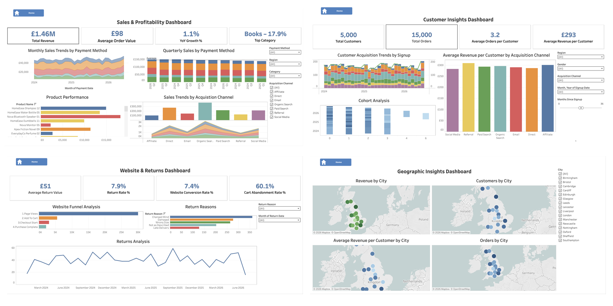
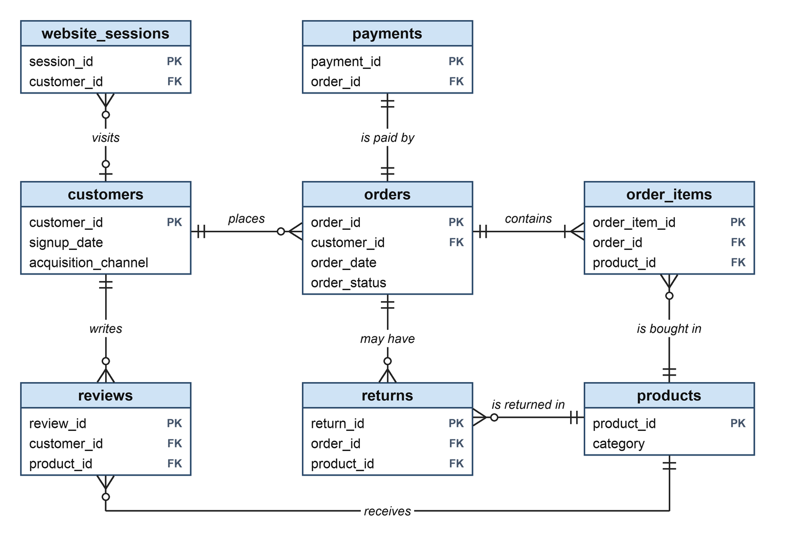

# UK E-Commerce Analytics

[← Back to portfolio](../README.md)

[](https://public.tableau.com/views/UKE-CommerceAnalytics/Home)

*The four pages of the Tableau dashboard, The UK Customer Journey: Acquisition to Returns. Select the image to open the live version.*

**Open the live dashboard:** [Home](https://public.tableau.com/views/UKE-CommerceAnalytics/Home) · [Sales & Profitability](https://public.tableau.com/views/UKE-CommerceAnalytics/SalesProfitability) · [Customer Insights](https://public.tableau.com/views/UKE-CommerceAnalytics/CustomerInsights) · [Website & Returns](https://public.tableau.com/views/UKE-CommerceAnalytics/WebsiteReturns) · [Geographic Insights](https://public.tableau.com/views/UKE-CommerceAnalytics/GeographicInsights)

## Table of Contents
1. [Overview](#1-overview)
   - [Repository Structure](#repository-structure)
   - [Data](#data)
2. [Executive Summary](#2-executive-summary)
   - [Key Findings](#key-findings)
   - [Key Performance Indicators (KPIs)](#key-performance-indicators-kpis)
3. [Business Problem](#3-business-problem)
4. [Methodology](#4-methodology)
5. [How to Reproduce](#5-how-to-reproduce)
6. [Exploratory Data Analysis](#6-exploratory-data-analysis)
7. [Business Questions](#7-business-questions)
8. [Key Insights](#8-key-insights)
9. [Dashboard](#9-dashboard)
10. [Deductions](#10-deductions)
11. [Recommendations](#11-recommendations)

## 1. Overview

An end-to-end analysis of a UK online retailer's sales, customers, marketing, products, returns and website conversion, using **PostgreSQL** for analysis and **Tableau** for the dashboard.

| | |
|---|---|
| **Tools** | PostgreSQL, Tableau |
| **Live dashboard** | [View on Tableau Public](https://public.tableau.com/views/UKE-CommerceAnalytics/Home) |
| **Skills** | • PostgreSQL: CTEs (step-by-step queries), window functions (comparing rows over time) and cohort analysis (following customers grouped by signup month)<br>• PostgreSQL joins across related tables (customers, orders, products, payments, returns)<br>• Checking and exploring data<br>• Tracking key business measures and the website sales funnel<br>• Customer segmentation (grouping customers by value)<br>• Dashboard design in Tableau<br>• Data storytelling and recommendations |
| **Data** | 15,000 orders from 5,000 customers, 504 products and 30,000 website visits, January 2024 to June 2026 |
| **Database** | `ecommerce_db`, with the tables in a group called `ecommerce` |

### Repository Structure

<details>
<summary>View the repository structure</summary>

```text
uk-ecommerce-analytics/
├── README.md                              this report
├── dashboard/
│   └── ECommerce Analytics.twbx           Tableau workbook (opens without a database)
├── data/
│   └── customers.csv, products.csv,       the eight data files
│       orders.csv, order_items.csv,
│       payments.csv, returns.csv,
│       reviews.csv, website_sessions.csv
├── images/
│   ├── dashboard.png                      the four dashboard pages
│   └── erd.png                            how the tables link
└── sql/
    ├── 00_schema_and_load.sql             creates the database and the eight tables, and loads the data
    ├── 01_exploratory_data_analysis.sql   data checks and exploration
    ├── 02_data_cleaning.sql               data cleaning fixes and checks
    └── 03_business_questions.sql          the eight business questions
```

</details>

### Data

The data covers the sales, customers, products, payments, returns, reviews and website visits of a UK online retailer, with all amounts in £. It comes as eight CSV files in [`data/`](data/). Orders run from 1 January 2024 to 29 June 2026, and returns and reviews run a few weeks later. The tables sit in the `ecommerce` schema of the `ecommerce_db` database.

| Table | Rows | What one row is |
|---|---:|---|
| `customers` | 5,000 | A customer: city, region, signup date and acquisition channel |
| `products` | 504 | A product: category, brand, selling price and cost |
| `orders` | 15,000 | An order: status, delivery option, discount and total |
| `order_items` | 28,331 | A product line within an order |
| `payments` | 15,000 | The one payment for an order: method, status and amount |
| `returns` | 1,233 | A returned product, with the reason and the refund |
| `reviews` | 11,308 | A star rating from a customer for a product |
| `website_sessions` | 30,000 | A website visit: device, traffic source and funnel steps |

<details>
<summary>View every column</summary>

| Table | Column | Type | Description |
|---|---|---|---|
| `customers`<br>5,000 rows | `customer_id` | whole number | Unique ID for each customer |
|  | `customer_name` | text | Customer name (placeholder names such as `Customer_00001`) |
|  | `gender` | text | Customer's gender |
|  | `date_of_birth` | date | Customer's date of birth |
|  | `city` | text | City the customer lives in (16 cities) |
|  | `region` | text | Region of the UK the city is in |
|  | `postcode` | text | Street address |
|  | `signup_date` | date | Date the customer signed up |
|  | `acquisition_channel` | text | Where the customer first came from, such as Organic Search or Email (7 channels) |
| `products`<br>504 rows | `product_id` | whole number | Unique ID for each product |
|  | `product_name` | text | Product name |
|  | `category` | text | Product category (6 categories) |
|  | `subcategory` | text | Narrower group within the category |
|  | `brand` | text | Brand name |
|  | `unit_price` | money (£) | Selling price of one unit |
|  | `cost_price` | money (£) | What one unit costs the retailer |
|  | `stock_quantity` | whole number | Units in stock |
| `orders`<br>15,000 rows | `order_id` | whole number | Unique ID for each order |
|  | `customer_id` | whole number | Customer who placed the order (links to `customers`) |
|  | `order_date` | date | Date the order was placed |
|  | `order_status` | text | Delivered, Shipped, Processing or Cancelled |
|  | `shipping_method` | text | Delivery option: Standard, Next Day or Click & Collect |
|  | `delivery_date` | date | Date delivered (empty until the order is delivered) |
|  | `discount_amount` | money (£) | Amount taken off the whole order |
|  | `shipping_cost` | money (£) | Delivery charge |
|  | `total_amount` | money (£) | Order total: items plus shipping, minus the order discount |
| `order_items`<br>28,331 rows | `order_item_id` | whole number | Unique ID for each product line in an order |
|  | `order_id` | whole number | Order the line belongs to (links to `orders`) |
|  | `product_id` | whole number | Product bought (links to `products`) |
|  | `quantity` | whole number | Number of units bought |
|  | `unit_price` | money (£) | Price of one unit |
|  | `discount` | money (£) | Amount taken off this line |
|  | `item_total` | money (£) | Line total: quantity times unit price, minus the line discount |
| `payments`<br>15,000 rows | `payment_id` | whole number | Unique ID for each payment |
|  | `order_id` | whole number | Order that was paid for (links to `orders`) |
|  | `payment_date` | date | Date of the payment |
|  | `payment_method` | text | Credit Card, Debit Card, PayPal, Apple Pay or Google Pay |
|  | `payment_status` | text | Paid, Pending or Refunded |
|  | `amount` | money (£) | Amount paid |
| `returns`<br>1,233 rows | `return_id` | whole number | Unique ID for each return |
|  | `order_id` | whole number | Order the product came from (links to `orders`) |
|  | `product_id` | whole number | Product returned (links to `products`) |
|  | `return_date` | date | Date of the return |
|  | `return_reason` | text | Changed Mind, Damaged, Wrong Size, Not as Described or Late Delivery |
|  | `quantity_returned` | whole number | Number of units returned |
|  | `refund_amount` | money (£) | Amount refunded |
| `reviews`<br>11,308 rows | `review_id` | whole number | Unique ID for each review |
|  | `customer_id` | whole number | Customer who wrote the review (links to `customers`) |
|  | `product_id` | whole number | Product reviewed (links to `products`) |
|  | `review_date` | date | Date of the review |
|  | `rating` | whole number | Star rating given |
|  | `verified_purchase` | yes / no | Whether the reviewer bought the product |
| `website_sessions`<br>30,000 rows | `session_id` | whole number | Unique ID for each visit to the website |
|  | `customer_id` | whole number | Customer who visited (empty if not logged in; links to `customers`) |
|  | `session_date` | date | Date of the visit |
|  | `device_type` | text | Mobile, Desktop or Tablet |
|  | `traffic_source` | text | How the visitor arrived, such as Organic Search or Email |
|  | `pages_viewed` | whole number | Pages viewed during the visit |
|  | `session_duration_seconds` | whole number | Time spent on the site, in seconds |
|  | `added_to_cart` | yes / no | Whether an item was added to the cart |
|  | `checkout_started` | yes / no | Whether checkout was started |
|  | `purchase_completed` | yes / no | Whether the visit ended in a purchase |

</details>

The tables link together, as the entity relationship diagram below shows. Each customer can place many orders, and each order has one or more products, exactly one payment and, sometimes, returns. Reviews and website visits link to customers and products. PK marks a table's unique ID, and FK marks a column that links to another table.



Every order has at least one product and exactly one payment, and 246 of the 5,000 customers have not placed an order. A website visit has no customer when the visitor is not logged in.

## 2. Executive Summary

### Purpose

This project examines how a UK online retailer performs in four areas: sales, customers, the website and returns. Using 15,000 orders from January 2024 to June 2026, it answers eight business questions, two for each page of the dashboard, and ends with practical steps the business can take to improve.

### Key Findings

- **Sales & Profitability:** Revenue is £1.46M and **flat** (+1.1% in 2025; first half of 2026 +3.9%). Books lead (17.9% of sales). **5% of revenue (£72,989) is cancelled orders.**
- **Customer Insights:** Customers are worth about the same from every acquisition channel, meaning where they first came from, such as search or email (£283 to £309). Sign-ups are flat, with a high June. A customer typically waits **141 days** between orders, and 27% have gone a year or more.
- **Website & Returns:** 7.4% of website visits end in a purchase, and 60.1% of shopping carts are abandoned (items added but not bought). 7.9% of orders are returned, and 49% of the reasons are the retailer's to fix.
- **Geographic Insights:** All 16 cities hold 5.4% to 7% of revenue and are worth about the same per customer.
- **Orders that need follow-up:** 29% of cancelled orders (£20,799) show a Paid status, 1,999 orders (£197,544) have stayed in Shipped or Processing for over 90 days, and refunds ignore discounts, so £2,102 more was refunded than customers paid.

### Key Performance Indicators (KPIs)

The tiles and maps on the dashboard, with the values it shows. The Sales and Customer tiles count all 15,000 orders, including the 765 that were cancelled. The Geographic page shows four maps, so its KPIs are the range across the 16 cities.

| Dashboard page | KPI | Value |
|---|---|---:|
| **Sales & Profitability** | Total Revenue | £1.46M (£1,462,569) |
| | Average Order Value | £98 |
| | YoY Growth % | 1.1% |
| | Top Category | Books, 17.9% |
| **Customer Insights** | Total Customers | 5,000 |
| | Total Orders | 15,000 |
| | Average Orders per Customer | 3.2 |
| | Average Revenue per Customer | £293 |
| **Website & Returns** | Average Return Value | £51 |
| | Return Rate % | 7.9% |
| | Website Conversion Rate % | 7.4% |
| | Cart Abandonment Rate % | 60.1% |
| **Geographic Insights** | Revenue by City | £78,469 (Sheffield) to £102,917 (Newcastle) |
| | Customers by City | 272 (Birmingham) to 346 (Newcastle) |
| | Orders by City | 823 (Sheffield) to 1,041 (Newcastle) |
| | Average Revenue per Customer by City | £272 (Sheffield) to £310 (Edinburgh) |

## 3. Business Problem

**How are sales, customers, returns and website conversion performing, and where does the retailer have the most room to improve?**

**Sales & Profitability**
- **Q1** Is revenue growing?
- **Q2** What drives sales and profit: categories, products, payment methods and channels?

**Customer Insights**
- **Q3** Where do customers come from, and is that changing?
- **Q4** What is a customer worth, and do they come back?

**Website & Returns**
- **Q5** Where does the website lose buyers?
- **Q6** How many orders are returned, why, and when?

**Geographic Insights**
- **Q7** Which cities earn the most, and where are the customers?
- **Q8** Are cities worth different amounts per customer?

## 4. Methodology

1. Load the eight data files (CSVs) into a PostgreSQL database.
2. Explore and check the data: missing values, repeated IDs, totals, dates, and how each table links to the others.
3. Clean only what stopped the data loading: IDs written with a decimal point, and the database name.
4. Answer eight business questions with SQL (the language used to query a database), two for each dashboard page.
5. Match each result to the dashboard tile or chart it explains in Tableau.
6. Draw insights, deductions and recommendations from the results.

## 5. How to Reproduce

Requires PostgreSQL 13+ and `psql`.

```bash
cd uk-ecommerce-analytics/sql
psql -U postgres -f 00_schema_and_load.sql      # creates ecommerce_db and the 8 tables, loads the data, prints row counts
psql -U postgres -d ecommerce_db -f 01_exploratory_data_analysis.sql      # then 02_data_cleaning.sql and 03_business_questions.sql
```

You can run the first script again safely: it only rebuilds the `ecommerce` tables.

## 6. Exploratory Data Analysis

The data loads cleanly and holds together. No ID is repeated, no record points to something that does not exist, every payment equals its order total, and every return belongs to a delivered order. The checks below also turned up a few things worth knowing about.

### Results of Exploration

| Finding | Action Taken |
|---|---|
| For 71% of customers the signup date is later than their first order, and 48% of orders were placed before the customer's signup month | **Kept**<br>It is the only date for when a customer joined, so it is read as a signup date. The cohort chart therefore shows when customers joined, and how long they keep buying is measured from the first order |
| Dates of birth give many young ages (42% under 20), the `postcode` column holds street addresses rather than postcodes, and customer names are placeholders (`Customer_00001`) | **Kept**<br>No question uses them; location analysis uses `city` |
| 67 orders have a £0 total, 221 cancelled orders show a Paid status, and 2,219 orders are still Shipped or Processing | **Kept and analysed**<br>They are real records, analysed in Q1 |

<details>
<summary>View the queries and results behind the checks</summary>

<details>
<summary>View the SQL query: Missing values in every column of every table</summary>

```sql
-- Missing values in every column of every table (only two columns have any)
WITH rows_as_json AS (
    SELECT 'customers' AS table_name, to_jsonb(t) AS j FROM ecommerce.customers t
    UNION ALL SELECT 'products',         to_jsonb(t) FROM ecommerce.products t
    UNION ALL SELECT 'orders',           to_jsonb(t) FROM ecommerce.orders t
    UNION ALL SELECT 'order_items',      to_jsonb(t) FROM ecommerce.order_items t
    UNION ALL SELECT 'payments',         to_jsonb(t) FROM ecommerce.payments t
    UNION ALL SELECT 'returns',          to_jsonb(t) FROM ecommerce.returns t
    UNION ALL SELECT 'reviews',          to_jsonb(t) FROM ecommerce.reviews t
    UNION ALL SELECT 'website_sessions', to_jsonb(t) FROM ecommerce.website_sessions t
)
SELECT table_name, key AS column_name, COUNT(*) AS missing_values
FROM rows_as_json, jsonb_each(j)
WHERE value = 'null'::jsonb
GROUP BY table_name, key
ORDER BY table_name, key;
```

</details>

**Result:** Only two columns have empty values: the delivery date in `orders` (2,984 orders not yet delivered) and the customer ID in `website_sessions` (21 anonymous visits).

<details>
<summary>View the SQL query: Do order totals add up? (the £0 orders)</summary>

```sql
-- Does each order's total equal its items plus shipping minus the order discount?
WITH basket AS (
    SELECT order_id, SUM(item_total) AS items FROM ecommerce.order_items GROUP BY order_id
)
SELECT COUNT(*)                                                         AS orders,
       COUNT(*) FILTER (WHERE ABS(o.total_amount - (b.items + o.shipping_cost - o.discount_amount)) > 0.01) AS orders_that_do_not_add_up,
       COUNT(*) FILTER (WHERE o.total_amount = 0)                       AS orders_with_a_zero_total
FROM ecommerce.orders o
JOIN basket b ON b.order_id = o.order_id;
```

</details>

**Result:**

| Orders | Totals that do not add up | Orders with a £0 total |
|---:|---:|---:|
| 15,000 | 67 | 67 |

All 67 are £0 orders where the discount is larger than the basket plus shipping.

<details>
<summary>View the SQL query: Customers who ordered before their signup date</summary>

```sql
-- How many customers placed their first order before their signup date?
WITH first_order AS (
    SELECT customer_id, MIN(order_date) AS first_order_date
    FROM ecommerce.orders GROUP BY customer_id
)
SELECT COUNT(*)                                                       AS customers_with_orders,
       COUNT(*) FILTER (WHERE f.first_order_date < c.signup_date)     AS first_order_before_signup,
       ROUND(AVG(c.signup_date - f.first_order_date))                 AS avg_days_signup_after_first_order
FROM first_order f
JOIN ecommerce.customers c ON c.customer_id = f.customer_id;
```

</details>

**Result:**

| Customers who ordered | First order before signup | Signup came on average |
|---:|---:|---:|
| 4,754 | 3,373 (71%) | 198 days after the first order |

<details>
<summary>View the SQL query: Dates of birth, postcodes and names</summary>

```sql
-- Dates of birth that cannot be right
SELECT COUNT(*) FILTER (WHERE date_of_birth > signup_date)            AS born_after_signup,
       COUNT(*) FILTER (WHERE signup_date - date_of_birth < 18 * 365) AS under_18_at_signup,
       MAX(date_of_birth)                                             AS latest_date_of_birth
FROM ecommerce.customers;

-- The postcode column: none is in UK postcode format, and the names are placeholders
SELECT COUNT(*)                                                                         AS customers,
       COUNT(*) FILTER (WHERE postcode ~ '^[A-Z]{1,2}[0-9][0-9A-Z]? ?[0-9][A-Z]{2}$')   AS in_uk_postcode_format,
       COUNT(*) FILTER (WHERE customer_name ~ '^Customer_[0-9]{5}$')                    AS placeholder_names
FROM ecommerce.customers;
```

</details>

**Result:**

| Check | Customers |
|---|---:|
| Born after they signed up | 72 |
| Under 18 at signup | 2,010 |
| Postcode in UK postcode format | 0 of 5,000 |
| Placeholder names (`Customer_00001`) | 5,000 of 5,000 |

<details>
<summary>View the SQL query: Cancelled orders still Paid, and orders stuck as Shipped or Processing</summary>

```sql
-- Cancelled orders whose payment is still marked Paid
SELECT COUNT(*)                   AS cancelled_but_paid,
       ROUND(SUM(o.total_amount)) AS value
FROM ecommerce.orders o
JOIN ecommerce.payments p ON p.order_id = o.order_id
WHERE o.order_status = 'Cancelled' AND p.payment_status = 'Paid';

-- Orders still Shipped or Processing more than 90 days after the order
SELECT order_status,
       COUNT(*)                         AS orders,
       COUNT(*) FILTER (WHERE (SELECT MAX(order_date) FROM ecommerce.orders) - order_date > 90) AS older_than_90_days,
       ROUND(SUM(total_amount) FILTER (WHERE (SELECT MAX(order_date) FROM ecommerce.orders) - order_date > 90)) AS value_older_than_90_days
FROM ecommerce.orders
WHERE order_status IN ('Shipped', 'Processing')
GROUP BY order_status
ORDER BY order_status;
```

</details>

**Result:**

| Check | Orders | Value |
|---|---:|---:|
| Cancelled but still marked Paid | 221 | £20,799 |
| Shipped for over 90 days | 1,022 of 1,152 | £99,519 |
| Processing for over 90 days | 977 of 1,067 | £98,025 |

</details>

### Data Cleaning

Only the load was changed. No rows were removed or edited. After loading, all eight tables hold the same number of rows as their CSV files. All the queries below, and the row counts, are in [`sql/02_data_cleaning.sql`](sql/02_data_cleaning.sql).

| Issue | Fix |
|---|---|
| Some IDs were written with a decimal point (`118.0`) in `reviews.product_id` and `website_sessions.customer_id`, which stopped the first load at `reviews` | Load through temporary holding tables, then convert the IDs to whole numbers. The source files are untouched |
| The queries and the Tableau workbook use the database name `ecommerce_db`, but the load script created one called `ecommerce_analytics` | The load script now creates `ecommerce_db` |
| Products that were never returned have no return details, which Tableau shows as NULL (empty). The Product Performance chart leaves out these 43 products, and one more (44 in all), including the #4 seller (Luma Desk Lamp 04) | The chart ranks 460 of the 504 products. The 44 left out account for £126,738 (8% of item sales), and the query below keeps every product and shows 0 returns for them |

<details>
<summary>View the cleaning queries and results</summary>

#### Decimal IDs

<details>
<summary>View the SQL query: The fix for the decimal IDs (shown for reviews; sessions use the same pattern in sql/00_schema_and_load.sql)</summary>

```sql
CREATE TEMP TABLE reviews_stage (
    review_id INT, customer_id INT, product_id NUMERIC, review_date DATE,
    rating INT, verified_purchase BOOLEAN
);
\copy reviews_stage FROM '../data/reviews.csv' CSV HEADER;
INSERT INTO ecommerce.reviews (review_id, customer_id, product_id, review_date, rating, verified_purchase)
SELECT review_id, customer_id, product_id::INT, review_date, rating, verified_purchase
FROM reviews_stage;
```

</details>

<details>
<summary>View the SQL query: Both ID columns are now whole numbers, every ID loaded, and every ID matches a real product or customer</summary>

```sql
-- Both columns are now whole numbers, not decimals.
SELECT table_name, column_name, data_type
FROM information_schema.columns
WHERE table_schema = 'ecommerce'
  AND (table_name, column_name) IN (('reviews', 'product_id'), ('website_sessions', 'customer_id'))
ORDER BY table_name;

-- Every ID loaded. The 21 website sessions without a customer are visitors who were
-- not logged in. Their customer ID is empty in the CSV and stays empty.
SELECT 'reviews.product_id'            AS column_checked,
       COUNT(*)                        AS rows_loaded,
       COUNT(product_id)               AS ids_converted,
       COUNT(*) - COUNT(product_id)    AS ids_empty
FROM ecommerce.reviews
UNION ALL
SELECT 'website_sessions.customer_id',
       COUNT(*),
       COUNT(customer_id),
       COUNT(*) - COUNT(customer_id)
FROM ecommerce.website_sessions;

-- Every converted ID still points to a real product or customer (none were changed by the conversion).
SELECT (SELECT COUNT(*) FROM ecommerce.reviews r
        LEFT JOIN ecommerce.products p ON p.product_id = r.product_id
        WHERE p.product_id IS NULL)                                      AS reviews_with_unknown_product,
       (SELECT COUNT(*) FROM ecommerce.website_sessions s
        LEFT JOIN ecommerce.customers c ON c.customer_id = s.customer_id
        WHERE s.customer_id IS NOT NULL AND c.customer_id IS NULL)       AS sessions_with_unknown_customer;
```

</details>

**Result:**

| Column | Data type | Rows loaded | IDs converted | IDs empty | IDs matching no real product or customer |
|---|---|---:|---:|---:|---:|
| `reviews.product_id` | integer | 11,308 | 11,308 | 0 | 0 |
| `website_sessions.customer_id` | integer | 30,000 | 29,979 | 21 | 0 |

The 21 empty customer IDs are anonymous sessions (visitors who were not logged in). They are empty in the CSV and stay empty. Nothing is lost.

#### Products with no returns

<details>
<summary>View the SQL query: The products that were never returned (NULLs in Tableau)</summary>

```sql
-- The problem. A product that was never returned has no matching row in the returns table,
-- so its return fields are NULL when the tables are joined. A chart that removes NULL rows
-- also removes these products, even though they sold normally.
SELECT COUNT(DISTINCT p.product_id)  AS products_never_returned,
       ROUND(SUM(oi.item_total))     AS item_sales
FROM ecommerce.products p
JOIN ecommerce.order_items oi ON oi.product_id = p.product_id
LEFT JOIN ecommerce.returns r ON r.product_id = p.product_id
WHERE r.return_id IS NULL;
```

</details>

**Result:**

| Products never returned | Item sales |
|---:|---:|
| 43 of 504 | £126,054 (8% of item sales) |

The Tableau chart left out 44 products. These were the 43 never returned, plus UrbanPeak Body Lotion 08, which has one return and is also on the chart's exclusion list (£126,738 in all).

<details>
<summary>View the SQL query: The fix: every product kept, with its returns shown as 0</summary>

```sql
-- The fix: keep every product and show its returns as 0.
-- Use this table (or the same COALESCE in Tableau) for the Product Performance chart.
WITH sales AS (
    SELECT product_id, SUM(item_total) AS item_sales
    FROM ecommerce.order_items
    GROUP BY product_id
),
returned AS (
    SELECT product_id, COUNT(*) AS returns, SUM(refund_amount) AS refunded
    FROM ecommerce.returns
    GROUP BY product_id
)
SELECT p.product_name,
       p.category,
       ROUND(s.item_sales)           AS item_sales,
       COALESCE(r.returns, 0)        AS returns,
       COALESCE(ROUND(r.refunded), 0) AS refunded
FROM ecommerce.products p
JOIN sales s ON s.product_id = p.product_id
LEFT JOIN returned r ON r.product_id = p.product_id
ORDER BY s.item_sales DESC
LIMIT 5;
```

</details>

**Result:**

| Product | Category | Item sales | Returns | Refunded |
|---|---|---:|---:|---:|
| Nova Bluetooth Speaker 01 | Electronics | £18,260 | 4 | £1,187 |
| HomeEase Shampoo 12 | Beauty | £14,971 | 6 | £1,531 |
| HomeEase Water Bottle 05 | Sports & Fitness | £13,527 | 4 | £811 |
| Luma Desk Lamp 04 | Home & Kitchen | £13,174 | 0 | £0 |
| Pulse Self-Help Book 04 | Books | £12,810 | 1 | £169 |

</details>

## 7. Business Questions

### Sales & Profitability

#### Q1. Is revenue growing?

**Answer:** No. Revenue is flat at £1.46M: £577,457 in 2024 and £583,759 in 2025 (+1.1%), and +3.9% in the first half of 2026. The average order value is £98. 5.1% of orders (765, £72,989) were cancelled, 221 of them (£20,799) still show a Paid status, and 1,999 orders (£197,544) have been in Shipped or Processing for over 90 days.

**Dashboard elements:** Total Revenue, Average Order Value and YoY Growth % tiles.

<details>
<summary>View the detailed results</summary>

**Results:**

| Period | Orders | Revenue | Orders (excluding cancelled) | Revenue (excluding cancelled) |
|---|---:|---:|---:|---:|
| 2024 | 5,942 | £577,457 | 5,615 | £547,921 |
| 2025 | 6,024 | £583,759 | 5,737 | £555,532 |
| 2026 (Jan–Jun) | 3,034 | £301,354 | 2,883 | £286,128 |
| **Total** | **15,000** | **£1,462,569** | **14,235** | **£1,389,581** |

| Measure | Result |
|---|---|
| Average order value | £98 |
| Revenue growth, 2025 against 2024 | +1.1% |
| Revenue growth, first half of 2026 against first half of 2025 | +3.9% |
| Orders cancelled | 765 of 15,000 (5.1%), worth £72,989 |
| Cancelled orders with a Paid status | 221 (29%), £20,799 |
| Customers who order again after a cancelled order | 67.6% (67% after a delivered order) |
| Orders still Shipped or Processing for over 90 days | 1,999, worth £197,544 |

</details>

<details>
<summary>View the SQL queries</summary>

<details>
<summary>View the SQL query: Revenue, average order value and year-on-year growth, with and without cancelled orders</summary>

```sql
-- Tiles: Total Revenue, Average Order Value, YoY Growth %
SELECT
    ROUND(SUM(total_amount))                                        AS total_revenue,
    ROUND(AVG(total_amount))                                        AS average_order_value,
    ROUND(100.0 * (SUM(total_amount) FILTER (WHERE EXTRACT(YEAR FROM order_date) = 2025)
                 - SUM(total_amount) FILTER (WHERE EXTRACT(YEAR FROM order_date) = 2024))
          / SUM(total_amount) FILTER (WHERE EXTRACT(YEAR FROM order_date) = 2024), 1) AS yoy_growth_2025_vs_2024_pct
FROM ecommerce.orders;

-- Revenue and orders by year, and the first half of each year (2026 only has Jan-Jun)
SELECT
    EXTRACT(YEAR FROM order_date)::int                                              AS year,
    COUNT(*)                                                                        AS orders,
    ROUND(SUM(total_amount))                                                        AS revenue,
    COUNT(*) FILTER (WHERE EXTRACT(MONTH FROM order_date) <= 6)                     AS h1_orders,
    ROUND(SUM(total_amount) FILTER (WHERE EXTRACT(MONTH FROM order_date) <= 6))     AS h1_revenue
FROM ecommerce.orders
GROUP BY 1
ORDER BY 1;

-- Revenue and orders by year, and the first half of each year (2026 only has Jan-Jun)
SELECT
    EXTRACT(YEAR FROM order_date)::int                                                       AS year,
    COUNT(*)                                                                                 AS orders,
    ROUND(SUM(total_amount))                                                                 AS revenue,
    ROUND(AVG(total_amount))                                                                 AS aov,
    COUNT(*) FILTER (WHERE EXTRACT(MONTH FROM order_date) <= 6)                              AS h1_orders,
    ROUND(SUM(total_amount) FILTER (WHERE EXTRACT(MONTH FROM order_date) <= 6))              AS h1_revenue
FROM ecommerce.orders
WHERE order_status <> 'Cancelled'
GROUP BY 1
ORDER BY 1;
```

</details>

<details>
<summary>View the SQL query: Cancelled orders: how many, what happened to the money, and whether those customers return</summary>

```sql
-- What percentage of orders are cancelled?
SELECT
    COUNT(*)                                                           AS total_orders,
    COUNT(*) FILTER (WHERE order_status = 'Cancelled')                 AS cancelled_orders,
    ROUND(100.0 * COUNT(*) FILTER (WHERE order_status = 'Cancelled') / COUNT(*), 2) AS pct_cancelled
FROM ecommerce.orders;

-- What happened to the money on cancelled orders? Refunded or still Paid,
-- by year and by payment method.
SELECT
    'all cancelled orders' AS grp,
    COUNT(*)                                                                 AS cancelled,
    COUNT(*) FILTER (WHERE p.payment_status = 'Refunded')                    AS refunded,
    COUNT(*) FILTER (WHERE p.payment_status = 'Paid')                        AS still_paid,
    ROUND(100.0 * COUNT(*) FILTER (WHERE p.payment_status = 'Paid') / COUNT(*), 1) AS pct_still_paid,
    ROUND(SUM(o.total_amount) FILTER (WHERE p.payment_status = 'Paid'))      AS value_still_paid
FROM ecommerce.orders o
JOIN ecommerce.payments p ON p.order_id = o.order_id
WHERE o.order_status = 'Cancelled'
UNION ALL
SELECT EXTRACT(YEAR FROM o.order_date)::text,
       COUNT(*),
       COUNT(*) FILTER (WHERE p.payment_status = 'Refunded'),
       COUNT(*) FILTER (WHERE p.payment_status = 'Paid'),
       ROUND(100.0 * COUNT(*) FILTER (WHERE p.payment_status = 'Paid') / COUNT(*), 1),
       ROUND(SUM(o.total_amount) FILTER (WHERE p.payment_status = 'Paid'))
FROM ecommerce.orders o
JOIN ecommerce.payments p ON p.order_id = o.order_id
WHERE o.order_status = 'Cancelled'
GROUP BY EXTRACT(YEAR FROM o.order_date)
UNION ALL
SELECT p.payment_method,
       COUNT(*),
       COUNT(*) FILTER (WHERE p.payment_status = 'Refunded'),
       COUNT(*) FILTER (WHERE p.payment_status = 'Paid'),
       ROUND(100.0 * COUNT(*) FILTER (WHERE p.payment_status = 'Paid') / COUNT(*), 1),
       ROUND(SUM(o.total_amount) FILTER (WHERE p.payment_status = 'Paid'))
FROM ecommerce.orders o
JOIN ecommerce.payments p ON p.order_id = o.order_id
WHERE o.order_status = 'Cancelled'
GROUP BY p.payment_method;

-- Are cancellations concentrated in certain customers, and do those customers come back?
-- Customers with at least one cancelled order, against the share expected if cancellations
-- were random (1 - (1 - rate) ^ orders per customer).
WITH per_customer AS (
    SELECT customer_id,
           COUNT(*)                                        AS orders,
           COUNT(*) FILTER (WHERE order_status = 'Cancelled') AS cancelled
    FROM ecommerce.orders
    GROUP BY customer_id
)
SELECT
    COUNT(*)                                                                AS customers_with_orders,
    COUNT(*) FILTER (WHERE cancelled >= 1)                                  AS with_a_cancellation,
    COUNT(*) FILTER (WHERE cancelled >= 2)                                  AS with_two_or_more,
    ROUND(100.0 * COUNT(*) FILTER (WHERE cancelled >= 1) / COUNT(*), 1)     AS pct_with_a_cancellation,
    ROUND(100 * (1 - POWER(1 - (SELECT 1.0 * COUNT(*) FILTER (WHERE order_status = 'Cancelled') / COUNT(*)
                                  FROM ecommerce.orders), AVG(orders))), 1) AS pct_expected_if_random
FROM per_customer;

-- (continued) after a cancelled order, does the customer order again (a later,
-- non-cancelled order)? Compared with the same measure after a delivered order.
SELECT
    o.order_status,
    COUNT(*)                                                                AS orders,
    COUNT(*) FILTER (WHERE EXISTS (
        SELECT 1 FROM ecommerce.orders later
        WHERE later.customer_id = o.customer_id
          AND later.order_date  > o.order_date
          AND later.order_status <> 'Cancelled'))                           AS customer_ordered_again,
    ROUND(100.0 * COUNT(*) FILTER (WHERE EXISTS (
        SELECT 1 FROM ecommerce.orders later
        WHERE later.customer_id = o.customer_id
          AND later.order_date  > o.order_date
          AND later.order_status <> 'Cancelled')) / COUNT(*), 1)            AS pct_ordered_again
FROM ecommerce.orders o
WHERE o.order_status IN ('Cancelled', 'Delivered')
GROUP BY o.order_status
ORDER BY o.order_status;

-- Orders that never completed: still Shipped or Processing long after the order.
-- Age is measured from the order date to the last order date in the data.
SELECT
    o.order_status,
    COUNT(*)                                                                AS orders,
    COUNT(*) FILTER (WHERE (SELECT MAX(order_date) FROM ecommerce.orders) - o.order_date > 30) AS older_than_30_days,
    COUNT(*) FILTER (WHERE (SELECT MAX(order_date) FROM ecommerce.orders) - o.order_date > 90) AS older_than_90_days,
    ROUND(SUM(o.total_amount) FILTER (WHERE (SELECT MAX(order_date) FROM ecommerce.orders) - o.order_date > 90)) AS value_older_than_90_days,
    COUNT(*) FILTER (WHERE p.payment_status = 'Pending')                    AS payment_pending,
    MIN(o.order_date)                                                       AS oldest_order
FROM ecommerce.orders o
JOIN ecommerce.payments p ON p.order_id = o.order_id
WHERE o.order_status IN ('Shipped', 'Processing')
GROUP BY o.order_status
ORDER BY o.order_status;
```

</details>

</details>

#### Q2. What drives sales and profit: categories, products, payment methods and channels?

**Answer:** Sales are well spread. Books lead with 17.9% of sales, within 3.2 points of the other categories; Credit Card is 29.6% of sales and Organic Search 26.3%, in line with their share of customers. The 10 best-selling products bring in £125,979 (8.2% of item sales), and the top seller, Nova Bluetooth Speaker 01, makes £18,260 (1.2%).

**Dashboard elements:** Top Category tile, Product Performance chart, Monthly Sales Trends by Payment Method and Quarterly Sales by Payment Method charts, and Sales Trends by Acquisition Channel chart.

<details>
<summary>View the detailed results</summary>

**Results:**

| Category | Share | Payment method | Share | Channel | Share |
|---|---:|---|---:|---|---:|
| Books | 17.9% | Credit Card | 29.6% | Organic Search | 26.3% |
| Home & Kitchen | 17.3% | Debit Card | 25.3% | Direct | 18.7% |
| Electronics | 17.2% | PayPal | 20.2% | Paid Search | 14.9% |
| Sports & Fitness | 17.1% | Apple Pay | 14.9% | Social Media | 14.6% |
| Beauty | 15.9% | Google Pay | 10% | Email | 10% |
| Fashion | 14.7% | | | Referral | 8.6% |
| | | | | Affiliate | 6.9% |

| Product | Category | Item sales | Share of item sales |
|---|---|---:|---:|
| Nova Bluetooth Speaker 01 | Electronics | £18,260 | 1.2% |
| HomeEase Shampoo 12 | Beauty | £14,971 | 1% |
| HomeEase Water Bottle 05 | Sports & Fitness | £13,527 | 0.9% |
| Luma Desk Lamp 04 | Home & Kitchen | £13,174 | 0.9% |
| Pulse Self-Help Book 04 | Books | £12,810 | 0.8% |
| EverydayCo Power Bank 07 | Electronics | £11,532 | 0.8% |
| Apex Fiction Novel 09 | Books | £11,418 | 0.7% |
| HomeEase Bluetooth Speaker 07 | Electronics | £10,874 | 0.7% |
| HomeEase Dumbbells 11 | Sports & Fitness | £9,958 | 0.7% |
| Pulse Dumbbells 03 | Sports & Fitness | £9,455 | 0.6% |
| **Top 10 together** | **5 of 6 categories** | **£125,979** | **8.2%** |

</details>

<details>
<summary>View the SQL queries</summary>

<details>
<summary>View the SQL query: Share of sales by category</summary>

```sql
-- Tile: Top Category (share of item sales) and the share of every category
SELECT
    p.category,
    ROUND(SUM(oi.item_total))                                       AS item_sales,
    ROUND(100.0 * SUM(oi.item_total) / SUM(SUM(oi.item_total)) OVER (), 1) AS share_pct
FROM ecommerce.order_items oi
JOIN ecommerce.products p ON p.product_id = oi.product_id
GROUP BY p.category
ORDER BY item_sales DESC;
```

</details>

<details>
<summary>View the SQL query: Sales by payment method</summary>

```sql
-- Chart: Quarterly Sales by Payment Method, summarised by payment method
-- (share of all sales, and sales in the first half of each year, since 2026 stops in June)
SELECT
    payment_method,
    ROUND(SUM(amount))                                              AS sales,
    ROUND(100.0 * SUM(amount) / SUM(SUM(amount)) OVER (), 1)        AS share_pct,
    ROUND(SUM(amount) FILTER (WHERE EXTRACT(YEAR FROM payment_date) = 2024)) AS sales_2024,
    ROUND(SUM(amount) FILTER (WHERE EXTRACT(YEAR FROM payment_date) = 2025)) AS sales_2025,
    ROUND(100.0 * (SUM(amount) FILTER (WHERE EXTRACT(YEAR FROM payment_date) = 2025)
                 - SUM(amount) FILTER (WHERE EXTRACT(YEAR FROM payment_date) = 2024))
          / SUM(amount) FILTER (WHERE EXTRACT(YEAR FROM payment_date) = 2024), 1) AS change_2025_vs_2024_pct
FROM ecommerce.payments
GROUP BY payment_method
ORDER BY sales DESC;
```

</details>

<details>
<summary>View the SQL query: Sales by acquisition channel</summary>

```sql
-- Chart: Sales Trends by Acquisition Channel (sales and orders by the customer's channel)
SELECT
    c.acquisition_channel,
    COUNT(DISTINCT c.customer_id)                                   AS customers,
    COUNT(o.order_id)                                               AS orders,
    ROUND(SUM(o.total_amount))                                      AS sales,
    ROUND(100.0 * SUM(o.total_amount) / SUM(SUM(o.total_amount)) OVER (), 1) AS share_pct
FROM ecommerce.customers c
LEFT JOIN ecommerce.orders o ON o.customer_id = c.customer_id
GROUP BY c.acquisition_channel
ORDER BY sales DESC;
```

</details>

<details>
<summary>View the SQL query: Best-selling products</summary>

```sql
-- Chart: Product Performance (top 10 products by item sales, and each one's share of all item sales)
SELECT
    p.product_name,
    p.category,
    ROUND(SUM(oi.item_total))                                                AS item_sales,
    ROUND(100.0 * SUM(oi.item_total) / SUM(SUM(oi.item_total)) OVER (), 1)   AS pct_of_item_sales
FROM ecommerce.order_items oi
JOIN ecommerce.products p ON p.product_id = oi.product_id
GROUP BY p.product_id, p.product_name, p.category
ORDER BY item_sales DESC
LIMIT 10;

-- The top 10 products together: their sales, their share of all item sales, and how many categories they cover
WITH product_sales AS (
    SELECT p.product_id, p.category, SUM(oi.item_total) AS item_sales
    FROM ecommerce.order_items oi
    JOIN ecommerce.products p ON p.product_id = oi.product_id
    GROUP BY p.product_id, p.category
),
top_10 AS (
    SELECT * FROM product_sales ORDER BY item_sales DESC LIMIT 10
)
SELECT ROUND(SUM(item_sales))                                                  AS top_10_sales,
       ROUND(100.0 * SUM(item_sales) / (SELECT SUM(item_sales) FROM product_sales), 1) AS pct_of_item_sales,
       COUNT(DISTINCT category)                                                AS categories_covered
FROM top_10;
```

</details>

</details>

### Customer Insights

#### Q3. Where do customers come from, and is that changing?

**Answer:** Organic Search (1,301, 26%) and Direct (952, 19%) bring 45.1% of customers, Social Media and Paid Search about 15% each, and Affiliate the fewest (338, 6.8%). Sign-ups are steady: 2,008 in each of 2024 and 2025, with June 17.5% above an average day.

**Dashboard elements:** Total Customers tile and Customer Acquisition Trends by Signup chart.

<details>
<summary>View the detailed results</summary>

**Results:**

| Channel | Customers | Share | Cumulative share | Sign-ups in 2024 | Sign-ups in 2025 |
|---|---:|---:|---:|---:|---:|
| Organic Search | 1,301 | 26% | 26% | 542 | 504 |
| Direct | 952 | 19% | 45.1% | 378 | 391 |
| Social Media | 757 | 15.1% | 60.2% | 327 | 293 |
| Paid Search | 743 | 14.9% | 75.1% | 270 | 319 |
| Email | 503 | 10.1% | 85.1% | 195 | 198 |
| Referral | 406 | 8.1% | 93.2% | 159 | 169 |
| Affiliate | 338 | 6.8% | 100% | 137 | 134 |
| **Total** | **5,000** | **100%** | **100%** | **2,008** | **2,008** |

June is the busiest month for sign-ups, at 6.4 a day. That is 17.5% above an average day (5.5 sign-ups), and no other month is more than 4% above it. Each month's sign-ups are divided by the number of days it covers in the data, so every month is compared fairly:

| Month | Average sign-ups per day | Compared with an average day |
|---|---:|---:|
| January | 5.6 | +2.4% |
| February | 5 | -7.9% |
| March | 5.5 | -0.4% |
| April | 5.3 | -3.3% |
| May | 5.2 | -5.9% |
| **June** | **6.4** | **+17.5%** |
| July | 5.5 | +0.6% |
| August | 5.4 | -2.3% |
| September | 5.4 | -1.8% |
| October | 5.6 | +1.8% |
| November | 5.7 | +4% |
| December | 5.1 | -6.2% |

</details>

<details>
<summary>View the SQL queries</summary>

<details>
<summary>View the SQL query: Customers by acquisition channel</summary>

```sql
-- Which acquisition channels bring the most customers?
SELECT
    acquisition_channel,
    COUNT(*)                                          AS customers,
    ROUND(100.0 * COUNT(*) / SUM(COUNT(*)) OVER (), 1) AS pct_of_customers,
    ROUND(100.0 * SUM(COUNT(*)) OVER (ORDER BY COUNT(*) DESC) / SUM(COUNT(*)) OVER (), 1) AS cumulative_pct
FROM ecommerce.customers
GROUP BY acquisition_channel
ORDER BY customers DESC;
```

</details>

<details>
<summary>View the SQL query: Sign-ups by year and channel</summary>

```sql
-- Like-for-like year comparison by channel. 2026 only has Jan-Jun, so the
-- full years (2024 vs 2025) and the first halves (H1 2024, 2025, 2026) are compared separately.
SELECT
    acquisition_channel,
    COUNT(*) FILTER (WHERE EXTRACT(YEAR FROM signup_date) = 2024)  AS fy_2024,
    COUNT(*) FILTER (WHERE EXTRACT(YEAR FROM signup_date) = 2025)  AS fy_2025,
    ROUND(100.0 * (COUNT(*) FILTER (WHERE EXTRACT(YEAR FROM signup_date) = 2025)
                 - COUNT(*) FILTER (WHERE EXTRACT(YEAR FROM signup_date) = 2024))
          / COUNT(*) FILTER (WHERE EXTRACT(YEAR FROM signup_date) = 2024), 1) AS fy_pct_change,
    COUNT(*) FILTER (WHERE EXTRACT(YEAR FROM signup_date) = 2024 AND EXTRACT(MONTH FROM signup_date) <= 6) AS h1_2024,
    COUNT(*) FILTER (WHERE EXTRACT(YEAR FROM signup_date) = 2025 AND EXTRACT(MONTH FROM signup_date) <= 6) AS h1_2025,
    COUNT(*) FILTER (WHERE EXTRACT(YEAR FROM signup_date) = 2026 AND EXTRACT(MONTH FROM signup_date) <= 6) AS h1_2026,
    ROUND(100.0 * (COUNT(*) FILTER (WHERE EXTRACT(YEAR FROM signup_date) = 2026 AND EXTRACT(MONTH FROM signup_date) <= 6)
                 - COUNT(*) FILTER (WHERE EXTRACT(YEAR FROM signup_date) = 2025 AND EXTRACT(MONTH FROM signup_date) <= 6))
          / COUNT(*) FILTER (WHERE EXTRACT(YEAR FROM signup_date) = 2025 AND EXTRACT(MONTH FROM signup_date) <= 6), 1) AS h1_pct_change_26_vs_25
FROM ecommerce.customers
GROUP BY acquisition_channel
ORDER BY fy_2025 DESC;
```

</details>

<details>
<summary>View the SQL query: Sign-ups per day in each calendar month</summary>

```sql
-- Sign-ups per day in each calendar month, compared with an average day. Each month's sign-ups are
-- divided by the number of days it covers in the data, so every month is compared fairly.
-- June is the highest (+17.5%).
WITH span AS (
    SELECT g.day::date AS day
    FROM generate_series((SELECT MIN(signup_date) FROM ecommerce.customers),
                         (SELECT MAX(signup_date) FROM ecommerce.customers), INTERVAL '1 day') AS g(day)
),
days_per_month AS (
    SELECT EXTRACT(MONTH FROM day)::int AS month_number, COUNT(*) AS days
    FROM span
    GROUP BY 1
),
signups AS (
    SELECT EXTRACT(MONTH FROM signup_date)::int AS month_number, COUNT(*) AS customers
    FROM ecommerce.customers
    GROUP BY 1
)
SELECT d.month_number,
       s.customers,
       d.days,
       ROUND(1.0 * s.customers / d.days, 2)                                                    AS average_signups_per_day,
       ROUND(100.0 * ((1.0 * s.customers / d.days)
             / ((SELECT COUNT(*) FROM ecommerce.customers)::numeric / (SELECT COUNT(*) FROM span)) - 1), 1) AS pct_compared_with_average_day
FROM days_per_month d
JOIN signups s ON s.month_number = d.month_number
ORDER BY d.month_number;
```

</details>

</details>

#### Q4. What is a customer worth, and do they come back?

**Answer:** Customers are worth about the same from every acquisition channel (£283 to £309, around £293, 3.2 orders each). 82% reorder, typically 141 days apart, and 27% (1,264) have not ordered for a year or more. The 767 Champions, 16% of the customers who ordered, bring in 30% of revenue.

**Dashboard elements:** Average Orders per Customer and Average Revenue per Customer tiles, Average Revenue per Customer by Acquisition Channel chart and Cohort Analysis chart.

<details>
<summary>View the detailed results</summary>

**Results:**

| Measure | Result |
|---|---|
| Orders per customer | 3.2 |
| Revenue per customer | £293 (£283 for Social Media to £309 for Referral) |
| Customers who order more than once | 82.4% (3,882 of 4,709) |
| Orders dated before the customer's signup month | 47.7% (7,159 of 15,000) |
| Customers who order in a later month, after their first purchase | about 9% a month (9.2% after one month, 8.9% after twelve) |
| Typical time between a customer's orders | 141 days (half wait longer) |
| Customers with no order for a year or more | 1,264 (27%) |

Customer groups, among the 4,709 customers with a completed (not cancelled) order:

| Group | Who they are | Customers | Share of customers | Days since last order | Orders each | Revenue | Share of revenue |
|---|---|---:|---:|---:|---:|---:|---:|
| Core / Needs Nurturing | The middle of the range | 2,080 | 44.2% | 208 | 3.2 | £585,624 | 42.1% |
| Champions | Ordered recently, often and spent a lot | 767 | 16.3% | 64 | 5 | £421,820 | 30.4% |
| Lost | Not ordered for a long time and few orders | 1,132 | 24% | 527 | 1.5 | £164,065 | 11.8% |
| At Risk (High Value) | Ordered often and spent a lot, but not recently | 279 | 5.9% | 378 | 4.4 | £143,482 | 10.3% |
| New / Promising | Ordered recently, but only once or twice | 451 | 9.6% | 75 | 1.7 | £74,590 | 5.4% |

</details>

<details>
<summary>View the SQL queries</summary>

<details>
<summary>View the SQL query: Customers, orders, revenue per customer and value by channel</summary>

```sql
-- Tiles: Total Customers, Total Orders, Average Orders per Customer, Average Revenue per Customer.
-- Average orders = orders / customers who placed at least one order.
-- Average revenue = revenue / all customers.
SELECT
    (SELECT COUNT(*) FROM ecommerce.customers)                      AS total_customers,
    (SELECT COUNT(*) FROM ecommerce.orders)                         AS total_orders,
    ROUND((SELECT COUNT(*) FROM ecommerce.orders)::numeric
          / (SELECT COUNT(DISTINCT customer_id) FROM ecommerce.orders), 1) AS avg_orders_per_customer,
    ROUND((SELECT SUM(total_amount) FROM ecommerce.orders)
          / (SELECT COUNT(*) FROM ecommerce.customers))             AS avg_revenue_per_customer;

-- Chart: Average Revenue per Customer by Acquisition Channel (revenue / all customers in the channel)
SELECT
    c.acquisition_channel,
    COUNT(DISTINCT c.customer_id)                                   AS customers,
    ROUND(SUM(o.total_amount))                                      AS revenue,
    ROUND(SUM(o.total_amount) / COUNT(DISTINCT c.customer_id))      AS clv
FROM ecommerce.customers c
LEFT JOIN ecommerce.orders o ON o.customer_id = c.customer_id
GROUP BY c.acquisition_channel
ORDER BY clv DESC;
```

</details>

<details>
<summary>View the SQL query: Repeat purchasers</summary>

```sql
-- What percentage of customers are repeat purchasers?
WITH customer_orders AS (
    SELECT customer_id, COUNT(*) AS order_count
    FROM ecommerce.orders
    WHERE order_status != 'Cancelled'
    GROUP BY customer_id
)
SELECT
    COUNT(*)                                                       AS customers_with_orders,
    COUNT(*) FILTER (WHERE order_count > 1)                        AS repeat_customers,
    ROUND(100.0 * COUNT(*) FILTER (WHERE order_count > 1) / COUNT(*), 2) AS pct_repeat
FROM customer_orders;
```

</details>

<details>
<summary>View the SQL query: The dashboard's cohort chart (customers grouped by signup month)</summary>

```sql
-- Chart: Cohort Analysis. Customers are grouped by signup month, and each order is placed
-- in the number of months since signup. Orders before the signup month have a negative number.
SELECT
    COUNT(*)                                                        AS orders,
    COUNT(*) FILTER (WHERE months_since_signup < 0)                 AS orders_before_signup_month,
    COUNT(*) FILTER (WHERE months_since_signup = 0)                 AS orders_in_signup_month,
    COUNT(*) FILTER (WHERE months_since_signup > 0)                 AS orders_after_signup_month,
    ROUND(100.0 * COUNT(*) FILTER (WHERE months_since_signup < 0) / COUNT(*), 1) AS pct_before_signup_month
FROM (
    SELECT (EXTRACT(YEAR FROM age(date_trunc('month', o.order_date), date_trunc('month', c.signup_date))) * 12
            + EXTRACT(MONTH FROM age(date_trunc('month', o.order_date), date_trunc('month', c.signup_date))))::int AS months_since_signup
    FROM ecommerce.orders o
    JOIN ecommerce.customers c ON c.customer_id = o.customer_id
) t;
```

</details>

<details>
<summary>View the SQL query: Retention by months after the first purchase</summary>

```sql
-- Summary of first-purchase cohort retention: cohort retention pooled over all cohorts
-- (customers active in month N / customers in the cohorts that have reached month N)
WITH first_purchase AS (
    SELECT customer_id, date_trunc('month', MIN(order_date))::date AS cohort_month
    FROM ecommerce.orders WHERE order_status <> 'Cancelled' GROUP BY customer_id
),
activity AS (
    SELECT DISTINCT customer_id, date_trunc('month', order_date)::date AS activity_month
    FROM ecommerce.orders WHERE order_status <> 'Cancelled'
),
cohort_activity AS (
    SELECT fp.cohort_month, a.customer_id,
           (EXTRACT(YEAR FROM age(a.activity_month, fp.cohort_month)) * 12
            + EXTRACT(MONTH FROM age(a.activity_month, fp.cohort_month)))::int AS month_number
    FROM first_purchase fp
    JOIN activity a ON a.customer_id = fp.customer_id
),
cohort_size AS (
    SELECT cohort_month, COUNT(*) AS customers FROM first_purchase GROUP BY cohort_month
),
by_cohort AS (
    SELECT ca.cohort_month, ca.month_number, cs.customers, COUNT(DISTINCT ca.customer_id) AS active
    FROM cohort_activity ca
    JOIN cohort_size cs ON cs.cohort_month = ca.cohort_month
    GROUP BY ca.cohort_month, ca.month_number, cs.customers
)
SELECT month_number,
       COUNT(*)                                      AS cohorts,
       SUM(customers)                                AS cohort_customers,
       SUM(active)                                   AS active_customers,
       ROUND(100.0 * SUM(active) / SUM(customers), 1) AS pooled_retention_pct
FROM by_cohort
WHERE month_number IN (0, 1, 2, 3, 6, 12)
GROUP BY month_number
ORDER BY month_number;
```

</details>

<details>
<summary>View the SQL query: Time between orders, and customers who have gone a year or more</summary>

```sql
-- Days between a customer's consecutive orders. The typical (middle) gap is 141 days, so
-- "no order for 90 days" is normal between orders and is not a sign of a lapsed customer.
WITH gaps AS (
    SELECT order_date - LAG(order_date) OVER (PARTITION BY customer_id ORDER BY order_date, order_id) AS gap
    FROM ecommerce.orders
)
SELECT COUNT(gap) AS gaps,
       ROUND(AVG(gap))                                                       AS mean_days,
       ROUND(PERCENTILE_CONT(0.50) WITHIN GROUP (ORDER BY gap)::numeric)     AS typical_days,
       ROUND(PERCENTILE_CONT(0.75) WITHIN GROUP (ORDER BY gap)::numeric)     AS p75_days,
       ROUND(PERCENTILE_CONT(0.90) WITHIN GROUP (ORDER BY gap)::numeric)     AS p90_days,
       ROUND(PERCENTILE_CONT(0.95) WITHIN GROUP (ORDER BY gap)::numeric)     AS p95_days
FROM gaps;

-- Customers by time since their last (non-cancelled) order: a better lapsed measure than 90 days
WITH last_order AS (
    SELECT customer_id, (SELECT MAX(order_date) FROM ecommerce.orders) - MAX(order_date) AS days_since
    FROM ecommerce.orders WHERE order_status <> 'Cancelled' GROUP BY customer_id
)
SELECT COUNT(*)                                          AS customers,
       COUNT(*) FILTER (WHERE days_since >= 90)          AS over_90_days,
       COUNT(*) FILTER (WHERE days_since >= 180)         AS over_180_days,
       COUNT(*) FILTER (WHERE days_since >= 365)         AS over_365_days,
       COUNT(*) FILTER (WHERE days_since >= 540)         AS over_540_days,
       COUNT(*) FILTER (WHERE days_since >= 730)         AS over_730_days
FROM last_order;
```

</details>

<details>
<summary>View the SQL query: Customer groups by how recently, how often and how much they buy</summary>

```sql
-- Summary of customer groups (RFM): customers, recency, orders and revenue per RFM segment.
-- Customers are scored 1 to 5 on how recently they ordered (recency), how often (frequency) and how much
-- they spent (monetary); each score covers a fifth of the customers, and customers with equal values are
-- ordered by customer ID, so the groups are the same on every run.
WITH ref_date AS (
    SELECT MAX(order_date) + 1 AS as_of FROM ecommerce.orders
),
customer_agg AS (
    SELECT customer_id,
           (SELECT as_of FROM ref_date) - MAX(order_date) AS recency,
           COUNT(*)                                       AS frequency,
           SUM(total_amount)                              AS monetary
    FROM ecommerce.orders
    WHERE order_status <> 'Cancelled'
    GROUP BY customer_id
),
scored AS (
    SELECT *,
           NTILE(5) OVER (ORDER BY recency DESC,  customer_id) AS r_score,
           NTILE(5) OVER (ORDER BY frequency ASC, customer_id) AS f_score,
           NTILE(5) OVER (ORDER BY monetary ASC,  customer_id) AS m_score
    FROM customer_agg
)
SELECT
    CASE
        WHEN r_score >= 4 AND f_score >= 4 AND m_score >= 4 THEN 'Champions'
        WHEN r_score >= 4 AND f_score <= 2                   THEN 'New / Promising'
        WHEN r_score <= 2 AND f_score >= 4 AND m_score >= 4  THEN 'At Risk (High Value)'
        WHEN r_score <= 2 AND f_score <= 2                   THEN 'Lost'
        ELSE 'Core / Needs Nurturing'
    END                         AS rfm_segment,
    COUNT(*)                                                   AS customers,
    ROUND(100.0 * COUNT(*) / SUM(COUNT(*)) OVER (), 1)         AS pct_of_customers,
    ROUND(AVG(recency))                                        AS avg_days_since_last_order,
    ROUND(AVG(frequency), 1)                                   AS avg_orders,
    ROUND(SUM(monetary))                                       AS revenue,
    ROUND(100.0 * SUM(monetary) / SUM(SUM(monetary)) OVER (), 1) AS pct_of_revenue
FROM scored
GROUP BY 1
ORDER BY revenue DESC;
```

</details>

</details>

### Website & Returns

#### Q5. Where does the website lose buyers?

**Answer:** 81.5% of visits never add an item and 60.1% of carts are abandoned. Conversion (visits ending in a purchase) is 7.4% overall, similar across ways of arriving (7% to 8.2%) and devices (6.7% to 7.6%), and rises from 4.3% for 1 to 2 pages viewed to 11.7% for 10 or more.

**Dashboard elements:** Website Conversion Rate % and Cart Abandonment Rate % tiles, and the Website Funnel Analysis chart.

<details>
<summary>View the detailed results</summary>

**Results:**

| Step | Visits | Share of the step before |
|---|---:|---:|
| Visits to the site | 30,000 | – |
| Add to cart | 5,562 | 18.5% |
| Checkout start | 3,073 | 55.2% |
| Purchase complete | 2,221 | 72.3% |

Conversion rate (visits that end in a purchase) 7.4%; cart abandonment rate (carts not bought) 60.1%.

| Traffic source | Conversion | Device | Conversion |
|---|---:|---|---:|
| Affiliate | 8.2% | Mobile | 7.6% |
| Direct | 7.6% | Desktop | 7.2% |
| Paid Search | 7.6% | Tablet | 6.7% |
| Referral | 7.5% | | |
| Organic Search | 7.4% | | |
| Email | 7.3% | | |
| Social Media | 7% | | |

| Pages viewed in a session | Added to cart | Purchased |
|---|---:|---:|
| 1 to 2 | 10.9% | 4.3% |
| 3 to 4 | 14.5% | 5.9% |
| 5 to 6 | 19.7% | 8% |
| 7 to 9 | 25.7% | 10.1% |
| 10 or more | 33.5% | 11.7% |

</details>

<details>
<summary>View the SQL queries</summary>

<details>
<summary>View the SQL query: Sessions, cart, checkout and purchase</summary>

```sql
-- What percentage of website sessions add an item to cart?
-- What percentage of sessions start checkout?
-- What percentage of sessions convert to purchase?
SELECT
    COUNT(*)                                                                AS sessions,
    COUNT(*) FILTER (WHERE added_to_cart)                                   AS added_to_cart,
    COUNT(*) FILTER (WHERE checkout_started)                                AS checkout_started,
    COUNT(*) FILTER (WHERE purchase_completed)                              AS purchased,
    ROUND(100.0 * COUNT(*) FILTER (WHERE added_to_cart) / COUNT(*), 2)      AS pct_add_to_cart,
    ROUND(100.0 * COUNT(*) FILTER (WHERE checkout_started) / COUNT(*), 2)   AS pct_checkout,
    ROUND(100.0 * COUNT(*) FILTER (WHERE purchase_completed) / COUNT(*), 2) AS pct_converted
FROM ecommerce.website_sessions;
```

</details>

<details>
<summary>View the SQL query: Conversion by traffic source and device</summary>

```sql
-- Which traffic source has the highest conversion rate?
SELECT
    traffic_source,
    COUNT(*)                                                                AS sessions,
    COUNT(*) FILTER (WHERE purchase_completed)                              AS purchases,
    ROUND(100.0 * COUNT(*) FILTER (WHERE purchase_completed) / COUNT(*), 2) AS conversion_rate_pct
FROM ecommerce.website_sessions
GROUP BY traffic_source
ORDER BY conversion_rate_pct DESC;

-- How does conversion differ by device type?
SELECT
    device_type,
    COUNT(*)                                                                AS sessions,
    ROUND(100.0 * COUNT(*) FILTER (WHERE purchase_completed) / COUNT(*), 2) AS conversion_rate_pct
FROM ecommerce.website_sessions
GROUP BY device_type
ORDER BY conversion_rate_pct DESC;
```

</details>

<details>
<summary>View the SQL query: Pages viewed and time on site against buying</summary>

```sql
-- Pages viewed predict the outcome; time on site does not
SELECT CASE WHEN pages_viewed <= 2 THEN '1-2' WHEN pages_viewed <= 4 THEN '3-4' WHEN pages_viewed <= 6 THEN '5-6'
            WHEN pages_viewed <= 9 THEN '7-9' ELSE '10+' END AS pages_viewed,
       COUNT(*) AS sessions,
       ROUND(100.0 * AVG(added_to_cart::int), 1)       AS added_to_cart_pct,
       ROUND(100.0 * AVG(purchase_completed::int), 1)  AS purchase_pct
FROM ecommerce.website_sessions GROUP BY 1 ORDER BY MIN(pages_viewed);

SELECT CASE WHEN session_duration_seconds < 60 THEN '1 under 1 min' WHEN session_duration_seconds < 180 THEN '2 1-3 min'
            WHEN session_duration_seconds < 420 THEN '3 3-7 min' ELSE '4 over 7 min' END AS duration,
       COUNT(*) AS sessions,
       ROUND(100.0 * AVG(added_to_cart::int), 1)       AS added_to_cart_pct,
       ROUND(100.0 * AVG(purchase_completed::int), 1)  AS purchase_pct
FROM ecommerce.website_sessions GROUP BY 1 ORDER BY 1;
```

</details>

</details>

#### Q6. How many orders are returned, why, and when?

**Answer:** 7.9% of orders (9.9% of delivered orders) are returned, about 41 a month, and 49% of the reasons are Damaged, Not as Described or Late Delivery. Nova Monitor 05 stands out, with 23.1% of its sales lines returned. Refunds ignore discounts, so £2,102 more was refunded than customers paid, and Next Day delivery takes 4 days like Standard.

**Dashboard elements:** Return Rate % and Average Return Value tiles, Return Reasons chart and Returns Analysis chart.

<details>
<summary>View the detailed results</summary>

**Results:**

| Reason | Returns | Share |
|---|---:|---:|
| Changed Mind | 361 | 29.3% |
| Damaged | 277 | 22.5% |
| Wrong Size | 264 | 21.4% |
| Not as Described | 203 | 16.5% |
| Late Delivery | 128 | 10.4% |

| Measure | Result |
|---|---|
| Return rate | 7.9% of all orders (9.9% of delivered orders) |
| Average return value | £51 (£62,365 refunded over 1,233 returns) |
| Returns per month | about 41, between 28 and 59 |
| Refunds above what customers paid | £2,102 (refunds ignore discounts) |
| Product returned far more than others | Nova Monitor 05, 23.1% of its sales lines |
| Delivery time, Next Day and Standard | 4 days for both |

</details>

<details>
<summary>View the SQL queries</summary>

<details>
<summary>View the SQL query: Return rate and average return value</summary>

```sql
-- Tiles: Average Return Value and Return Rate % (orders with a return / all orders)
SELECT
    ROUND(SUM(refund_amount) / COUNT(*))                            AS avg_return_value,
    COUNT(*)                                                        AS returns,
    COUNT(DISTINCT order_id)                                        AS orders_with_return,
    ROUND(100.0 * COUNT(DISTINCT order_id) / (SELECT COUNT(*) FROM ecommerce.orders), 1) AS return_rate_pct
FROM ecommerce.returns;
```

</details>

<details>
<summary>View the SQL query: Return reasons</summary>

```sql
-- What are the most common return reasons?
SELECT
    return_reason,
    COUNT(*)                                                   AS returns,
    ROUND(100.0 * COUNT(*) / SUM(COUNT(*)) OVER (), 2)         AS pct_of_returns
FROM ecommerce.returns
GROUP BY return_reason
ORDER BY returns DESC;
```

</details>

<details>
<summary>View the SQL query: Returns by month</summary>

```sql
-- Chart: Returns Analysis (returns by month of return date).
-- The last month (July 2026) is only partly covered.
SELECT
    date_trunc('month', return_date)::date                          AS month,
    COUNT(*)                                                        AS returns,
    ROUND(SUM(refund_amount))                                       AS refunds
FROM ecommerce.returns
GROUP BY 1
ORDER BY 1;
```

</details>

<details>
<summary>View the SQL query: Refunds against what customers paid</summary>

```sql
-- Refunds equal the full undiscounted price of the returned units, even when the line was discounted
WITH line AS (
    SELECT r.refund_amount, r.quantity_returned, oi.unit_price, oi.quantity, oi.discount, oi.item_total
    FROM ecommerce.returns r
    JOIN ecommerce.order_items oi ON oi.order_id = r.order_id AND oi.product_id = r.product_id
)
SELECT COUNT(*)                                                              AS returns,
       ROUND(SUM(refund_amount))                                             AS refunded,
       ROUND(SUM(item_total * quantity_returned / quantity))                 AS net_paid_for_returned_units,
       ROUND(SUM(refund_amount) - SUM(item_total * quantity_returned / quantity)) AS refunded_above_paid,
       COUNT(*) FILTER (WHERE ABS(refund_amount - unit_price * quantity_returned) < 0.015) AS refund_equals_undiscounted_price,
       COUNT(*) FILTER (WHERE discount > 0)                                  AS returns_on_discounted_lines
FROM line;
```

</details>

<details>
<summary>View the SQL query: Does any product's return rate stand out from the rest?</summary>

```sql
-- Product return rates: is any product a genuine outlier? Compare each product's returns with the
-- 5.44% overall rate. z_score says how far above (or below) that rate a product sits, in typical
-- gaps; above about 3 stands out clearly from the other products. Only one product does.
WITH sold AS (
    SELECT oi.product_id, COUNT(*) AS lines FROM ecommerce.order_items oi
    JOIN ecommerce.orders o ON o.order_id = oi.order_id WHERE o.order_status = 'Delivered' GROUP BY oi.product_id
),
ret AS (SELECT product_id, COUNT(*) AS returns FROM ecommerce.returns GROUP BY product_id),
overall AS (SELECT (SELECT COUNT(*) FROM ecommerce.returns)::numeric / (SELECT SUM(lines) FROM sold) AS p)
SELECT p.product_name, s.lines, COALESCE(r.returns, 0) AS returns,
       ROUND(100.0 * COALESCE(r.returns, 0) / s.lines, 1) AS return_rate_pct,
       ROUND(((COALESCE(r.returns, 0) - s.lines * o.p) / SQRT(s.lines * o.p * (1 - o.p)))::numeric, 1) AS z_score
FROM sold s
JOIN ecommerce.products p ON p.product_id = s.product_id
LEFT JOIN ret r ON r.product_id = s.product_id
CROSS JOIN overall o
ORDER BY z_score DESC
LIMIT 5;
```

</details>

<details>
<summary>View the SQL query: Delivery time and shipping cost by shipping method</summary>

```sql
-- Delivery performance by shipping method: average days, share delivered within a day, average shipping cost
SELECT
    shipping_method,
    COUNT(*) FILTER (WHERE delivery_date IS NOT NULL)                                        AS delivered_orders,
    ROUND(AVG(delivery_date - order_date), 1)                                                AS avg_days,
    ROUND(100.0 * COUNT(*) FILTER (WHERE delivery_date - order_date <= 1)
          / COUNT(*) FILTER (WHERE delivery_date IS NOT NULL), 1)                            AS pct_within_1_day,
    ROUND(AVG(shipping_cost), 2)                                                             AS avg_shipping_cost
FROM ecommerce.orders
GROUP BY shipping_method
ORDER BY shipping_method;
```

</details>

</details>

### Geographic Insights

#### Q7. Which cities earn the most, and where are the customers?

**Answer:** Every city holds 5.4% to 7% of revenue: Newcastle earns the most (£102,917) and Sheffield the least (£78,469). Revenue follows the number of customers.

**Dashboard elements:** Revenue by City, Customers by City and Orders by City maps.

<details>
<summary>View the detailed results</summary>

**Results:** The three cities with the most revenue and the three with the least, out of 16.

| City | Customers | Orders | Revenue | Revenue per customer |
|---|---:|---:|---:|---:|
| Newcastle | 346 | 1,041 | £102,917 | £297 |
| London | 330 | 1,017 | £101,436 | £307 |
| Liverpool | 324 | 1,000 | £97,369 | £301 |
| … | … | … | … | … |
| Bristol | 293 | 885 | £87,465 | £299 |
| Birmingham | 272 | 840 | £78,576 | £289 |
| Sheffield | 288 | 823 | £78,469 | £272 |

</details>

<details>
<summary>View the SQL query</summary>

<details>
<summary>View the SQL query: Revenue, customers, orders and revenue per customer by city</summary>

```sql
-- Maps: Revenue, Customers, Orders and Average Revenue per Customer by City
SELECT
    c.city,
    c.region,
    COUNT(DISTINCT c.customer_id)                                   AS customers,
    COUNT(o.order_id)                                               AS orders,
    ROUND(SUM(o.total_amount))                                      AS revenue,
    ROUND(100.0 * SUM(o.total_amount) / SUM(SUM(o.total_amount)) OVER (), 1) AS revenue_share_pct,
    ROUND(SUM(o.total_amount) / COUNT(DISTINCT c.customer_id))      AS revenue_per_customer
FROM ecommerce.customers c
LEFT JOIN ecommerce.orders o ON o.customer_id = c.customer_id
GROUP BY c.city, c.region
ORDER BY revenue DESC;
```

</details>

</details>

#### Q8. Are cities worth different amounts per customer?

**Answer:** A customer is worth about the same in every city: revenue per customer runs from £272 (Sheffield) to £310 (Edinburgh), and the £11 gap is smaller than the £13 gap that normal differences in customer spending would produce anyway.

**Dashboard elements:** Average Revenue per Customer by City map.

<details>
<summary>View the detailed results</summary>

**Results:**

| Measure | Result |
|---|---|
| Highest revenue per customer | Edinburgh, £310 |
| Lowest revenue per customer | Sheffield, £272 |
| Gap between the 16 cities | £11 on average |
| Gap expected from normal differences in customer spending | £13 |

</details>

<details>
<summary>View the SQL query</summary>

<details>
<summary>View the SQL query: Is a customer worth more in some cities than in others?</summary>

```sql
-- Is a customer worth more in some cities than in others? Revenue per customer varies a lot from one
-- customer to the next, so the average for a city of about 300 customers would differ by around £13
-- simply because different people spend different amounts. This compares the real gap between cities
-- with the gap that normal differences in customer spending would produce anyway.
WITH customer_revenue AS (
    SELECT c.customer_id, c.city, COALESCE(SUM(o.total_amount), 0) AS revenue
    FROM ecommerce.customers c
    LEFT JOIN ecommerce.orders o ON o.customer_id = c.customer_id
    GROUP BY c.customer_id, c.city
),
by_city AS (
    SELECT city, COUNT(*) AS customers, AVG(revenue) AS revenue_per_customer
    FROM customer_revenue GROUP BY city
)
SELECT
    ROUND((SELECT STDDEV_SAMP(revenue) FROM customer_revenue))                       AS typical_gap_between_customers,
    ROUND(AVG((SELECT STDDEV_SAMP(revenue) FROM customer_revenue) / SQRT(customers))) AS expected_gap_from_customer_spending,
    ROUND(STDDEV_SAMP(revenue_per_customer))                                         AS actual_gap_between_cities
FROM by_city;
```

</details>

</details>

## 8. Key Insights

| | Insight | Evidence | Source |
|---|---|---|---|
| | **Sales & Profitability** | | |
| 1 | Sales are flat year on year | £577,457 in 2024 and £583,759 in 2025 (+1.1%); first half of 2026 +3.9%. The average order value (AOV, what an order is worth on average) is £98, but a typical order is £70 | Q1 |
| 2 | Order cancellations are low and evenly spread, and most of those customers buy again | 5.1% of orders (765, £72,989), at a similar rate across delivery options, payment methods, channels, regions, order sizes and weekdays; 67.6% of those customers order again | Q1 |
| 3 | Some orders need a status follow-up | 221 cancelled orders (29%, £20,799) show a Paid status, every year; 1,999 orders (£197,544) have been in Shipped or Processing for over 90 days, 14% to 16% of every quarter | Q1 |
| 4 | Sales are well spread, with no single category, payment method or channel to depend on | Books lead with 17.9%, within 3.2 points of the other categories; Credit Card is 29.6% of sales and Organic Search 26.3%, in line with their share of customers | Q2 |
| 5 | The best sellers come from five of the six categories | The 10 best-selling products bring in £125,979 (8.2% of item sales) and span Electronics, Beauty, Sports & Fitness, Home & Kitchen and Books; the top seller, Nova Bluetooth Speaker 01, makes £18,260 (1.2%) | Q2 |
| | **Customer Insights** | | |
| 6 | New customer sign-ups are steady, with a seasonal high in June | 2,008 sign-ups in each of 2024 and 2025, no lasting shift between channels, and June 17.5% above an average day | Q3 |
| 7 | Every acquisition channel brings customers of about the same value | £283 to £309 revenue per customer (around £293), 3.2 orders each; the top 20 customers are 1.9% of revenue | Q4 |
| 8 | Customers do buy again, but slowly | 82% reorder, typically 141 days apart; 27% (1,264) have not ordered for a year or more; about 9% of each group of first-time buyers orders in any later month | Q4 |
| 9 | Organic Search and Direct bring almost half of all customers | Organic Search (1,301, 26%) and Direct (952, 19%) together bring 2,253 customers (45.1%); Social Media and Paid Search bring about 15% each, and Affiliate the fewest (338, 6.8%) | Q3 |
| 10 | A small group of top customers drives about 30% of revenue | The 767 Champions, the best customers, are 16% of the customers who ordered and bring in 30% of revenue. A further 279 high-value customers sit in the At Risk group, which holds £143,482 of past revenue | Q4 |
| | **Website & Returns** | | |
| 11 | Most visitors leave before adding to cart, and browsing more goes with buying more | 81.5% of visits never add an item and 60.1% of carts are abandoned; conversion (visits ending in a purchase) is similar across ways of arriving (7% to 8.2%) and devices (6.7% to 7.6%), and rises from 4.3% for 1 to 2 pages viewed to 11.7% for 10 or more | Q5 |
| 12 | The return rate is steady, and about half of returns are for reasons the retailer controls | 7.9% of orders (9.9% of delivered orders) are returned, about 41 a month; 49% of the reasons are Damaged, Not as Described or Late Delivery | Q6 |
| 13 | One product has a clearly higher return rate | Nova Monitor 05 has 23.1% of its sales lines returned; no other product stands out from the rest | Q6 |
| 14 | Refund and delivery rules are set by the retailer | Refunds ignore discounts, so £2,102 more was refunded than customers paid; Next Day delivery takes 4 days like Standard and is priced the same | Q6 |
| | **Geographic Insights** | | |
| 15 | Cities perform alike, revenue follows customer numbers, and a customer is worth the same in every city | Every city holds 5.4% to 7% of revenue (Newcastle £102,917 most, Sheffield £78,469 least); revenue per customer runs from £272 (Sheffield) to £310 (Edinburgh), and the £11 gap is smaller than the £13 gap that normal differences in customer spending would produce anyway | Q7, Q8 |

## 9. Dashboard

**The UK Customer Journey: Acquisition to Returns** is published on [Tableau Public](https://public.tableau.com/views/UKE-CommerceAnalytics/Home), and the workbook is in [`dashboard/`](dashboard/ECommerce%20Analytics.twbx). It reads a saved copy of the data, so it opens without a database. Every tile and chart has a query in [`sql/03_business_questions.sql`](sql/03_business_questions.sql).

The Sales and Customer tiles count every order placed, including the 765 that were cancelled (£72,989, 5% of revenue), so they show demand; revenue from orders that were not cancelled is £1,389,581. The Product Performance chart ranks 460 of the 504 products and leaves out 44 (£126,738, 8% of item sales): the 43 never returned, and UrbanPeak Body Lotion 08, which has one return.

## 10. Deductions

| Evidence | What can be deduced | Question |
|---|---|---|
| Revenue, orders and sign-ups are flat | Growth has to come from somewhere new, such as bigger baskets, more repeat orders or a wider audience, not from the current mix | Q1, Q3 |
| Cancellations are spread evenly, and 29% show a Paid status | The cause sits in the cancellation process itself, so recording why each order is cancelled would show where to act | Q1 |
| 1,999 orders have had no outcome for over 90 days | Either the orders are still being delivered, or paid customers are waiting; the dashboard counts them as orders placed | Q1 |
| No category, payment method or channel dominates, and each channel's sales match its share of customers | The business does not rely on any one of them, and nowhere is an obvious place to concentrate spend; choosing between channels needs cost per customer, which this dataset does not cover | Q2, Q4 |
| Customers typically wait 141 days between orders, and the cohort chart groups customers by signup month | A 90-day gap is normal, and a lapsed customer is one who has not ordered for a year or more; how long customers keep buying is best measured from their first purchase | Q4 |
| Most visitors leave before adding to cart, and browsing more goes with buying more | The biggest gain is in the journey before checkout; the data shows a link, not a cause, so each change should first be tried on a share of shoppers and compared with the rest | Q5 |
| Returns, refunds and delivery follow rules the retailer sets | A large part of the £62,365 in refunds can be reduced, and refund rules, Next Day pricing and discounts are choices the retailer can change | Q6 |
| Every city holds a similar share of revenue (5.4% to 7%), and a city earns more only when it has more customers | Where a customer lives does not change what they are worth, so separate targets for each city would only rank small differences and one national plan is enough | Q7, Q8 |

## 11. Recommendations

| | Recommendation | Evidence (from dashboard) | Expected impact | Question |
|---|---|---|---|---|
| | **Sales & Profitability** | | | |
| 1 | **Grow basket size:** Raise the value of each order with product bundles, cross-sell suggestions at checkout (offering related items) and free delivery above a set spend, and try each one on a share of shoppers first, comparing results with the rest | The YoY Growth % tile shows 1.1%, so sales are flat. The Average Order Value tile shows £98 across the 15,000 orders in the Total Orders tile | More revenue from the same number of orders: every £1 added to the average order brings in about £15,000 over the 30 months of data | Q1 |
| | **Customer Insights** | | | |
| 2 | **Lift repeat purchases:** Send post-purchase emails and loyalty offers (rewards for repeat buyers), timed to when customers usually reorder | The Average Orders per Customer tile shows 3.2 orders in 30 months, and the Average Revenue per Customer tile £293 | More revenue from existing customers, with no cost of winning new ones: if 1 in 10 customers (500) places one more order, that is 500 extra orders, worth about £49,000 at £98 each | Q4 |
| 3 | **Run a seasonal campaign for June:** Add extra acquisition spend and promotions | The Customer Acquisition Trends by Signup chart is highest in June every year, with 17.5% more sign-ups per day than an average day | Marketing timed to a peak that already exists: June brings about 28 more sign-ups a year than an average month would (185 to 205 in June), so a campaign builds on demand that is already there | Q3 |
| 4 | **Track channel costs:** Work out what each acquisition channel costs to win a customer, and shift marketing budget towards the cheapest | The Average Revenue per Customer by Acquisition Channel chart shows customers from every channel spend about the same, £283 to £309 each, so revenue alone cannot tell the channels apart | A lower cost of winning each customer: marketing spend moves to the channels that bring in customers at the lowest cost, so the same budget wins more customers | Q4 |
| | **Website & Returns** | | | |
| 5 | **Reduce cart abandonment:** Help shoppers who add to cart finish buying by simplifying checkout, offering guest checkout (buying without an account) and more payment options, and sending abandoned-cart reminders, and try each change on a share of shoppers first, comparing results with the rest | The Cart Abandonment Rate % tile shows 60.1% and the Website Conversion Rate % tile 7.4%. The Website Funnel Analysis chart shows 81.5% of sessions never add an item | Fewer lost sales at checkout: every 1-point drop in abandoned carts means about 56 more purchases, or about £5,400 at £98 per order | Q5 |
| 6 | **Lower the return rate:** Use better packaging, checks on the delivery companies, accurate product descriptions and size guides | The Return Rate % tile shows 7.9% and the Average Return Value tile £51. The Return Reasons chart shows 49% are Damaged, Not as Described or Late Delivery | Lower refund costs: every 1-point drop in the return rate means about 150 fewer returns, or about £7,650 less refunded at £51 each | Q6 |
| 7 | **Fix the refund and Next Day rules:** Refund customers what they paid, after any discount, not the full list price. Deliver Next Day orders in one day and price them above Standard, or stop selling them as Next Day, and watch complaints and repeat orders after each change | The Average Return Value tile shows £51 and the Returns Analysis chart about 41 returns a month, £62,365 in refunds in all. The dashboard does not show the refund and delivery rules, but the Q6 queries do: refunds ignore discounts, so £2,102 more was refunded than customers paid, across 527 returns of discounted items; Next Day orders take 4 days on average, like Standard, and only 13.1% arrive within a day, yet Next Day costs £2.10 on average against £1.99 for Standard | Lower refund costs and fairer pricing: refunding what was paid saves £2,102 over the 30 months of data, about £840 a year. If Next Day is delivered in a day and priced above Standard, every £1 added to its price brings in about £2,800 over the 30 months (2,835 orders); if it cannot be delivered in a day, customers stop paying for a speed they do not get | Q6 |
| | **Geographic Insights** | | | |
| 8 | **Treat every city alike:** Run national campaigns and the same promotions in every city, rather than city-specific targets | The four maps show every city holds 5.4% to 7% of revenue and is worth £272 to £310 per customer | Simpler planning: one national plan replaces separate plans for 16 cities, and effort goes to what drives sales, not to small differences between cities | Q7, Q8 |

---

*Author: Anita Owiredu · [LinkedIn](https://www.linkedin.com/in/anitaowiredu-data)*
